# 實戰紀錄 — A13 陷阱道具拆解:電鋸陷阱(A)+ 尖刺陷阱(B)

> 從一張哥德大廳概念圖,拆出兩組可動陷阱 → 修成可用貼圖 → 3ds Max 建模 → Unity 不受光 shader 上線。
> 對應工作流:`ai-media-generator`(concept→3D V2)+ `/asset-cutout`;前置知識:
> [B1](B1-forest-bg-4k-detail.md)(鎖句字典、白邊坑)、[B2](B2-greybox-module-pipeline.md)(貼材質灰盒、Crop-Gen-Paste)、
> [B4](B4-master-variant-tileset.md)(套圖變體)、[B9](B9-tree-trunk-restyle.md)(參考圖幾何滲漏)、[A4/A5](A4-castle-concept-decomposition.md)(紅框定位、正交鎖)。

**🔑 關鍵字:** `A13`、`陷阱`、`電鋸`、`圓鋸`、`尖刺`、`鋸齒等距`、`正圓修正`、`上下鏡射`、
`溝槽 tile`、`tile 變化型`、`八角底座`、`正交底稿`、`烘貼圖`、`扇形 UV`、`EnvCube`、`古銅轉銀色`

**狀態:✅ 陷阱 A(電鋸 + 軌道)、陷阱 B(伸縮尖刺 + 固定底座環)皆已進 Unity 場景完成(2026-11-26)。**
**日期:** 2026-11-23 ~ 2026-11-26 · **對話:** `https://claude.ai/code/session_01W4Q9GjMSoof91T1LwVKXx5`
**工具:** [`tools/trap-texture-tools/`](../../tools/trap-texture-tools/README.md)

---

## ⭐ 一句話心法

> **AI 出材質,程式修幾何。**
> 生成模型不會數數、畫不出正圓、畫不出真正交、對不準 UV —— 這四件事每次都交給程式,
> 不要用「再抽一次」去賭。AI 只負責「這塊金屬長什麼樣」。

| 交給 AI(NB2) | 交給程式 |
|---|---|
| 精緻度提升、去動態(火花/煙)、材質風格、調性對齊場景 | 齒數等距、正圓、旋轉/鏡射對稱、去接縫、無縫 tile、tile 變化型 |
| 依「形狀底稿」上色(paint-over) | 形狀底稿本身(從 3D 模型算出真正交)|
| 局部補圖(被擋住的底盤) | 烘貼圖進模型 UV、側面防拉扯、換色(古銅→銀) |

---

## 成品

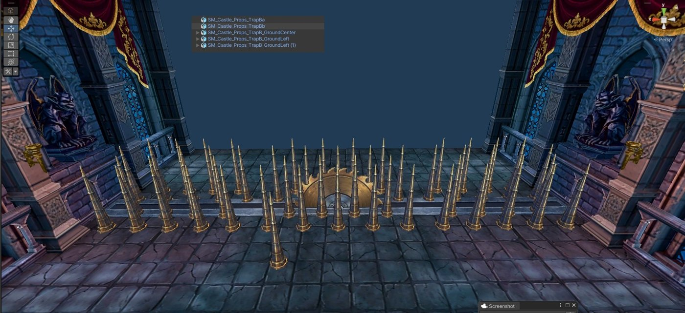

| 陷阱 A — 電鋸 + 軌道(Unity) | 陷阱 B — 尖刺 + 底座環(Unity) |
|---|---|
|  |  |

| 陷阱 A atlas(上半鋸片 + 軌道 tile) | 陷阱 B 貼圖(扇形 UV 烘焙 + 底座環) |
|---|---|
| 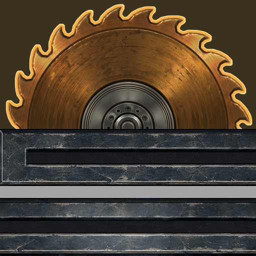 |  |

---

# 🟢 陷阱 A — 電鋸 + 軌道

## 流程總覽

```
概念圖 → 局部裁切 → NB2 去動態+精修 → NB2 細節 pass → 正交正面抽取(de-lit)
      → 程式:24 齒等距 → 程式:去接縫+正圓 → 程式:上下鏡射 / 中心鐵圈正圓
      → 軌道:NB2 去鋸片/齒輪 → 程式切橫向 tile → NB2 正交上視 → 程式 tile + 4 變化型
      → 3ds Max:鋸片上下鏡射 UV、軌道左右鏡射 + 變化型 → Unity EnvCube shader
```

| 概念圖 | 局部裁切 | 去動態 + 精修 |
|---|---|---|
| 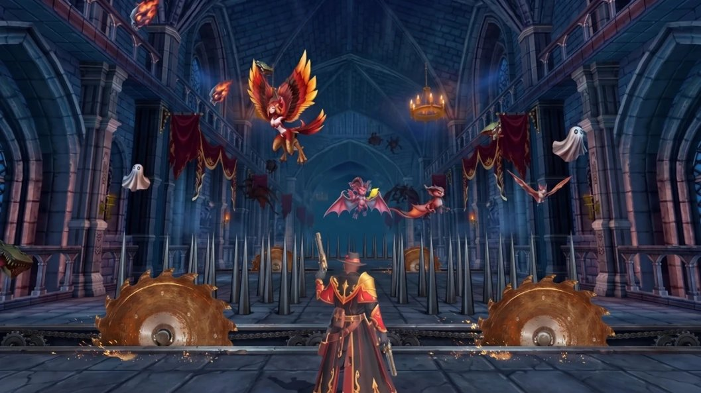 |  | 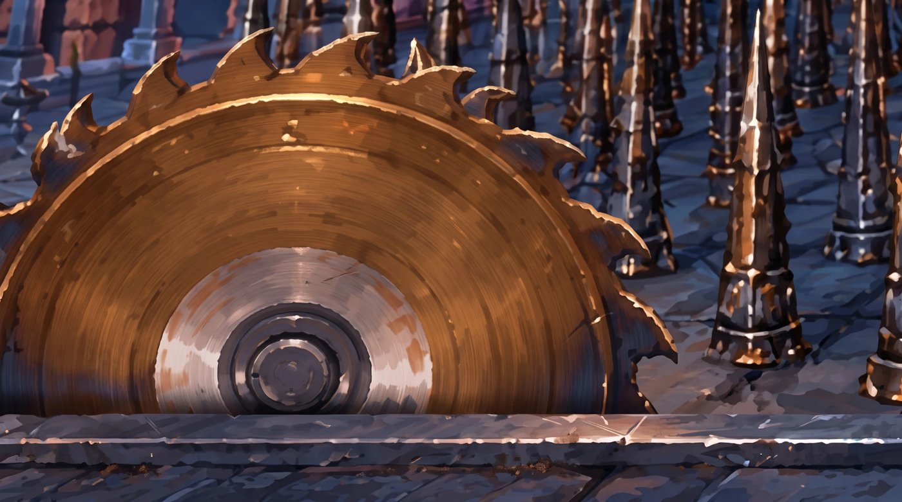 |

## A-1. 去動態 + AAA 精修(NB2,先 Universal Upscaler 2× 再跑)

```text
REPAINT this crop as a STATIC, frozen game asset at Unreal Engine 5
AAA quality. Same composition, same objects — but all motion effects
are removed and every surface is re-rendered with high material detail.

REMOVE ALL MOTION (completely gone, not reduced):
- all sparks, embers and flying particles
- the dust / smoke cloud around the blade and the spikes
- the orange spark glow and the light streaks on the blade face
- the bright friction flash where the blade meets the floor
- any motion blur on the teeth
Where these effects are removed, paint what is behind them: clean
blade metal, floor stone and spike bases — nothing new.

SAW BLADE (keep exact position, size, tooth count and silhouette —
the blade still emerges from the slot in the floor): ...
FRAME LOCK: keep the exact framing — do NOT crop, zoom, extend or outpaint.
STRICT: no new objects, no new spikes, no fog, no glow, no particles of
any kind. Do not brighten the overall exposure.
```

不夠精緻 → **不要原樣重抽**,改拿成品當 ref 1 跑「DETAIL REFINEMENT PASS」(只講材質,明禁 `smeared or blotchy brush strokes`)。
理由:去動態 pass 的注意力分給了「移除+補畫」,細節要獨立一輪。

## A-2. 正交正面抽取(concept→3D B de-lit 軌)

照 `concept-to-3d-v2.md` 的 de-lit 模板;鋸片下半藏在槽裡 → 寫 **`COMPLETE THE DISC ... by rotational symmetry of the visible upper half`**。

## A-3. 程式修幾何(NB2 做不到的部分)

| NB2 原始(齒不等距、22~26 齒) | 24 齒等距(`radial_teeth.py`) | 去接縫 + 溝線正圓(`disc_seam_circle.py` + `hub_symmetry.py`) |
|---|---|---|
| 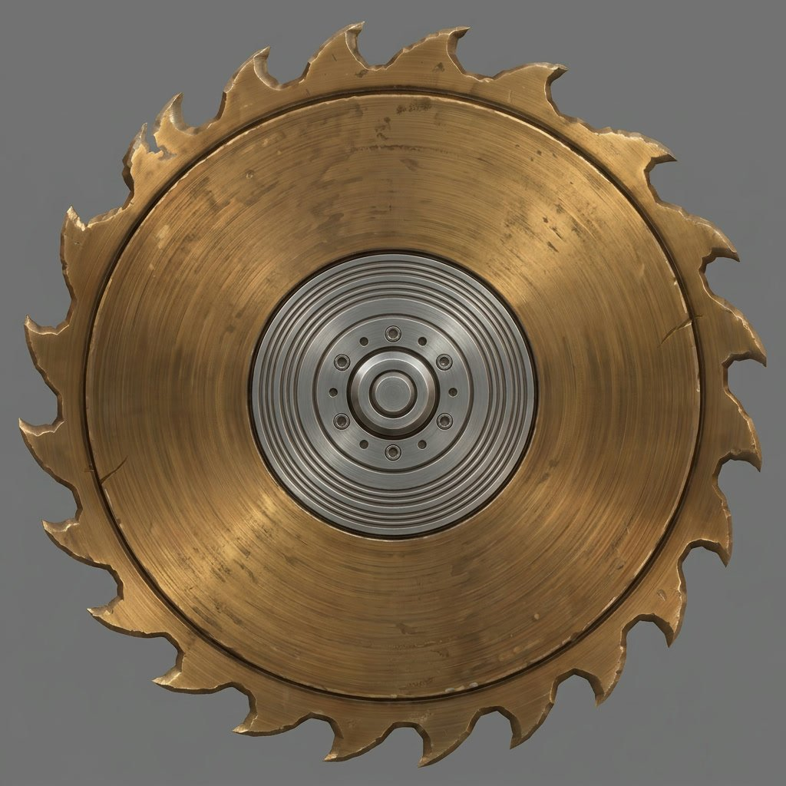 |  | 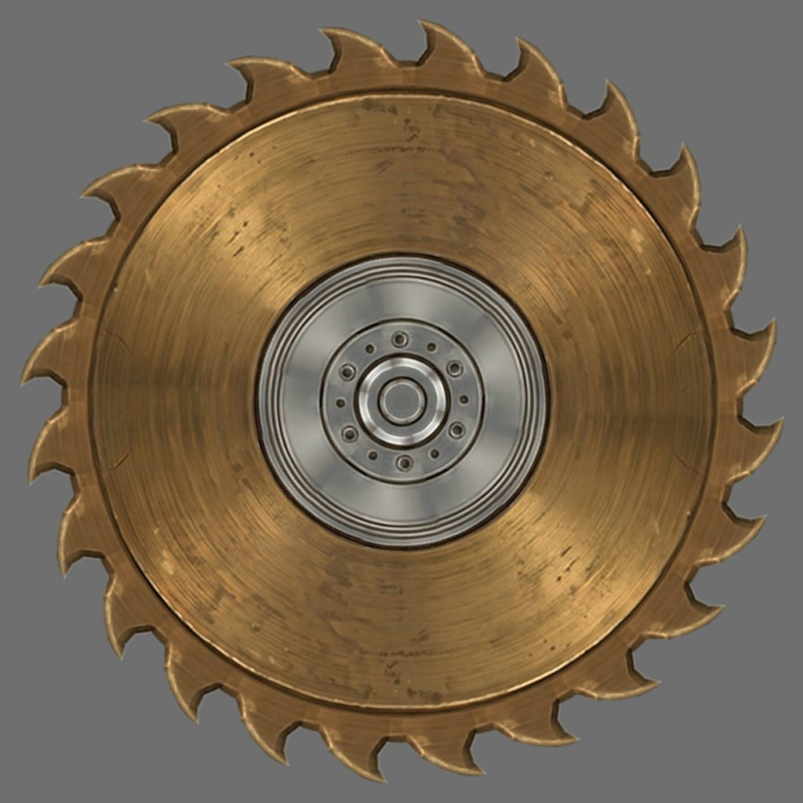 |

| 上下鏡射(盤面鏡射、鋸齒不翻) | 中心鐵圈正圓(透明底,`hub_round_rgba.py`) |
|---|---|
| 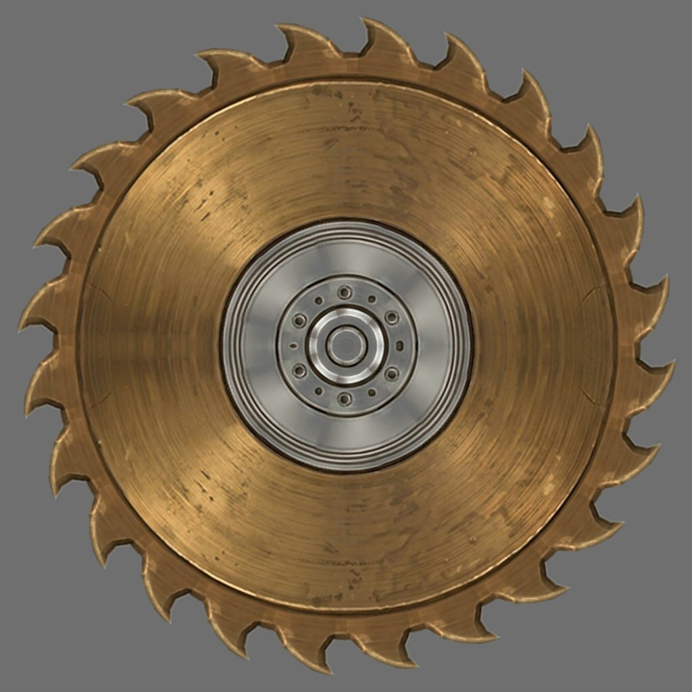 |  |

- **齒數**:量圓心 → 量出各齒間距(實測 14.5°~22.5°)→ 挑最好的一顆、縮到 15° → 環形複製 24 份;中間盤面原像素不動。
- **接縫**:NB2 常在水平中線留一條拼接痕;盤面是同心紋 → 用旋轉 ±9° 的樣本覆蓋接縫帶。
- **正圓**:逐角度量溝線半徑(396~401px)→ 徑向分段線性拉到平均半徑。
- **中心軸**:6 螺栓 + 6 孔 = 60° 對稱 → 取一塊乾淨扇形複製 6 份。
- **鏡射時鋸齒不要翻**:鋸齒有旋轉方向,整張鏡射會讓下半圈齒鉤反向(B 版踩坑)。

## A-4. 側面 / 光澤 / EnvCube

- **側面**:圖上沒有厚度資訊 → 程式畫「側面幾何導引圖」(厚度、凸出量用設定值)當 ref 1,正面成品當 ref 2 上材質。
- **光澤放哪**:給 3D → 貼圖保持 de-lit、光澤交給引擎;給 2D 旋轉物 → 光澤要「每齒一致、無方向」+ 另做固定方向的高光疊層。
- **Unity 不受光 shader + EnvCube**:

| 環境球(依場景光源配色:暖吊燈 / 藍彩窗 / 火把帶) | Unity 設定 |
|---|---|
|  |  |

  - PNG 拖不進 Cube 欄位 → **Texture Shape 改 Cube**;2:1 圖選 Latitude-Longitude,正方形鏡面球選 Mirrored Ball。
  - 切 shader 變亮 = Cube 空著 + CustCube Scale 1 + 無頂點色(Alpha 預設 1)→ 先把 Scale 拉 0 確認,金屬從 0.3 起加。
  - 平面 quad 反射只會是一片單色(法線一樣)→ EnvCube 要用在有倒角的 3D 模型上。

## A-5. 軌道溝槽 tile

| NB2 去齒輪/鋸片後 | 空溝槽橫向 tile(x3 接縫預覽) |
|---|---|
| 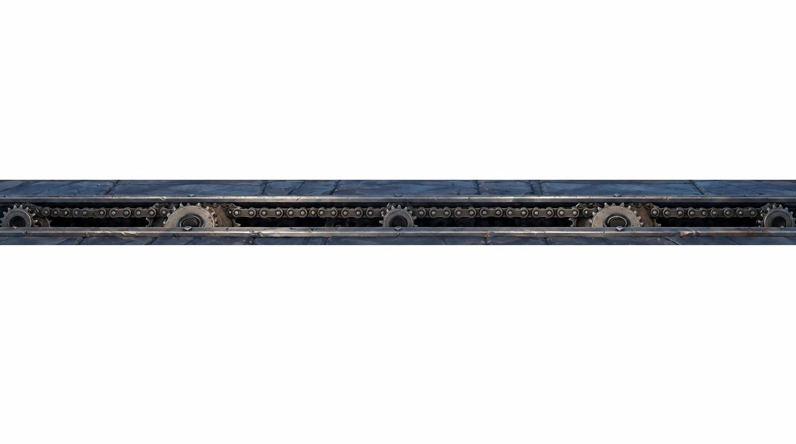 | 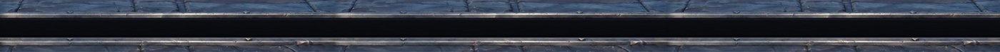 |

| NB2 正交上視 | 上視 tile(螺栓固定 212.5px 間距) | 4 變化型 + 端頭互拼檢查 |
|---|---|---|
| 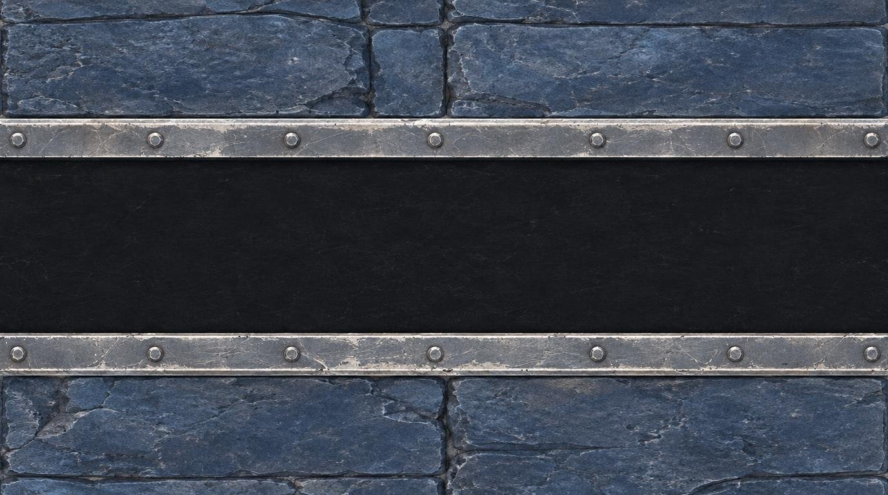 |  | 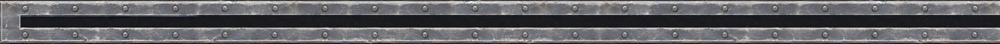 |

- 裁切 14:1 太扁 → NB2 輸出不了 → **裁一段 2:1 滿版**跑,做好一段再程式接長。
- tile 切法:找自相關最佳的重複長度,切口落在鏈條/螺栓**中間**、淡入淡出。
- **變化型共用接縫**:每顆螺栓切成單元、重新排列/翻轉,所有變化型左右邊緣換成同一段共用接縫 → 任意順序互拼都無縫。

**正交上視 prompt(ref 1 = 2:1 滿版裁切)**:
```text
Re-render this crop as a TRUE TOP-DOWN ORTHOGRAPHIC view, looking
straight down at the floor — a flat texture for a 3D model. IGNORE the
source's camera angle: no perspective, no foreshortening, no visible
vertical side faces, no vanishing point. ...
TEXTURE RULES: everything runs perfectly horizontal; the left and right
edges must continue seamlessly. ...
STRICT: no gears, no chain, no saw blades, no new objects, no text.
```

**拆法(使用者定案)**:電鋸只存**上半圓**,UV 上下鏡射;軌道只存**一端端頭 + 中段**,另一端 UV 左右鏡射、中段排變化型。

---

# 🟢 陷阱 B — 伸縮尖刺 + 固定底座環

## 流程總覽

```
概念圖裁切 → (造型探索:一段式 / 簡化 / 古銅復古)→ 使用者 NB2 鏈:優化 → 拿掉飾釘 → 舊化
      → 調性 pass(對齊 Unity 場景 + 電鋸 atlas)
      → 拆兩件:紅圈尖刺(會伸縮)/ 藍圈底座環(固定,要補圖)— 程式先依畫圈切開再生成
      → 底座環:程式畫正八邊形導引 → NB2 paint-over → 程式拆頂面/側面貼圖
      → 尖刺:3ds Max 描底圖 Lathe(8 邊)→ 扇形 UV
      → 程式從 OBJ 算真正交底稿 → NB2 依底稿上色(失敗→修正 pass→PS 合成)
      → 程式烘進扇形 UV(每面取自中間面、側面跳過 V 字、側面壓暗、4K)
      → 使用者手修 → 程式古銅轉銀色(保留環境藍紫)→ Unity
```

| 裁切 | 一段式(程式拉直) | 使用者 NB2 造型鏈 | 調性對齊場景後 |
|---|---|---|---|
|  |  | 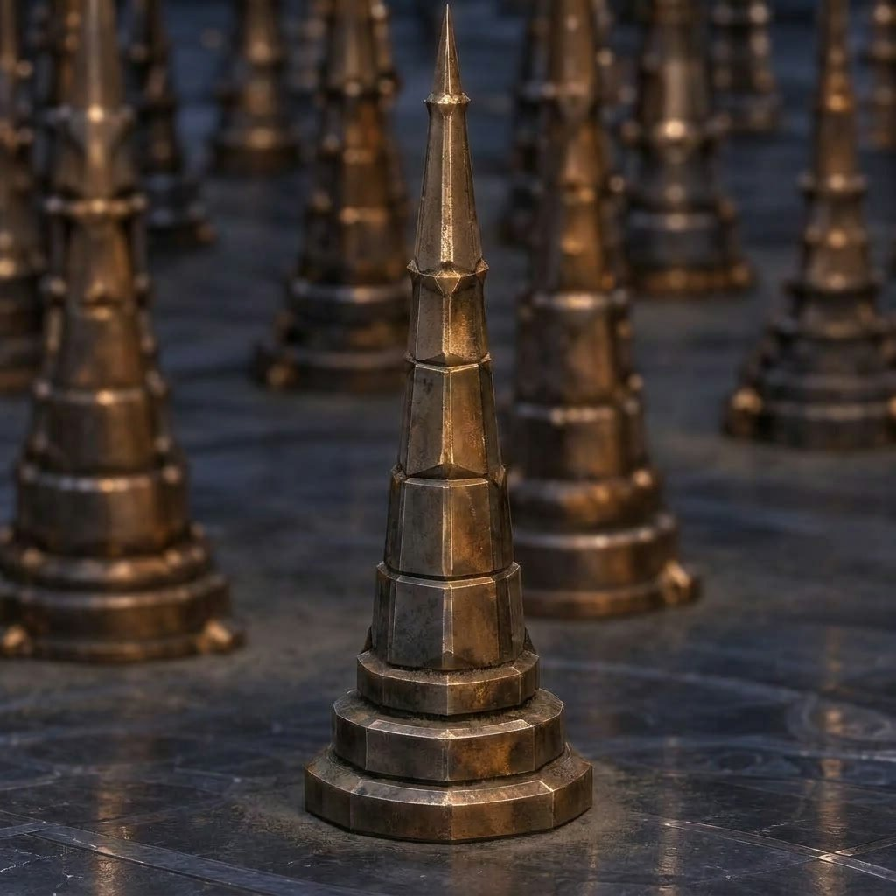 | 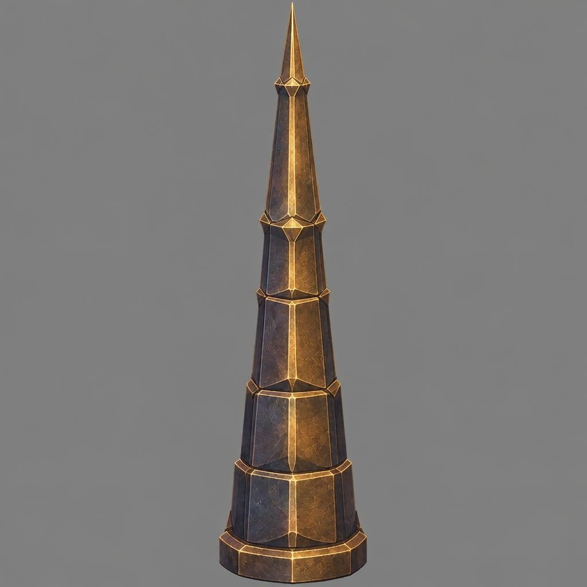 |

## B-1. 紅圈 / 藍圈拆件:先用程式切開,再生成

| 使用者畫圈 | 程式切出:紅=尖刺 | 程式切出:藍=底座(擋住處填灰待補) |
|---|---|---|
|  |  | 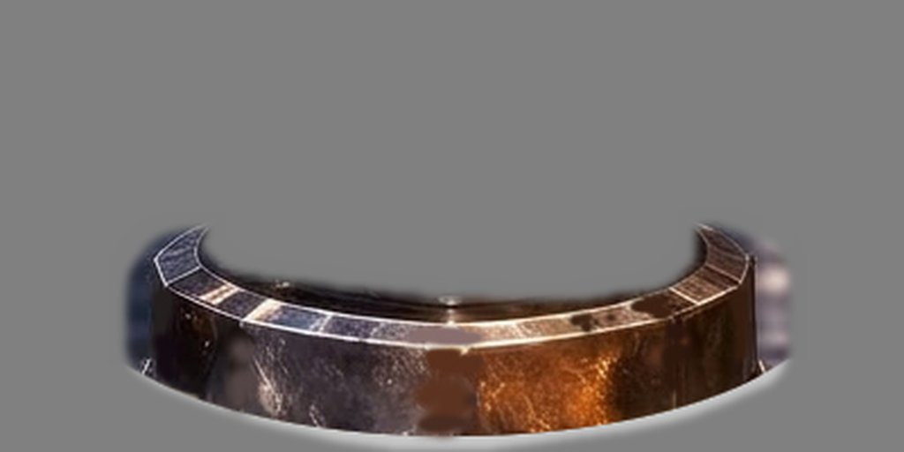 |

只靠「紅圈 / 藍圈」文字讓 NB2 分界 → 兩次都失敗(尖刺帶進底盤、底盤被重新設計成藍鋼八角板)。
**改成每張輸入只留一個部件,prompt 只給這一張**,一次成功。

藍圈補圖 prompt:
```text
This image shows the FRONT part of a round, low base ring seen from a
slightly elevated angle. The grey area above it is where an object used
to stand. COMPLETE the ring: continue its rim around the back so it
becomes one full closed ring, keeping exactly the same shape,
thickness, perspective, bronze-and-dark-metal material and polished
edge highlights as the visible front part.
The center of the ring is an OPEN DARK HOLE going down into the floor:
near-black inside, with the inner wall of the ring visible at the back.
It is a hole, NOT a solid top, and nothing stands in it. ...
```

## B-2. 底座環:「八邊形」要用導引圖,不能用文字

| 文字寫 octagonal → 出 12 邊 | 程式畫正八邊形導引(角朝前、對齊尖刺稜線) | NB2 paint-over 成功 | 程式拆出頂面正俯視 |
|---|---|---|---|
| 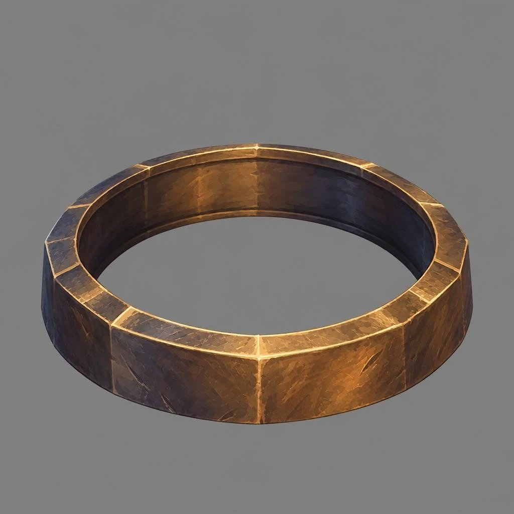 |  | 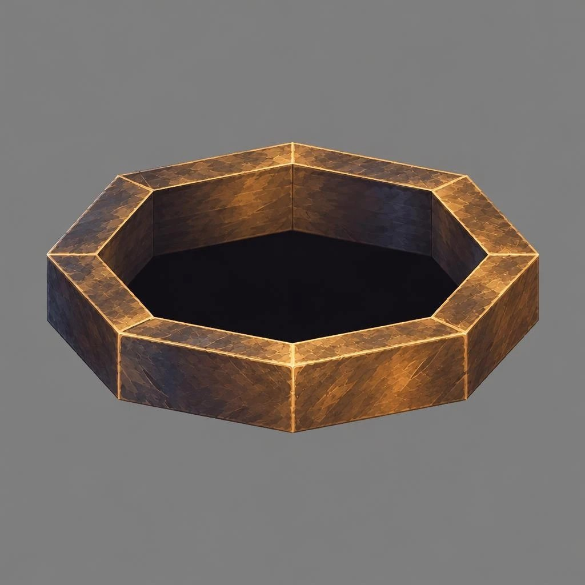 | 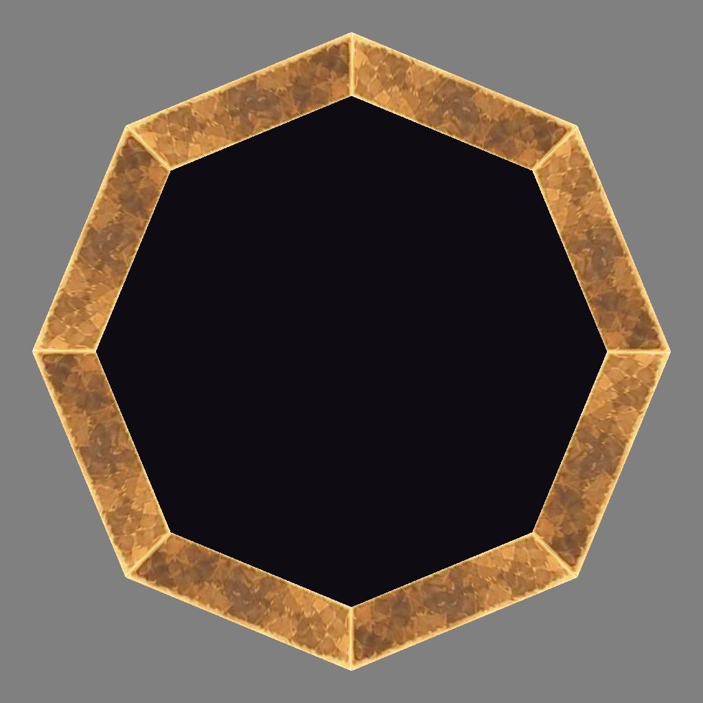 |

```text
Image 1 (FIRST) = the EXACT geometry: a REGULAR OCTAGONAL ring — exactly
8 equal straight sides, one corner pointing straight at the viewer.
Keep its outline, the number of sides, the corner positions, the wall
height, the rim width and the camera angle EXACTLY. Do NOT round it,
do NOT add more sides. This is a PAINT-OVER of Image 1 only.
Image 2 (SECOND) = the material and style reference. ...
The center is an OPEN DARK HOLE ... It is NOT see-through ...
```
成品疊回導引幾何驗證 8 角都對上 → 程式反投影拆出**頂面(8 段旋轉複製)**與**側面單片**。
Max:Tube Sides=8、取消 Smooth、內徑 = 外徑 × 0.8、轉 22.5° 讓角朝前。

## B-3. 尖刺:建模 → 扇形 UV → 烘貼圖(本案最長的攻關)

| 增高 1.5×(底座不拉) | 使用者扇形 UV | 第一版投影:金邊掉到牆面(V 字透視) |
|---|---|---|
| 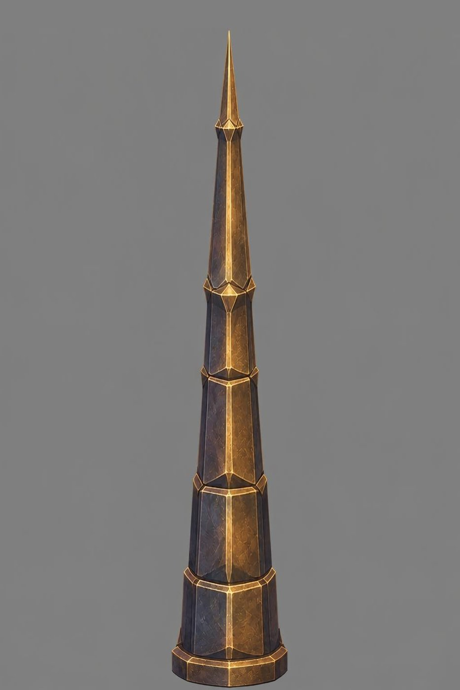 |  |  |

**根因**:AI 畫的「正面圖」其實是略俯視 → 每節頂邊是 V 字。投影到水平邊的模型必然錯位。
**解法:從使用者的 OBJ 算出真正正交的形狀底稿**,讓 NB2 照底稿上色。

| 程式從 OBJ 算的正交底稿 | 疊上使用者截圖輪廓(紅線)驗證比例一致 | 修正 pass + PS 合成後的正交圖 |
|---|---|---|
| 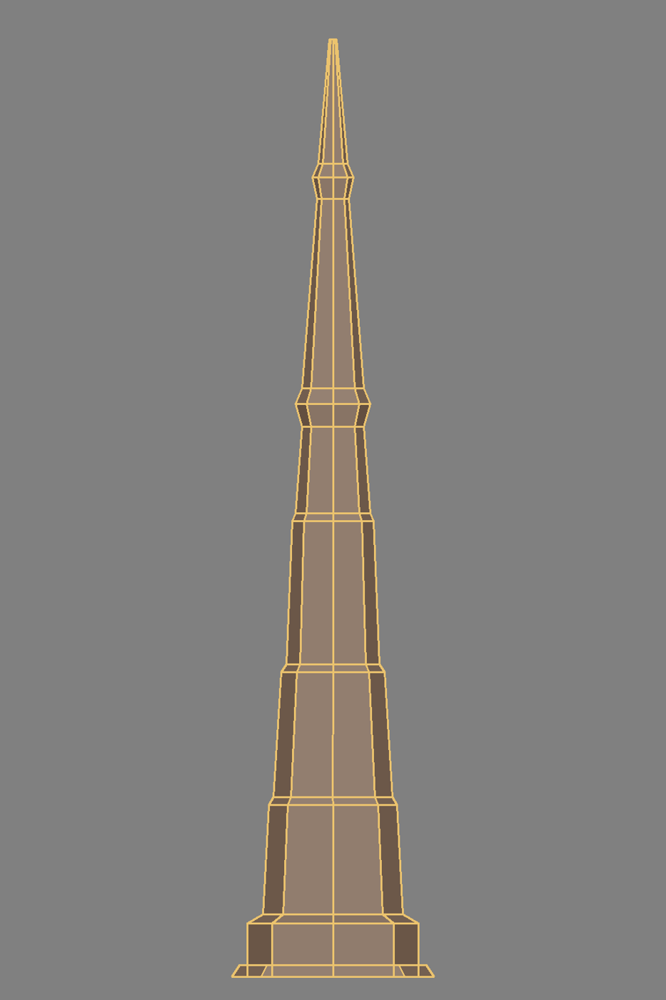 |  | 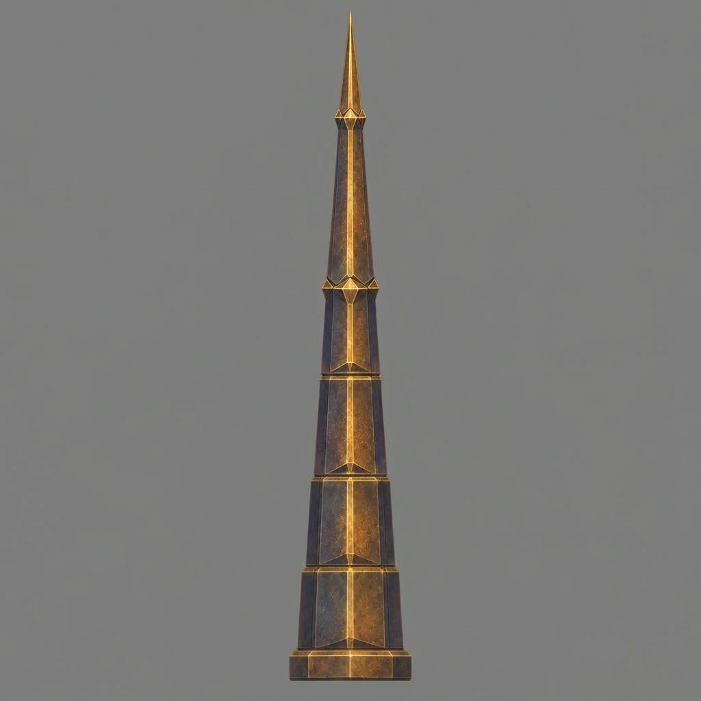 |

**底稿上色時不要給有透視的參考圖**(會把立體角度一起學走,B9 同理)。最後有效的是「修正 pass」——
拿接近正交的成品當唯一輸入,把錯誤逐條點名:
```text
Keep this exact spike — same outline, same width and height of every
tier, same position, same material, same colours. This is a CORRECTION
pass to make it a perfect FRONT ORTHOGRAPHIC ELEVATION. Change ONLY
the tier junctions and the base:
1. Every tier junction becomes ONE PERFECTLY STRAIGHT HORIZONTAL LINE
   across the whole width — no dip or point at the center ridge, no
   V-shape, no diamond or arrow shape where the vertical ridges meet
   the junction. The vertical ridge simply ends at the horizontal line.
2. NO visible top surface on any tier step: remove the thin lit band
   or ledge at each junction. Seen exactly from the side, a step is
   only a straight horizontal line where the width changes.
3. The base: its top edge is a straight horizontal line with NO
   visible top face or slanted rim. Its bottom edge is also straight
   and horizontal.
Each tier is a flat-sided trapezoid in this view: straight sides,
straight horizontal top and bottom. The camera is exactly level — it
does NOT look down at all. ...
```
使用者再把兩次結果在 PS 合成(交界取修正版、凸環取前一版)→ 正交圖定案。

**烘貼圖(`bake_front_to_uv.py`)**——不改使用者 UV:

| v5 預覽:左 v4、中 v5 正面、右 轉 40° | v4 的側面三角形 bug | 古銅 → 銀色(加強藍紫) |
|---|---|---|
| 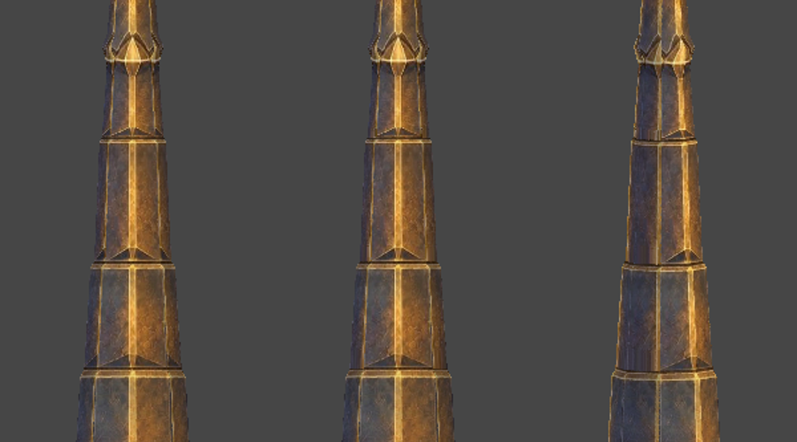 | 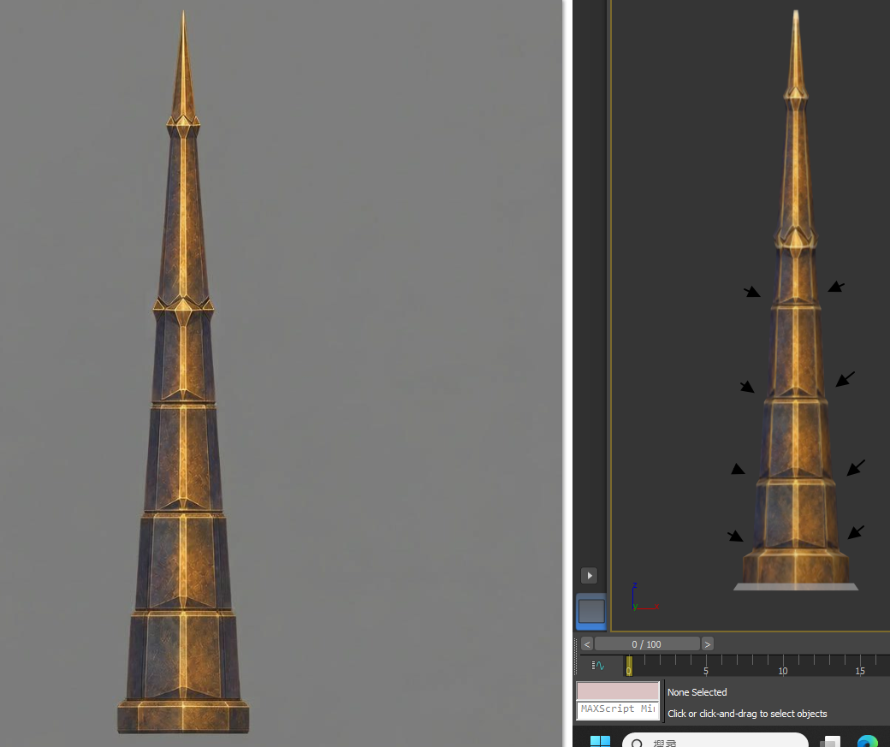 |  |

1. **逐節對高度**:量正交圖每節交界列,對應模型每圈頂點高度(分段線性),寬度也照每節輪廓。
2. **防拉扯**:正面投影時兩側面被壓到 cos67.5°≈0.38 → 拉長 2.6 倍。改成**每個面先旋轉到最近的中間面再取色**,8 面都是正面取色。
3. **側面壓暗**:全部取自最亮的中間面會整支一樣亮 → 量原圖側面/中間亮度比(R0.69 G0.73 B0.88)套到側面。
4. **側面跳過 V 字**:中間面每節底部畫了橫跨兩面的 V 字,側面取色時跳過那一帶,否則出現多餘三角形。
5. **解析度**:扇形 UV 只佔貼圖 27% 高度 → 1024 時細節被壓 5 倍;改烘 4096(長期解:UV 填滿 0~1)。
6. **古銅 → 銀色(`bronze_to_silver.py`)**:Lab 空間只減掉古銅色軸(保留 12% 暖光),正交的藍紫環境色保留並在中暗部加強 1.8 倍;高光保持中性(避免偏綠)。

### B-4. 底座頂面貼圖(使用者自行產出的路線)

> B-2 的八角環是**斜角立體圖**(拆頂面/側面用);實際貼在底座頂面的「正俯視古銅八角環」是使用者另外跑的一條 NB2 鏈。
> ⚠️ 第 2、3 輪 prompt 原文未留存,以「輸入 → 意圖 → 結果」記錄;第 1、4 輪附逐字 prompt。

| 輪 | 輸入(ref) | 意圖 | 結果 |
|---|---|---|---|
| 1 | 尖刺原圖 + 電鋸 atlas(軌道鋼條當材質) | 正俯視八角底盤,中間暗洞(prompt 見下) |  藍鋼、暗洞 ✅、單層邊框 |
| 2 | 斜角立體藍鋼八角板(B-1 的失敗品) | 「給我正交上方視角」— 拿立體版轉正俯視 | 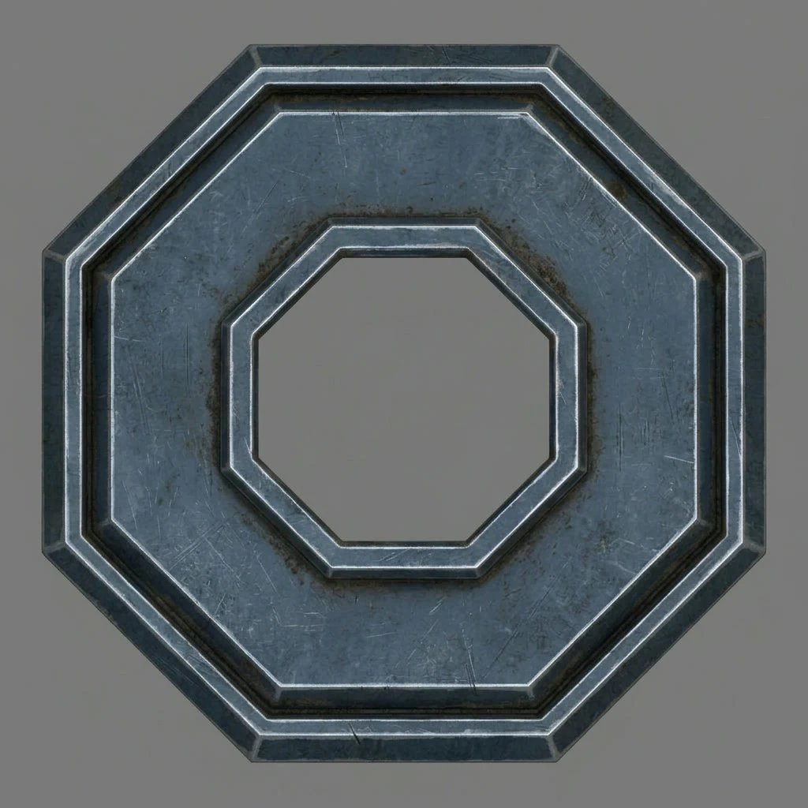 正交 ✅,但洞**透出灰底**、多一圈凸起內框 |
| 3 | 第 2 輪結果 + 古銅 12 邊環(色票) | 換成古銅材質 |  古銅 ✅,洞仍透灰 ❌ |
| 4 | **第 1 輪結果**(暗洞版)+ 古銅 12 邊環(色票) | 換成古銅材質 | 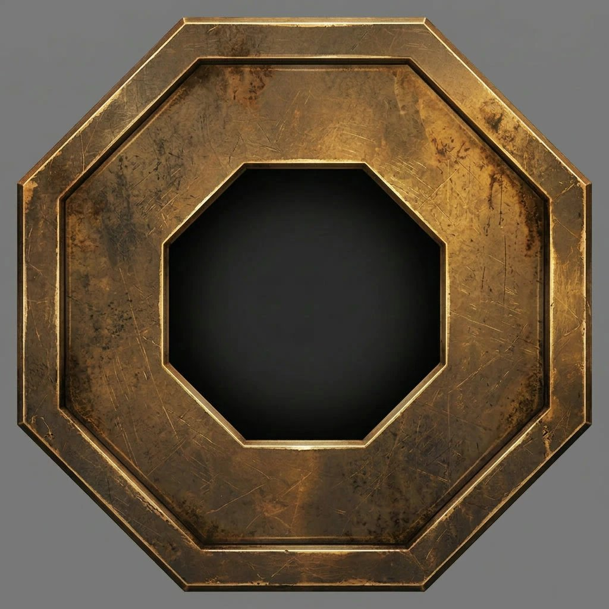 古銅 ✅、暗洞 ✅ → **採用** |

第 2 輪的輸入(斜角立體藍鋼板):

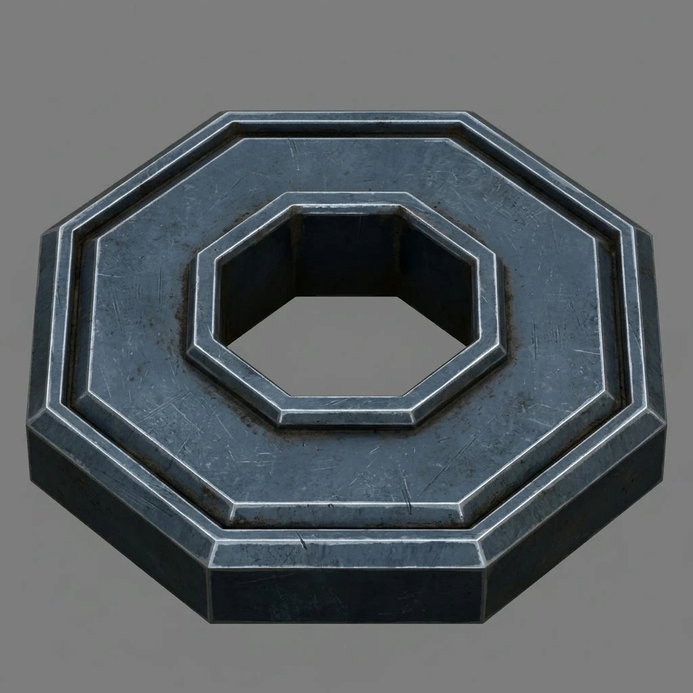

**第 1 輪 prompt(逐字)**:
```text
Design a TOP-DOWN ORTHOGRAPHIC texture of a flat octagonal floor plate,
seen from DIRECTLY ABOVE: the camera looks straight down, no
perspective, no side walls visible. A regular octagon, perfectly
centered and symmetric, filling about 90% of the square canvas.

DESIGN (based on the base plate under the spike in the FIRST image):
- a thin flat plate with two shallow concentric steps: an outer rim
  band, then a slightly raised inner ring
- in the center, an octagonal opening about 35% of the plate width,
  aligned with the outer octagon. The opening is a DARK PIT going down
  into the floor: near-black inside, with a soft dark gradient on its
  inner walls. It is NOT a see-through hole — no grey background shows
  through it
- NO raised collar around the opening, no bolts, no extra ornaments

MATERIAL — match the steel strips in the lower half of the SECOND
image: dark blue-grey worn steel, fine scratches, darker grime in the
corners, and a thin, crisp, bright highlight line along EVERY edge:
the outer octagon edge, the step edge, and the rim of the opening.

Soft even top lighting, no directional light, no cast shadows.
Flat neutral grey (#808080) outside the octagon. Stylized AAA game
texture. No spike, no text.
```

**第 4 輪(採用版)prompt(逐字,Leonardo 生成紀錄)**:
```text
參照這張的色調 調整
```
References:① 古銅 12 邊環(色票)② 第 1 輪藍鋼正俯視八角板(暗洞版)。

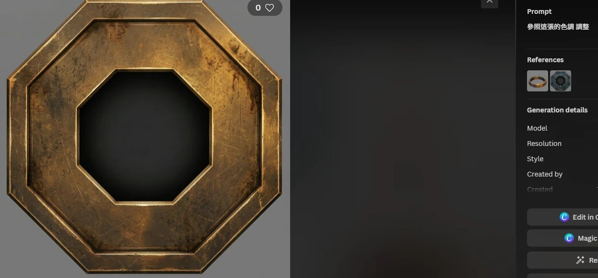

> 💡 **換材質 pass 不需要長 prompt**:形狀已經由輸入圖鎖住時,一句中文「參照這張的色調 調整」+ 色票參考就成功(與 B9「極短 prompt + 材質特寫」同理)。長鎖句反而容易讓模型重畫幾何。

**這條鏈的教訓:**
- **「形狀對」和「材質對」分兩步**:先拿到形狀正確的版本(第 1 輪:正俯視 + 暗洞),再單獨做換材質 pass;換材質那輪的輸入要選**形狀已經對的那張**(第 4 輪成功、第 3 輪失敗的差別就在輸入選錯)。
- **透底洞會一路遺傳**:第 2 輪洞已透灰,後面換材質也修不回來 → 從暗洞版重來比補救快。
- **換色只要色票**:古銅 12 邊環只當材質參考,它的邊數沒有滲進結果(因為輸入 1 的八邊形輪廓夠強)。
- 最後再於 PS 加工(簡化成單圈古銅框 + 黑色中心)排進貼圖左上空白區,見下圖中間那張。

**最終貼圖組裝(使用者手修)**:烘焙原始素材 + 底座環頂面加工素材 → 合成完稿(底座環排進左上空白區,兩件共用一張貼圖)。

左 = Claude bake 的原始素材、中 = 底座環加工素材、右 = 完稿:

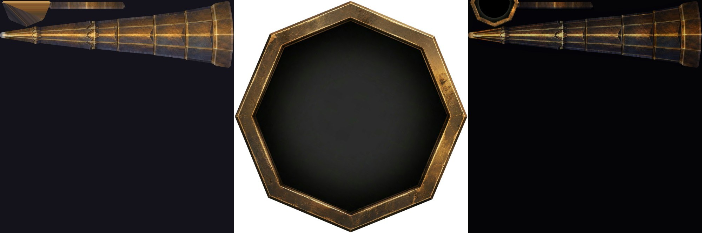

---

## 📌 踩坑紀錄

| # | 症狀 | 根因 | 解法 |
|---|---|---|---|
| 1 | 精修後尖刺變成整片刺林、電鋸位置變 | prompt 列了「加什麼細節」= 授權加物件(B1 #3/#9) | 保真定性 + 物件逐一列入 OBJECT LOCK |
| 2 | 「不夠精緻」只是變銳利 | 保真定性下模型不敢長材質(B1 #7)+ 像素預算不足 | 重繪定性 + 分區 Crop-Gen-Paste |
| 3 | 鋸齒不等距、22~26 齒 | NB2 不會數數 | 程式環形陣列,AI 每次重跑都會再壞 → 所有 NB2 pass 結束後才排齒 |
| 4 | 盤面中線接縫、溝線不圓 | 生成器的拼接痕 / 畫不出正圓 | 同心紋旋轉覆蓋 + 徑向拉圓 |
| 5 | 整張鏡射後下半齒鉤反向 | 鋸齒有旋轉方向 | 盤面鏡射、齒帶不翻 |
| 6 | 切 Unlit shader 變亮、PNG 拖不進 Cube | Cube 空 + Scale 1 + Alpha 預設 1;Texture Shape 是 2D | Scale 先歸零;Texture Shape 改 Cube |
| 7 | 14:1 裁切輸出補白邊 | 超出 NB2 比例範圍 | 裁 2:1 滿版段落,程式接長 |
| 8 | tile 重複感明顯 | 單一 tile | 螺栓單元重排 + 共用接縫 4 變化型 |
| 9 | 紅圈/藍圈拆件,兩部件互相滲入 | 文字分界不可靠 | 程式先依畫圈切開,一張輸入只留一件 |
| 10 | 寫 octagonal 出 12 邊 | 模型數不準邊數 | 程式畫正八邊形導引 → paint-over |
| 11 | 底座中間洞透出灰底 | 「hole」被畫成穿透;透底版再換材質也修不回 | 明寫 `OPEN DARK HOLE ... NOT see-through`;換材質時輸入選暗洞版(B-4 第 4 輪) |
| 12 | 形狀導引圖把古銅畫成灰鋼 | 導引圖色塊被當材質 | 材質參考另給 ref 2;或不用導引直接抽取 |
| 13 | 烘貼圖金邊掉到牆面中間 | AI「正面圖」是略俯視,交界為 V 字 | 從 OBJ 算真正交底稿;補償俯角只能接近 |
| 14 | 依底稿上色仍出透視 | ref 2 有透視 → 構圖滲漏(B9) | 只給底稿一張 / ref 2 只給無邊無輪廓的材質特寫 / 修正 pass 逐條點名 |
| 15 | 側面貼圖拉扯 | 正面投影的側面被壓扁 | 每面旋轉到中間面取色 |
| 16 | 側面多出三角形 | 中間面的 V 字被帶到側面 | 側面取色跳過 V 字帶 |
| 17 | Max 裡糊、偏橘 | 扇形 UV 只用 27% 面積;Flat Color 無明暗 | 烘 4K / UV 填滿;側面壓暗;視圖 Texture Size 調高 |
| 18 | 「側面正交」其實不用算 | 八角柱角朝前時,轉 90° 也是角朝前 | 先檢查對稱性再決定要幾張視圖 |

## 🔒 本案新增鎖句

| 鎖 | 用途 | 關鍵句 |
|---|---|---|
| **去動態鎖** | 火花/煙/光痕完全移除並補背後 | `REMOVE ALL MOTION (completely gone, not reduced) ... paint what is behind them ... nothing new` |
| **旋轉補全** | 半埋物件補完整圈 | `Complete the hidden lower half by rotational symmetry of the visible upper half` |
| **邊數鎖(配導引圖)** | 正 N 邊形 | `exactly 8 equal straight sides, one corner pointing straight at the viewer ... Do NOT round it, do NOT add more sides` |
| **暗洞鎖** | 開口不透底 | `OPEN DARK HOLE going down into the floor ... NOT see-through — no grey background inside` |
| **正交修正鎖** | 消 V 字、消頂面 | `Every tier junction becomes ONE PERFECTLY STRAIGHT HORIZONTAL LINE ... NO visible top surface on any tier step` |
| **paint-over 定性** | 照底稿上色不改形 | `This is a PAINT-OVER of Image 1 — do NOT move, resize, redraw or add any edge` |
| **材質參考隔離** | ref 2 只取材質 | `Image 2 is only a small material swatch ... It contains no shape.` |

## ✅ 可複用結論

1. **AI 出材質、程式修幾何**:齒數、正圓、對稱、無縫、正交、UV 對位,一律程式。
2. **程式修幾何要放在所有 NB2 pass 之後**——任何一次 NB2 都會重畫幾何。
3. **拆件先用程式切開**,一張輸入只放一個部件。
4. **「正 N 邊」「正交」靠導引圖**;導引圖最好**從 3D 模型直接算**,比例保證一致。
5. **參考圖帶透視 = 透視滲漏**;只給材質特寫,或乾脆不給。
6. **有 3D 模型時,貼圖用烘的**:每面取自正對的面(防拉扯)、逐節對高度、側面依原圖亮度壓暗。
7. **換色用 Lab 色軸分離**:只拿掉材質本色軸,保留環境光帶入的顏色。
8. **省貼圖用鏡射**:電鋸上下、軌道左右、尖刺前後;tile 用共用接縫做變化型。
