# 實戰紀錄 — A13 陷阱道具拆解:電鋸陷阱(A)+ 尖刺陷阱(B)

> 從一張哥德大廳概念圖,拆出兩組可動陷阱 → 修成可用貼圖 → 3ds Max 建模 → Unity 不受光 shader 上線。
> 對應工作流:`ai-media-generator`(concept→3D V2)+ `/asset-cutout`;前置知識:
> [B1](B1-forest-bg-4k-detail.md)(鎖句字典、白邊坑)、[B2](B2-greybox-module-pipeline.md)(貼材質灰盒、Crop-Gen-Paste)、
> [B4](B4-master-variant-tileset.md)(套圖變體)、[B9](B9-tree-trunk-restyle.md)(參考圖幾何滲漏)、[A4/A5](A4-castle-concept-decomposition.md)(紅框定位、正交鎖)。

**🔑 關鍵字:** `A13`、`陷阱`、`電鋸`、`圓鋸`、`尖刺`、`鋸齒等距`、`正圓修正`、`上下鏡射`、
`溝槽 tile`、`tile 變化型`、`八角底座`、`正交底稿`、`烘貼圖`、`扇形 UV`、`EnvCube`、`古銅轉銀色`

> 🪄 **日後複用:** 附概念圖(物件畫圈)說「**拆掉這張概念圖,我要自己建模加貼圖**」(或「concept→3D」「三視圖重建」+「我要自己建模加貼圖」)→ 一步一步引導走完整鏈;已有模型 + 正交圖時說「照 A13 烘貼圖」。

> 🖼️ 圖片都是縮圖,**點擊可看原圖**。

**狀態:✅ 陷阱 A(電鋸 + 軌道)、陷阱 B(伸縮尖刺 + 固定底座環)皆已進 Unity 場景完成(2026-11-26)。**
**日期:** 2026-11-23 ~ 2026-11-26 · **對話:** `https://claude.ai/code/session_01W4Q9GjMSoof91T1LwVKXx5`
**工具:** [`tools/trap-texture-tools/`](../../tools/trap-texture-tools/README.md) · **全部連結:** 見下方〈🔗 本次相關連結〉

---

## 🔗 本次相關連結

> 連結指向開發分支 `claude/wizardly-gauss-y2tnhh`;合併進 main 後,把網址中的分支名換成 `main` 即可。

**📘 主紀錄**
- A13 陷阱道具拆解(本頁):[A13-trap-props-saw-spike.md](https://github.com/TinaChen94/01/blob/claude/wizardly-gauss-y2tnhh/docs/asset-cases/A13-trap-props-saw-spike.md)

**🧰 工具**
- 程式修圖 / 烘貼圖工具說明:[tools/trap-texture-tools/README.md](https://github.com/TinaChen94/01/blob/claude/wizardly-gauss-y2tnhh/tools/trap-texture-tools/README.md)
- 本機網頁烘貼圖工具:[bake-tool.html](https://github.com/TinaChen94/01/blob/claude/wizardly-gauss-y2tnhh/tools/trap-texture-tools/bake-tool.html)(下載後雙擊開啟)
- 工具資料夾(10 支腳本):[tools/trap-texture-tools/](https://github.com/TinaChen94/01/tree/claude/wizardly-gauss-y2tnhh/tools/trap-texture-tools)

**🧭 Skill / SOP(concept→3D 延伸與互動規則)**
- SKILL.md(Auto-Pilot 例外、concept→3D 互動規則、用途分流):[SKILL.md](https://github.com/TinaChen94/01/blob/claude/wizardly-gauss-y2tnhh/.claude/skills/ai-media-generator/SKILL.md)
- concept→3D 主模板(一步一步引導、階段 0 用途分流、延伸到貼圖):[concept-to-3d-pipeline.md](https://github.com/TinaChen94/01/blob/claude/wizardly-gauss-y2tnhh/.claude/skills/ai-media-generator/templates/concept-to-3d-pipeline.md)
- concept→3D V2 SOP(延伸鏈:概念圖 → 正交圖 → 3D+UV → 貼圖):[concept-to-3d-v2.md](https://github.com/TinaChen94/01/blob/claude/wizardly-gauss-y2tnhh/.claude/skills/ai-media-generator/references/concept-to-3d-v2.md)
- Auto-Pilot 模板(不啟動情境加上 concept→3D):[auto-pilot.md](https://github.com/TinaChen94/01/blob/claude/wizardly-gauss-y2tnhh/.claude/skills/ai-media-generator/templates/auto-pilot.md)

**📑 索引與設定**
- 案例索引(A13 列):[docs/asset-cases/README.md](https://github.com/TinaChen94/01/blob/claude/wizardly-gauss-y2tnhh/docs/asset-cases/README.md)
- 產出統計 STATS(A13 案例列、技法列):[docs/STATS.md](https://github.com/TinaChen94/01/blob/claude/wizardly-gauss-y2tnhh/docs/STATS.md)
- CLAUDE.md(A13 叫用詞、concept→3D 互動方式):[CLAUDE.md](https://github.com/TinaChen94/01/blob/claude/wizardly-gauss-y2tnhh/CLAUDE.md)

**🖼️ 圖檔與總覽**
- A13 過程圖(`a13-01` ~ `a13-50`):[docs/asset-cases/images/](https://github.com/TinaChen94/01/tree/claude/wizardly-gauss-y2tnhh/docs/asset-cases/images)
- 整個分支:[claude/wizardly-gauss-y2tnhh](https://github.com/TinaChen94/01/tree/claude/wizardly-gauss-y2tnhh)
- 分支 commit 紀錄:[commits](https://github.com/TinaChen94/01/commits/claude/wizardly-gauss-y2tnhh)

**💬 對話**
- 本次工作階段:https://claude.ai/code/session_01W4Q9GjMSoof91T1LwVKXx5

---

## ⭐ 一句話心法

> **AI 出材質,程式修幾何。**
> 生成模型不會數數、畫不出正圓、**一次畫不出正交**(要提示詞矯正 + PS 收尾)、對不準 UV —— 數數 / 正圓 / UV 每次都交給程式,正交靠「提示詞矯正 + PS」,
> 不要用「再抽一次」去賭。AI 只負責「這塊金屬長什麼樣」。

| 交給 AI(NB2) | 交給程式 |
|---|---|
| 精緻度提升、去動態(火花/煙)、材質風格、調性對齊場景 | 齒數等距、正圓、旋轉/鏡射對稱、去接縫、無縫 tile、tile 變化型 |
| 依「形狀底稿」上色(paint-over) | 形狀底稿本身(從 3D 模型算出真正交)|
| 局部補圖(被擋住的底盤) | 烘貼圖進模型 UV、側面防拉扯、換色(古銅→銀) |

---

## 成品

<a href="images/a13-43-final-scene.jpg"></a>

| 陷阱 A — 電鋸 + 軌道(Unity) | 陷阱 B — 尖刺 + 底座環(Unity) |
|---|---|
| <a href="images/a13-17-trapA-engine.jpg"></a> | <a href="images/a13-42-trapB-engine.png">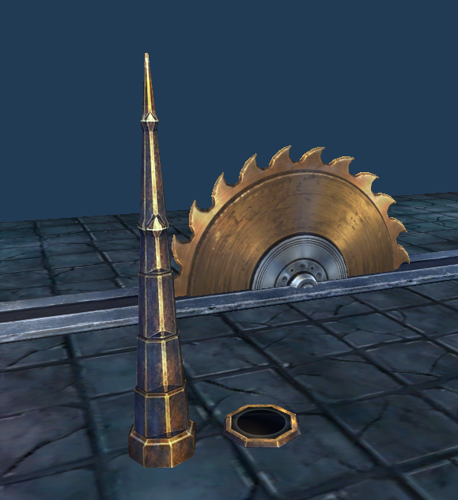</a> |

| 陷阱 A atlas(上半鋸片 + 軌道 tile) | 陷阱 B 貼圖(扇形 UV 烘焙 + 底座環) |
|---|---|
| <a href="images/a13-16-trapA-atlas.png"></a> | <a href="images/a13-41-trapB-final-texture.jpg">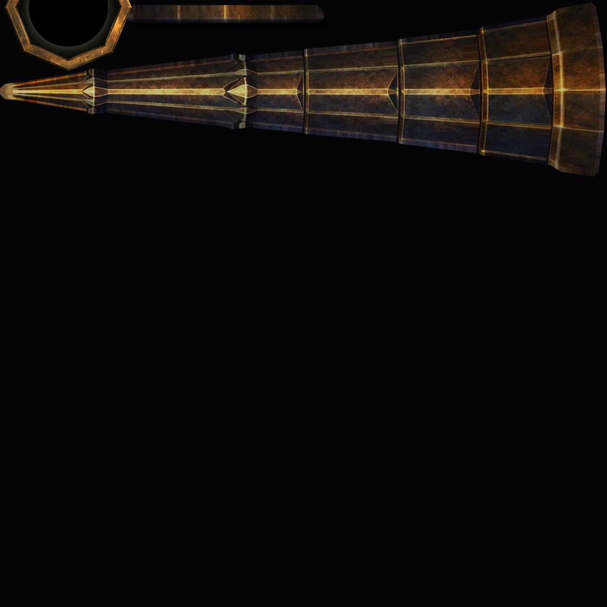</a> |

---

# ⭐ 本案核心:2D 正交正面圖 + 3D 模型/UV → 烘出貼圖

> 🧭 **定位:本案是 concept→3D SOP(「拆掉這張概念圖 / concept→3D / 三視圖重建」)的延伸。**
> 原 SOP 止於正交參考板;A13 把鏈接到可上線貼圖:
> **概念圖 → 正面正交圖 → 3D + UV → 貼圖產生**。SOP 端的摘要寫在
> `.claude/skills/ai-media-generator/references/concept-to-3d-v2.md`〈延伸〉段。

> 用途分流:**只有「自己建模 + 貼圖」才走完整條鏈**;2D 素材、image-to-3D 做到「正面正交圖」就收(對照表見 `SKILL.md`〈concept→3D 互動規則〉)。本案兩個陷阱都屬「自己建模 + 貼圖」。

| ① 概念圖 | ② 正面正交圖 | ③ 3D + UV | ④ 貼圖產生 | 上線 |
|---|---|---|---|---|
| <a href="images/a13-20-spike-crop.jpg">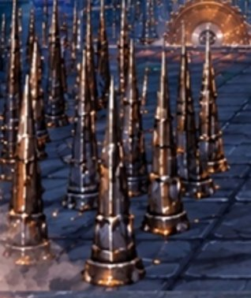</a> | <a href="images/a13-37-ortho-fix-ps-composite.jpg"></a> | <a href="images/a13-33-model-fan-uv.png">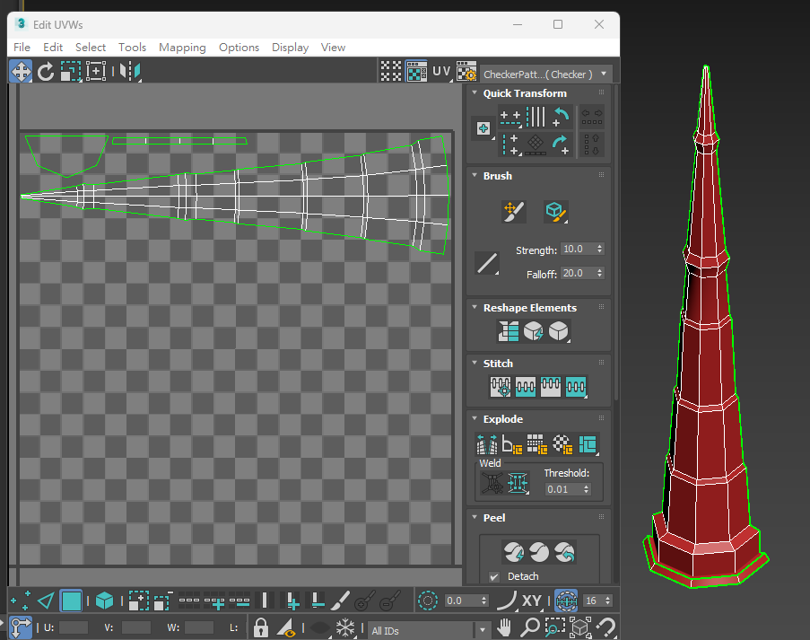</a> | <a href="images/a13-41-trapB-final-texture.jpg"></a> | <a href="images/a13-42-trapB-engine.png"></a> |

> **本案最重要、最可複用的流程。** 美術用 AI 畫好一張「正面正交圖」,建模師照自己習慣拆 UV,
> 程式把正面圖**直接烘進模型自己的 UV** —— **UV 不用配合貼圖改、貼圖也不用手畫展開圖。**
> 細節攻關過程見下方 [B-3](#b-3-尖刺建模--扇形-uv--烘貼圖本案最長的攻關);本節是可照做的 SOP。

## 輸入 → 輸出

| 輸入 | 要求 | 本案實例 |
|---|---|---|
| **① 3D 模型 OBJ**(含 UV) | 3ds Max → Export Selected → OBJ,**勾 Texture Coordinates**;只選要烘的物件;可只做前半(後半鏡射) | `SM_Prop_TrapB`(八角 Lathe,扇形 UV) |
| **② 正面正交圖** | **真正交**(每節交界是水平直線、看不到頂面);左右對稱;中性灰底;最好用 ③ 當形狀底稿畫出來 | <a href="images/a13-37-ortho-fix-ps-composite.jpg"></a> |
| ③ 形狀底稿(程式產) | 由 ① 直接算出的正交投影,保證比例與模型一致 | <a href="images/a13-35-ortho-guide-from-model.png"></a> |
| **輸出:貼圖** | 照 ① 的 UV 排列;UV 島外補 8px 邊色;建議 4096 再縮 | <a href="images/a13-41-trapB-final-texture.jpg"></a> |

> 🖥️ **不用 Claude 也能做:** 本機網頁工具 [`tools/trap-texture-tools/bake-tool.html`](../../tools/trap-texture-tools/bake-tool.html) —— 拖入 OBJ + 正交圖 → 對位檢查 → 烘焙 → 3D 預覽 → 下載 PNG(全程離線)。

## 步驟

```
1. 建模 + 拆 UV(照自己習慣,本案是扇形展開)→ 匯出 OBJ 給 Claude
2. Claude:ortho_guide_from_obj.py  → 從 OBJ 算出正交形狀底稿(③)
3. NB2:ref 1 = 底稿,paint-over 上色(只給底稿或無輪廓的材質特寫,禁止給有透視的參考圖)
       → 若仍有 V 字/頂面 → 修正 pass(逐條點名)→ 必要時 PS 合成
4. Claude:疊底稿線框檢查對位 → bake_front_to_uv.py 烘進 ① 的 UV
5. Claude:obj_preview_render.py 出正面 + 斜 40~60° 預覽 → 確認無錯位、無拉扯
6. 進 Max 換 Diffuse(UV 不動)→ 使用者手修 → 引擎
```

## 烘焙程式做的四件事(為什麼不能直接投影)

| 問題 | 直接正面投影的結果 | 程式的處理 |
|---|---|---|
| **高度錯位** | AI 圖每節高度和模型差 1~3%,金邊掉到牆面 | 量正交圖每節交界列,對應模型每圈頂點高度,**逐節分段對齊**;寬度也照每節輪廓 |
| **側面拉扯** | 側面在正面圖被壓到 cos67.5°≈0.38,貼回 3D 拉長 2.6 倍 | **每個面先旋轉到最近的正對面再取色**,8 面都是正面取色 |
| **整支一樣亮** | 都取最亮的中間面,失去立體感 | 量原圖側面 / 中間亮度比(R0.69 G0.73 B0.88)套到側面 |
| **跨面圖案外溢** | 中間面的 V 字被帶到側面變三角形 | 側面取色時跳過 V 字帶 |

## 驗收 checklist

- [ ] 正面預覽:每節金色橫邊落在模型邊上、中線稜線對在正前方的稜
- [ ] 斜 40~60° 預覽:側面無拉長、無多餘三角形
- [ ] Max 視圖 Texture Size 調到 2048+、用有明暗的著色模式看(Flat Color 看不出問題)
- [ ] UV 利用率:扇形只佔 27% 面積時要烘 4K,或把 UV 填滿 0~1

## 適用範圍

- ✅ 旋轉對稱 / 多邊形柱狀物(尖刺、柱子、燈柱、瓶罐、塔):一張正面圖就能烘全部面
- ⚠️ 非對稱物件:需要正面 + 側面(+ 背面)多張正交圖,程式依面法線選最接近的視圖取色(同一套程式可擴充)
- ❌ 底稿與模型比例不同(例如用「看起來像」的概念圖直接烘):一定錯位 → 必須先從模型算底稿再上色

---

# 🟢 陷阱 A — 電鋸 + 軌道

## 流程總覽

```
概念圖 → 局部裁切 → NB2 去動態+精修 → NB2 細節 pass → 正交正面抽取(de-lit)
      → 程式:24 齒等距 → 程式:去接縫+正圓 → 程式:上下鏡射 / 中心鐵圈正圓
      → 軌道:NB2 去鋸片/齒輪 → 程式切橫向 tile → NB2 正交上視 → 程式 tile + 4 變化型
      → 3ds Max:鋸片上下鏡射 UV、軌道左右鏡射 + 變化型 → Unity EnvCube shader
```

| 概念圖 | 局部裁切 | 去動態 + 精修 |
|---|---|---|
| <a href="images/a13-01-concept.jpg"></a> | <a href="images/a13-02-saw-crop.jpg">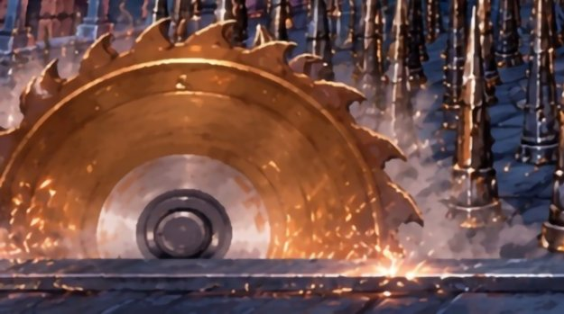</a> | <a href="images/a13-03-saw-static.jpg"></a> |

## A-1. 電鋸圓盤:分兩次算(去動態 → 細節 pass)

> 一次同時要求「移除特效 + 補畫 + 提升精緻度」,注意力會被分散。
> 所以分成兩輪:**第 1 次只負責去動態與補畫,第 2 次拿第 1 次成品專心提升材質**。
> 兩次都先用 Universal Upscaler 2×(最低 creativity)放大再跑 NB2;Prompt Enhance / Style = None。

| 局部裁切(輸入) | 第 1 次:去動態 | 第 2 次:細節 pass |
|---|---|---|
| <a href="images/a13-02-saw-crop.jpg"></a> | <a href="images/a13-03-saw-static.jpg"></a> | <a href="images/a13-55-saw-refined-pass2.jpg">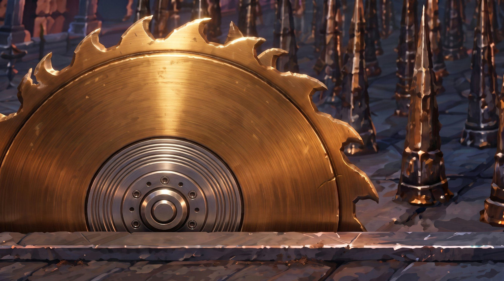</a> |

### 第 1 次 — 去動態 + AAA 重繪(ref 1 = 局部裁切,逐字)

```text
REPAINT this crop as a STATIC, frozen game asset at Unreal Engine 5
AAA quality. Same composition, same objects — but all motion effects
are removed and every surface is re-rendered with high material detail.

REMOVE ALL MOTION (completely gone, not reduced):
- all sparks, embers and flying particles
- the dust / smoke cloud around the blade and the spikes
- the orange spark glow and the light streaks on the blade face
- the bright friction flash where the blade meets the floor
- any motion blur on the teeth
Where these effects are removed, paint what is behind them: clean
blade metal, floor stone and spike bases — nothing new.

SAW BLADE (keep exact position, size, tooth count and silhouette —
the blade still emerges from the slot in the floor):
- solid bronze-gold metal disc with a brushed radial grain texture
- sharp, chipped saw teeth with bright bevel highlights on each edge,
  darker heat-tempered blue-purple discoloration near the teeth
- the center hub: heavy machined steel with a bolt ring, a visible
  bevel, crisp specular highlights and dark ambient occlusion inside
  the recess
- subtle scratches and wear, darker grime in the grooves

SPIKES (right side): same count, position and height — painted dark
iron with bronze tips, individual wear and edge highlights on each
spike, no identical clones, grounded contact shadows at the base.

FLOOR & RAIL: worn stone tiles with chipped edges and dirt in the grout
lines; the metal rail / slot edge with a crisp highlight and scratches.

LIGHTING: steady, static lighting — cool blue ambient from the hall,
warm bounce light from the torches, soft ambient occlusion in every
crevice and under the blade, crisp rim highlights on metal edges.

STYLE: premium hand-painted stylized AAA game art rendered with Unreal
Engine 5 material quality — clean PBR-like metal and stone, disciplined
painted detail, stepped value planes, hue-shifted shadows. Stylized,
NOT photorealistic, NOT a blurry concept sketch.

FRAME LOCK: keep the exact framing — do NOT crop, zoom, extend or
outpaint. The edges of this crop must continue seamlessly into the
surrounding scene: same perspective, same colors at the borders.

STRICT: no new objects, no new spikes, no fog, no glow, no particles of
any kind. Do not brighten the overall exposure.
```

結果:去動態完全成功;但鋸面一塊一塊、像塗抹的生鏽木頭,金屬感不足。

### 第 2 次 — 細節 pass(ref 1 = 第 1 次成品,逐字)

```text
DETAIL REFINEMENT PASS on this image. Same composition, same objects,
same lighting — only raise the material definition to Unreal Engine 5
AAA stylized game quality. Think of a high-end stylized 3D asset with
hand-crafted textures: clean, crisp and readable — NOT a loose painting.

SAW BLADE (keep exact position, size and outline):
- teeth: evenly spaced, sharp hooked saw teeth with a clean ground
  bevel on each tooth — crisp edges, bright highlight along each cutting
  edge, small chips only at the tips; no ragged, melted or blobby teeth
- blade face: a polished bronze disc with fine, tight concentric
  machining rings across the whole surface, one clean sweeping
  anisotropic highlight band, light scratches and a thin dark grime line
  where the bronze meets the inner steel ring
- inner ring: polished steel with crisp concentric grooves
- hub: a machined steel flange with a ring of 6 hex bolts, a thick
  washer and a bevelled center nut; dark ambient occlusion in the
  recesses, sharp specular highlights on every bevel

SPIKES: same count and position — forged dark iron with clean faceted
planes, crisp edge highlights and bronze-capped tips; contact shadows
at the base.

FLOOR & RAIL: keep as is, slightly sharper chipped edges and grout lines.

RENDERING: crisp silhouettes, clear value separation between metal
planes, clean specular highlights, soft ambient occlusion. Stylized
AAA game art (hand-crafted texture look), NOT photorealistic.

FRAME LOCK: exact same framing — do NOT crop, zoom, extend or outpaint.

STRICT: no smeared or blotchy brush strokes, no muddy patches, no rust
crust covering the metal, no sparks, smoke, glow or particles, no new
objects. Keep the current palette and exposure.
```

結果:材質變乾淨、金屬感出來,但**鋸齒仍不等距** → 交給程式(A-3)。

**為什麼分兩次:**
- 第 1 次的「hand-painted / brushwork」被理解成大筆塗抹 → 第 2 次改成 `hand-crafted textures ... NOT a loose painting`,並明禁 `smeared or blotchy brush strokes`。
- 同一句 prompt 重抽只是換一次運氣;**拿上一輪成品當輸入、只講材質**,才是往上加。
- 第 2 次刻意把 hub 寫成「6 hex bolts」,後面程式做 60° 對稱重建時剛好對得上。

## A-2. 第 3 次 — 正交正面抽取(concept→3D B de-lit 軌)

> 兩次精修完成後,才把鋸片單獨抽出來、轉成正面正交圖(ref 1 = 第 2 次細節 pass 成品)。
> 鋸片下半藏在槽裡 → 用「旋轉對稱補完」;Dimensions 1:1、Fixed Seed 開。

| 輸入(第 2 次成品) | 抽取結果(鋸齒仍不等距 → A-3 交程式) |
|---|---|
| <a href="images/a13-55-saw-refined-pass2.jpg"></a> | <a href="images/a13-56-saw-extract-result.jpg">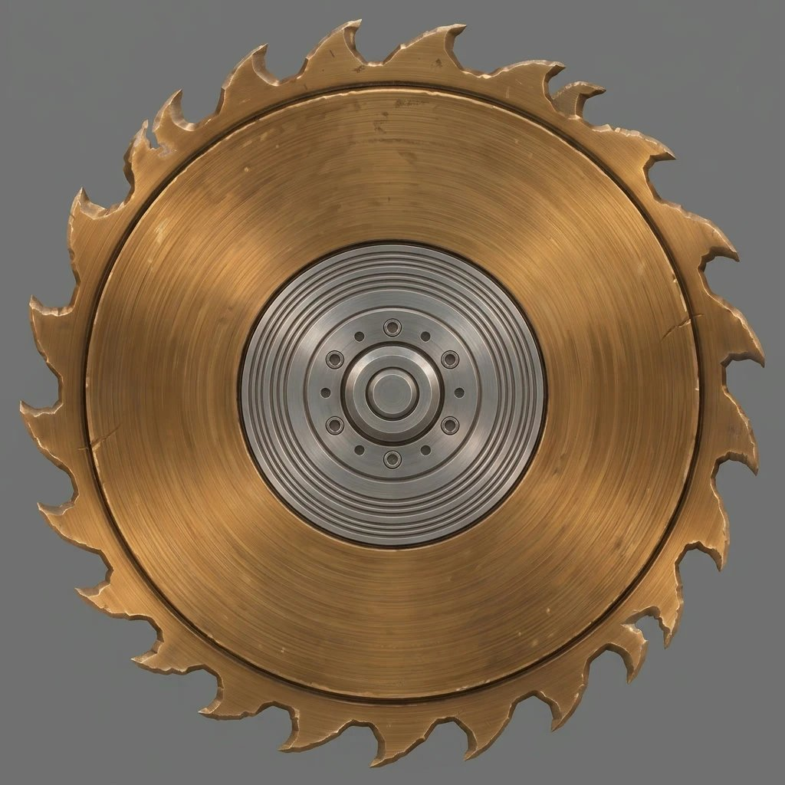</a> |

**Prompt(逐字):**
```text
From the attached image, extract ONLY the circular saw blade and present
it as a complete, isolated game prop. IGNORE everything else: the floor,
the rail slot, the spikes and the hall.

COMPLETE THE DISC: in the source, the lower half of the blade is hidden
inside a floor slot. Show the FULL circular blade. Complete the hidden
lower half by rotational symmetry of the visible upper half: the same
tooth shape and spacing continue all the way around; the bronze outer
disc, the grooved steel inner ring and the bolted hub are full circles.
Do not invent any new parts, engravings or decorations.

VIEW: true head-on FRONT view — the blade face is perpendicular to the
camera and reads as a perfect circle, not an ellipse. Render in TRUE
ORTHOGRAPHIC PROJECTION: no perspective, no foreshortening, no lens
distortion, no tilt.

KEEP the real bronze and steel albedo — true colours and all surface
detail (machining rings, scratches, bevels, bolt heads); do NOT turn it
into grey clay. DE-LIT it: remove all baked-in lighting — no key light,
no shadow side, no strong specular streaks, no warm torch glow. Light it
ONLY with perfectly even, flat diffuse studio lighting. No cast shadows,
no rim light.

Centered on a flat neutral grey (#808080) seamless background, the full
blade filling about 80% of the frame, nothing cropped. Clean de-lit
albedo reference plate for image-to-3D.
```

- `COMPLETE THE DISC ... by rotational symmetry`:半埋物件補完整圈的關鍵句(本案新增鎖句「旋轉補全」)。
- `do NOT turn it into grey clay` + `DE-LIT`:去光但保留本色(concept→3D V2 的 de-lit 軌)。
- 結果:正圓、去光都成功;**但齒數 / 齒距仍不規則、盤面中線有接縫** → 交給程式(A-3)。

**陷阱 A 電鋸的 AI 順序總結:** 第 1 次去動態 → 第 2 次細節 pass → 第 3 次正交抽取 → 之後全部交程式修幾何。
**程式修幾何一定排在最後**:任何一次 NB2 都會重畫鋸齒。

## A-3. 程式修幾何(NB2 做不到的部分)

| NB2 原始(齒不等距、22~26 齒) | 24 齒等距(`radial_teeth.py`) | 去接縫 + 溝線正圓(`disc_seam_circle.py` + `hub_symmetry.py`) |
|---|---|---|
| <a href="images/a13-04-saw-ortho-raw.jpg"></a> | <a href="images/a13-05-saw-24teeth.jpg">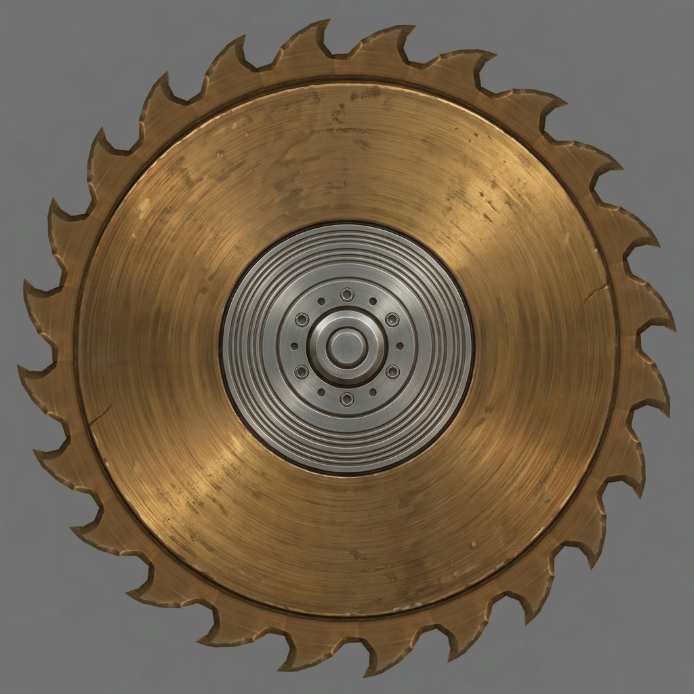</a> | <a href="images/a13-06-saw-seam-fixed.jpg"></a> |

| 上下鏡射(盤面鏡射、鋸齒不翻) | 中心鐵圈正圓(透明底,`hub_round_rgba.py`) |
|---|---|
| <a href="images/a13-07-saw-mirror.jpg"></a> | <a href="images/a13-08-saw-hub-round.png">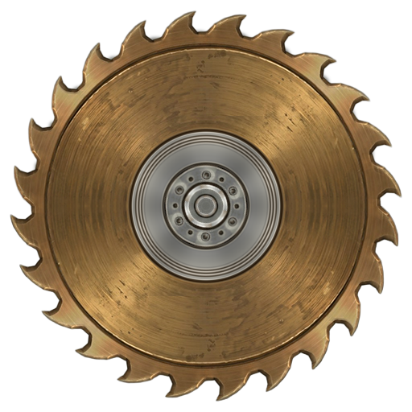</a> |

- **齒數**:量圓心 → 量出各齒間距(實測 14.5°~22.5°)→ 挑最好的一顆、縮到 15° → 環形複製 24 份;中間盤面原像素不動。
- **接縫**:NB2 常在水平中線留一條拼接痕;盤面是同心紋 → 用旋轉 ±9° 的樣本覆蓋接縫帶。
- **正圓**:逐角度量溝線半徑(396~401px)→ 徑向分段線性拉到平均半徑。
- **中心軸**:6 螺栓 + 6 孔 = 60° 對稱 → 取一塊乾淨扇形複製 6 份。
- **鏡射時鋸齒不要翻**:鋸齒有旋轉方向,整張鏡射會讓下半圈齒鉤反向(B 版踩坑)。

## A-4. 側面 / 光澤 / EnvCube

- **側面**:圖上沒有厚度資訊 → 程式畫「側面幾何導引圖」(厚度、凸出量用設定值)當 ref 1,正面成品當 ref 2 上材質。
- **光澤放哪**:見下方〈鋸齒可以保有金屬光澤感嗎〉。

### 鋸齒可以保有金屬光澤感嗎?(使用者提問)

**先看用途,光澤放的位置剛好相反:**

| 用途 | 光澤從哪來 | 貼圖怎麼做 |
|---|---|---|
| 給 image-to-3D / 建模 | 引擎材質參數(Metallic 1、刃口 Roughness 低)+ 打光 / EnvCube | **保持平光 de-lit**;光澤烘進貼圖 → 引擎再打一次光 = 雙重高光(髒、假) |
| 給 2D 直接貼 | 直接畫進圖裡 | 跑光澤 pass(下方) |

**順序很重要:先上光澤 → 再交程式排齒。** NB2 跑任何一次都會重畫鋸齒,24 齒等距一定跑掉;光澤 pass 後挑一顆光澤最好的齒,再用程式複製成 24 齒等距,每顆齒高光一致。

**第一版光澤 prompt(左上固定光源,適合靜態擺設):**
```text
Keep this exact saw blade — same shape, same teeth, same hub, same
framing. This is a MATERIAL / LIGHTING pass only: do NOT redraw the
silhouette.

Give the saw teeth a polished, bright metallic finish:
- each tooth has a freshly ground cutting edge — a thin, crisp, bright
  specular line along the front face and tip of every tooth
- a narrow bevel band along the outer edge of the tooth ring, catching
  light like sharpened steel
- the tooth faces show a subtle brushed-metal sheen, brighter than the
  disc face, with a soft gradient from the tip to the gullet
- keep the bronze colour of the teeth; highlights lean pale gold to
  near white

Lighting: one soft key light from the upper left. The highlights fall
consistently on the upper-left-facing edges of each tooth. The disc
face and the steel hub keep their current finish, with only a gentle
matching sheen.

Stylized AAA game asset rendering, crisp and clean. Same flat neutral
grey background (#808080). No glow, no lens flare, no sparks, no
reflections of an environment, no new parts.
```

**使用者選「給 2D」後的修正:電鋸會旋轉 → 光澤拆兩層。**
固定方向的光(左上亮)跟著鋸片轉,亮點繞圈 = 一眼看穿是假的。

| 層 | 內容 | 旋轉時 |
|---|---|---|
| ① 鋸片本體 | 每顆齒光澤完全一樣、**無光源方向**(例:刃口亮線) | 跟著轉,不穿幫 |
| ② 高光疊層 | 固定方向的反光帶 / 刃口小閃光,單獨一張透明圖(Screen / Add 疊) | **不轉**,固定原位 |

24 齒等距版本來就每齒一致,剛好適合第 ① 層。

**第二版光澤 prompt(本體層,無方向,ref 1 = 24 齒等距版):**
```text
Keep this exact saw blade — same shape, same teeth, same hub, same
framing. This is a MATERIAL pass only: do NOT redraw the silhouette.

Give the saw teeth a polished, bright metallic finish that is IDENTICAL
on every tooth (radially symmetric — no light direction):
- every tooth has a freshly ground cutting edge: a thin, crisp, bright
  specular line along its front face and tip
- a narrow polished bevel band along the outer edge of the whole tooth
  ring
- the tooth faces show a brushed-metal sheen, brighter than the disc
  face, fading from the bright tip to a darker gullet
- keep the bronze colour of the teeth; edge highlights pale gold to
  near white

The disc face keeps its concentric brushed-metal rings with an even
sheen; the steel hub stays polished steel. No directional key light, no
cast shadows, no single bright side — all 24 teeth must look the same.

Stylized AAA game asset rendering, crisp and clean. Same flat neutral
grey background (#808080). No glow, no lens flare, no sparks, no new
parts.
```
**光澤 pass 結果:**

<a href="images/a13-57-saw-gloss-result.jpg">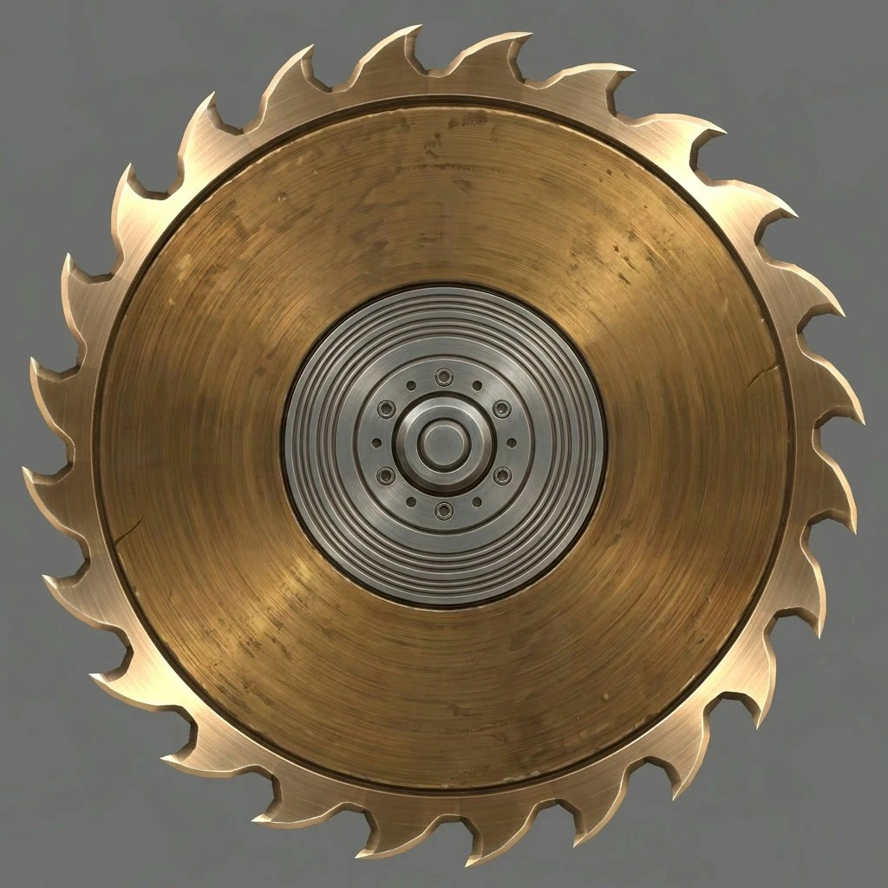</a>

刃口亮線、齒面拉絲光澤、盤面同心紋與鋼製中心軸都出來了;但齒數 / 齒距又被 NB2 重畫(驗證「先光澤、後排齒」的順序)。

跑完 → 程式挑光澤最好的齒重排 24 齒、去背;② 高光疊層由程式畫(沿弧形柔和亮帶 + 1~2 個刃口小閃光)。
若電鋸**不會轉**(靜態 / 只上下彈出)→ 不用拆層,用第一版左上光源更立體。

> 最後實際上線(Unity)走的是:**貼圖保持本色 + 不受光 shader 的 EnvCube 反射提供光澤**(見下)。

### EnvCube 建議(Unity 不受光 shader 的金屬光澤)

> 這個 shader 是**不受光(Unlit)**,金屬光澤只能靠 **EnvCube 反射**:環境貼圖畫什麼,鋸片就反射什麼。
> ⚠️ shader 行為是從面板標籤推測(未看原始碼),數值以實際畫面為準。

| shader 面板 | 匯入設定(Texture Shape = Cube) | 最後接上的設定 |
|---|---|---|
| <a href="images/a13-60-unity-shader-panel.jpg">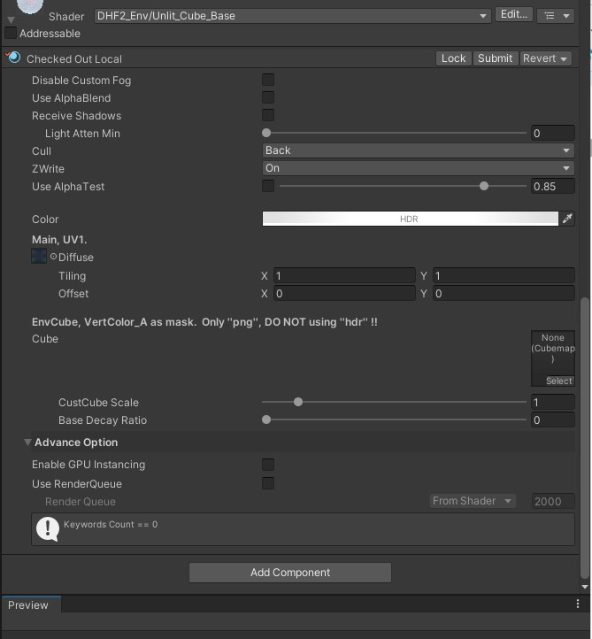</a> | <a href="images/a13-61-unity-cube-import.jpg">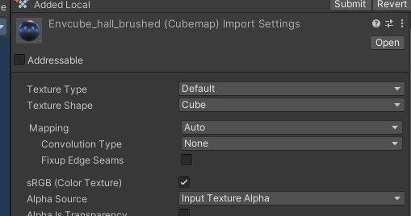</a> | <a href="images/a13-10-unity-envcube-setting.png">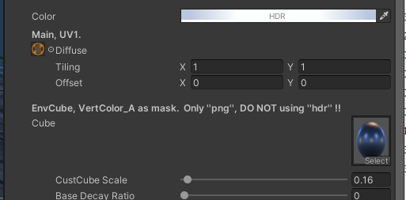</a> |

**1. 環境貼圖(程式依場景配色產生):** 上方暖色吊燈、兩側高處藍色彩窗、地平線一圈暖色火把、下方深石板地;鋸片反射的光會跟場景光源方向對得上。

| polished(亮面:中心鐵圈、刃口) | brushed(拉絲 / 霧面:銅盤,**推薦先用**) | brushed 1024 鏡面球版 |
|---|---|---|
| <a href="images/a13-58-envcube-polished.png"></a> | <a href="images/a13-09-envcube-brushed.jpg">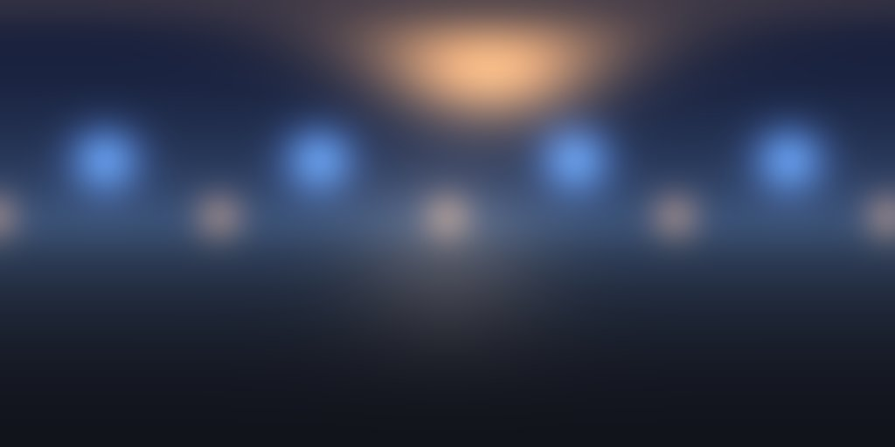</a> | <a href="images/a13-59-envcube-brushed-ball-1024.png">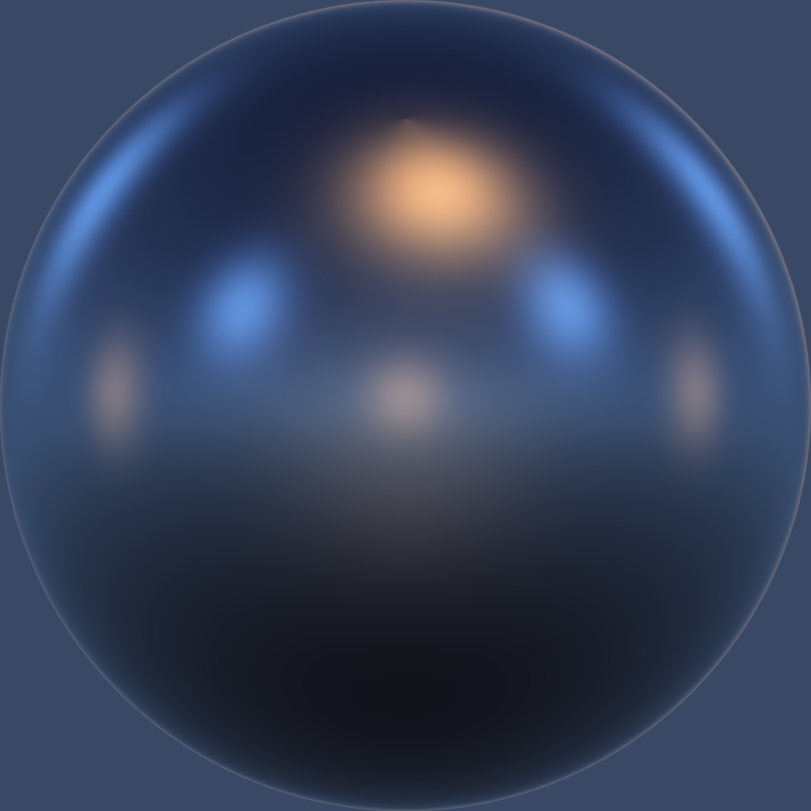</a> |

**2. 匯入設定(PNG 拖不進 Cube 欄位的解法):**

| 設定 | 2:1 經緯圖 | 1024 正方形鏡面球 |
|---|---|---|
| Texture Shape | **Cube** | **Cube** |
| Mapping | **Latitude-Longitude Layout (Cylindrical)** | **Mirrored Ball (Spheremap)**(一定要手選,Auto 可能判錯) |
| sRGB | 開 | 開 |
| Max Size | 256~512 即可 | 512~1024 |
| 其他 | 勾 **Fixup Edge Seams**(修 cube 面交界細縫) | 同左;球外四角無用、正後方解析度最低 |

→ 改完按 **Apply**,圖示變成一顆球就能拖進 Cube 欄位。面板寫的「Only png」是指來源檔用 PNG(不是 .hdr),不是 2D PNG 可以直接放。

**3. 切到這個 shader 就變亮?**
- 原因:**Cube 空著**(Unity 塞預設灰白環境)+ **CustCube Scale 1** + 模型**沒刷頂點色**(Alpha 預設 1 = 全反射)→ 整片疊灰白反射。
- 確認:把 **CustCube Scale 拉到 0**;恢復正常就是這個原因,接好環境貼圖後從 0.3 慢慢加。
- 還是偏亮:不受光 shader 不會被場景燈壓暗 → **Color(HDR)調灰 0.6~0.75**,或貼圖本身調暗。

**4. 用之前要注意:**
- **平面 quad 幾乎反射不出東西**:整面法線相同 → 反射一整片單色,繞法線旋轉也不變。EnvCube 要用在**有倒角的 3D 模型**;2D 平面的光澤改用「高光疊層」。
- **主貼圖用不帶光的版本**:Diffuse 已畫高光 + EnvCube 再加一層 = 雙重高光(髒)。
- **Color 要白色**(或為壓亮度調的灰);淡藍漸層會把本色整片染藍。

**5. 用頂點色 Alpha 控制哪裡反光(面板:VertColor_A as mask):**

| 部位 | Vertex Alpha | 效果 |
|---|---|---|
| 鋸齒刃口、中心鐵圈、尖刺稜線 | 1.0 | 最亮的金屬反光 |
| 銅盤面 | 0.4~0.6 | 柔和光澤 |
| 溝槽、螺栓孔 | 0~0.2 | 保持暗部 |

**6. 參數起點:**

| 參數 | 建議 | 說明 |
|---|---|---|
| CustCube Scale | 金屬 **0.3~0.6**(接上後起點 0.16 也可) | 1 以上暗部被沖淡、畫面發灰 |
| Base Decay Ratio | 先試 0.3 | 推測為「反射越強底色壓越暗」,以畫面為準 |
| 地板材質 | **0**(不反射)/ 0.1~0.2(潮濕微光) | 石板地不需要明顯反射;EnvCube 留給電鋸、尖刺等金屬 |

**7. 上線後的檢查與加分:**
- 轉視角看反射顏色會不會變;都不變 → 是平面法線問題。
- 電鋸接觸軌道處加一點**接地陰影**(blob decal 或在溝槽貼圖刷暗),比較像從槽裡冒出。
- 環境圖被壓成正方形的 2:1 圖:用 Latitude-Longitude 讀取時方向對應不受影響,只是水平解析度減半,可不動。

## A-5. 軌道溝槽 tile

### 第 1 步 — 擷取溝槽金屬構造(去動態 / 去角色 / 去鋸片)

**使用者發問:**
> 我裁切了局部來生成,去掉動態、去掉角色、去掉鋸齒陷阱,我要擷取陷阱溝槽的金屬構造,提升 Unreal 3A 遊戲精緻度,給我提示詞。

| 素材(局部裁切,約 14:1) | 結果(NB2) |
|---|---|
| <a href="images/a13-62-rail-src-crop.jpg">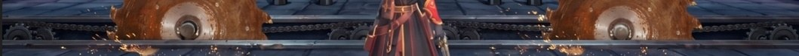</a> | <a href="images/a13-11-rail-gen.jpg"></a> |

**Prompt(逐字,ref 1 = 局部裁切):**
```text
REPAINT this crop as a clean, STATIC environment asset at Unreal Engine
5 AAA quality: the recessed metal trap channel set into the stone floor.
Same camera, same composition, same scale.

REMOVE COMPLETELY (paint what is behind them, nothing new):
- the circular saw blades
- the character
- all sparks, embers, dust, smoke and motion blur
Where they are removed, CONTINUE the channel mechanism exactly as it
appears in the visible parts: the same chain, the same gear sprockets at
the same regular spacing, the same rails.

THE CHANNEL (keep its exact position, height and perspective):
- a long horizontal recessed slot in the floor, dark inside, with soft
  ambient occlusion deep in the trench
- a heavy roller chain running along it: individual links and pins
  clearly readable, oiled dark steel with worn bright edges
- toothed gear sprockets at regular intervals: machined steel, crisp
  teeth, a hub with bolts, subtle wear on the tooth tips
- a polished steel rail lip along the top edge of the slot with a crisp
  edge highlight, scratches and small chips; bolted brackets at regular
  intervals
- worn stone floor slabs above and below with chipped edges

LIGHTING: steady and static — cool blue ambient from the hall, a soft
warm bounce from torches, crisp specular highlights on metal edges,
strong contact shadows where the chain meets the sprockets.

STYLE: stylized AAA game environment art with Unreal Engine 5 material
quality — clean PBR-like metal and stone, hand-crafted texture detail,
NOT photorealistic, NOT a blurry painting.

FRAME LOCK: same framing — do NOT crop, zoom, extend or outpaint.
STRICT: no saw blades, no characters, no sparks, no glow, no new
objects, no text.
```

**結果:**
- ✅ 鋸片、角色、火花全部移除,被擋住處的鏈條與齒輪補得連續完整。
- ⚠️ 齒輪一大一小交錯,但**間距不平均**(約 300 / 360 / 375 / 280px)。
- ⚠️ 輸入是 14:1 扁長裁切 → 輸出**上下大片白邊**(B1 白邊坑);這次模型沒去動白邊算運氣好,下次輸入要滿版。
- 之後使用者決定**不要齒輪、只要金屬條溝槽** → 程式重建「空溝槽」版(下表),再改走正交上視(下方 prompt)。

### 第 2 步 — 「我只需要金屬條溝槽,不需要齒輪」

**使用者發問:**
> 我只需要金屬條溝槽,不需要齒輪。

**做法(程式,不再跑 NB2):** 先把第 1 步結果切成一段可橫向無縫重複的 tile(716×113,自相關找重複長度,切口落在鏈條段、淡入淡出 16px),再把齒輪拿掉,做兩個版本:

| A 保留鏈條 | B 空溝槽(**採用**) |
|---|---|
| <a href="images/a13-63-rail-chain-tile-x3.jpg">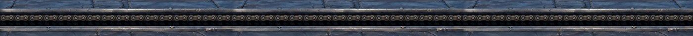</a> | <a href="images/a13-12-rail-empty-tile-x3.jpg"></a> |
| 從無齒輪的乾淨段取一組鏈節(44px,一長一短),重複 16 次排滿,每組 44.75px,頭尾剛好接成完整鏈節 | 取乾淨段「溝槽由上到下」的明暗剖面,鏈條列用上下暗色補平,加極淡雜訊避免死平色塊 |

- 上下金屬條與地磚**保持原樣**,只改溝槽內部。
- 第一次做 B 版時,剖面取到齒輪區、出現直條紋 → 改成只取乾淨段 + 可循環雜訊後修正。
- 限制:高度只有 113px(要清楚用 Universal Upscaler 2~4×、最低 creativity,**不要回 NB2**);金屬條上的釘頭與髒污每 716px 重複一次。
- 使用者選 **B 版**,接著要求「上視圖當貼圖,到 3ds Max 製作」→ 第 3 步。

### 第 3 步 — 正交上視圖(要拿到 3ds Max 當貼圖)

**使用者發問:**
> 我要用 B(空溝槽)。拆掉這張概念圖 / concept→3D / 三視圖重建:我要上視圖當貼圖,到 3ds Max 製作。

**輸入處理:** B 版是 716×113(約 6:1),NB2 輸出不了這麼扁 → 程式從中挑一段細節最多的 **2:1 區塊、放大成 1024×512 滿版**(無白邊)。Dimensions 選 2:1。

| 素材(2:1 滿版裁切) | 結果(NB2 正交上視) |
|---|---|
| <a href="images/a13-64-rail-top-input-2x1.jpg">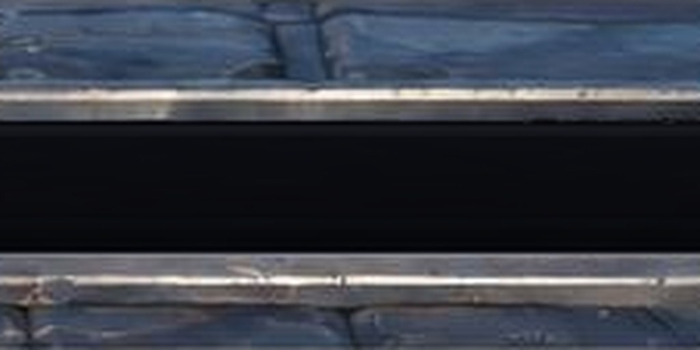</a> | <a href="images/a13-65-rail-top-result.jpg">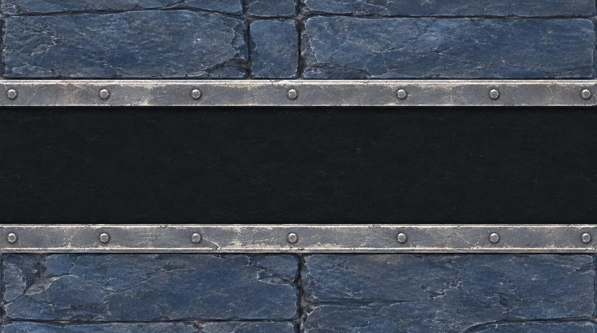</a> |

**Prompt(逐字,ref 1 = 2:1 滿版裁切):**
```text
Re-render this crop as a TRUE TOP-DOWN ORTHOGRAPHIC view, looking
straight down at the floor — a flat texture for a 3D model. IGNORE the
source's camera angle: no perspective, no foreshortening, no visible
vertical side faces, no vanishing point.

CONTENT (same materials, same layout from top to bottom):
- worn blue-grey stone floor slabs along the top and bottom edges
- two parallel steel edge strips (the top flanges of angle iron) running
  horizontally, each with bolt heads at regular intervals, scratches,
  chipped edges and a crisp bevel line on both long edges
- between them, the open channel: an even, near-black dark strip
The two steel strips are identical in width, perfectly straight and
parallel, running edge to edge across the image.

TEXTURE RULES: everything runs perfectly horizontal; the left and right
edges must continue seamlessly. Even, soft top-down lighting only — no
directional key light, no cast shadows, no rim light; keep the same
cool blue-grey stone and steel colours as the source.

Stylized AAA game environment texture, Unreal Engine 5 material quality,
crisp hand-crafted detail, NOT photorealistic.
STRICT: no gears, no chain, no saw blades, no new objects, no text.
```

**結果:**
- ✅ 真正正俯視:看不到側面、金屬條平行等寬、上下石板也轉成俯視。
- ✅ 解析度大幅提升(素材是 113px 高的低解析條,結果是清楚的手繪石板 + 鉚釘鋼條)。
- ⚠️ 螺栓間距不完全一致(約 213 / 212 / 221 / 252px)→ 第 4 步交程式。
- `IGNORE the source's camera angle` + `no visible vertical side faces`:否定來源斜角的關鍵句(concept→3D 正交鎖)。
- `two steel strips are identical in width, perfectly straight and parallel`:給 3ds Max Sweep 斷面對齊用。

### 第 4 步 — 程式切 tile + 變化型

**使用者 PS 裁切後的圖(石板拿掉、溝槽縮窄):**

<a href="images/a13-66-rail-top-ps-crop.jpg">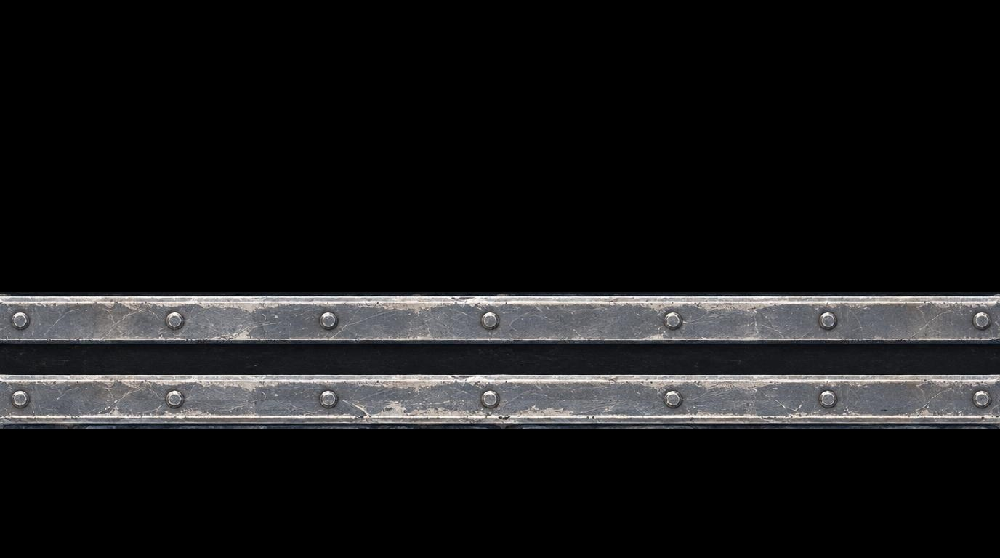</a>

**使用者發問:**
> 我已經得到結果,我想把這張調整成 tile 貼圖。

**做法:**
- 上圖當時沒有傳進對話(檔案未收到)→ 以第 3 步的 NB2 正交上視原圖,**照上圖版面重建**:只留「上金屬條 / 中間窄黑溝槽 / 下金屬條」三帶(石板拿掉),溝槽從 NB2 原本的寬黑帶縮成窄帶。
- 量出原圖螺栓間距(約 213 / 212 / 221 / 252 / 213 / 212px,中間兩段特別寬)→ **只取間距規則的兩段**(各 2 顆螺栓),切口在兩顆螺栓正中間、淡入淡出 30px 接成一組。
- 輸出:`rail_top_tile.png`(850×189)與 `rail_top_tile_1024.png`(1024×228);一張 4 顆螺栓、間距 212~213px,重複接起來也一致;另出 x3 預覽檢查接縫。
- Max 用法:貼金屬條頂面,U 方向重複、V 不重複;Sweep 勾 Real-World Map Size,貼圖寬 = 4 顆螺栓的實際長度(例:螺栓間距 25 cm → 貼圖寬 100 cm);Sweep 斷面照貼圖由上到下比例(上金屬條 68px / 溝槽 46px / 下金屬條 75px)。
- 若要照使用者自己調整過的版本重做(例如溝槽寬度不同),上傳該檔即可用同方法重切。

| 上視 tile(螺栓固定 212.5px 間距,x3 預覽) | 4 變化型 + 端頭互拼檢查 |
|---|---|
| <a href="images/a13-14-rail-top-tile-x3.jpg">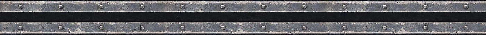</a> | <a href="images/a13-15-rail-variants-join.jpg"></a> |

**使用者整合進 atlas 的版本(上:端頭版、下:中段 tile,512×256):**

<a href="images/a13-67-rail-atlas-before-variants.jpg">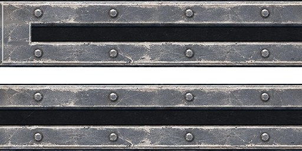</a>

**使用者發問:**
> 幫我做變化型,現在 tile 有點明顯。

- **變化型共用接縫**:每顆螺栓連同前後半段切成單元(5 種)、每張挑 4 個重新排列 / 部分左右翻轉,上下金屬條各用不同排法;所有變化型左右邊緣換成同一段共用接縫 → **任意順序互拼都無縫**。
- 尺寸對齊使用者 atlas(512×114,螺栓在 x = 64 / 192 / 320 / 449);端頭版只改右邊 18px 讓它能接任一變化型;另出 512×512 atlas(端頭 + V1~V3,每列間隔 128px)。
- 第一次做時取整數座標造成每隔一格暗帶,改成連續座標取樣修正。
- Max 用法:長溝槽拆段,每段 UV 對到不同列(端頭 → V2 → V1 → V3 …);V4 放不下可把某段 UV 左右翻轉(同樣無縫)、另一端端頭用 UV 鏡射。

- 3ds Max:Sweep 斷面照 tile 由上到下比例(上金屬條 / 溝槽 / 下金屬條),勾 Real-World Map Size,貼圖寬 = 4 顆螺栓實際長度;端頭另一端用 UV 左右鏡射。

**拆法(使用者定案)**:電鋸只存**上半圓**,UV 上下鏡射;軌道只存**一端端頭 + 中段**,另一端 UV 左右鏡射、中段排變化型。

---

## A-6. 陷阱 A 貼圖完稿(使用者整合)

| ① 軌道 atlas(程式 tile 版) | ② 軌道 atlas 完稿(使用者調色) | ③ 陷阱 A 總 atlas |
|---|---|---|
| <a href="images/a13-67-rail-atlas-before-variants.jpg"></a> | <a href="images/a13-68-rail-atlas-final.jpg">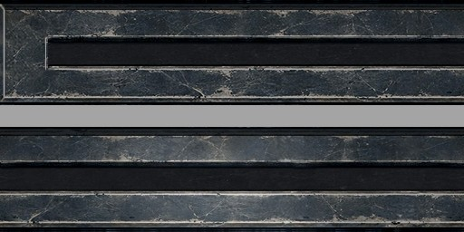</a> | <a href="images/a13-16-trapA-atlas.png"></a> |
| 上:端頭版、下:中段 tile;銀灰鋼、亮鉚釘 | 拿掉鉚釘、壓暗成深藍灰舊鋼,邊緣保留細亮高光線;中間灰條為分隔 | 上半:上半圓鋸片(UV 上下鏡射);下半:②的軌道 |

**Unity 上線畫面(不受光 shader + EnvCube):**

| 正面(鋸片完整圓,上下鏡射) | 斜角(鋸片從軌道冒出,軌道長距離鋪排) |
|---|---|
| <a href="images/a13-69-trapA-unity-front.jpg">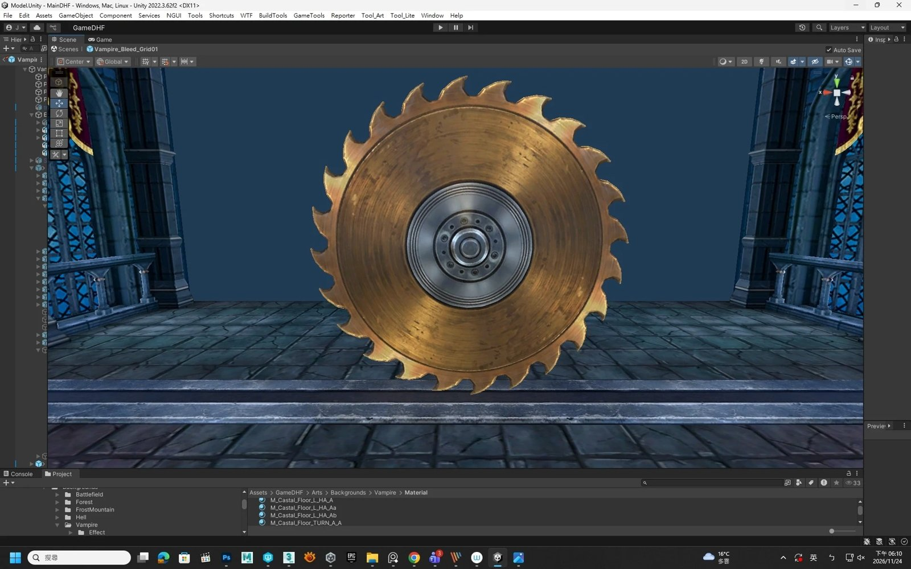</a> | <a href="images/a13-70-trapA-unity-angle.jpg">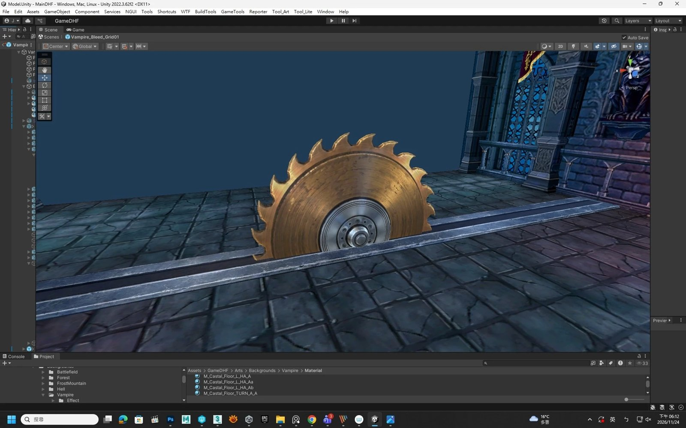</a> |

- 正面:上下鏡射的中線看不出接縫,24 齒節奏平均;EnvCube 讓刃口帶暖金反光、盤面有拉絲光澤。
- 斜角:軌道深藍灰與地板石板同色調,長距離鋪不見明顯重複;鋸片與軌道交界可再加接地陰影。

- **鉚釘拿掉**:鉚釘是 tile 重複感最明顯的來源;拿掉後中段可長距離鋪,不必靠大量變化型。
- **調色對場景**:銀灰亮鋼 → 深藍灰舊鋼,與地板石板同色調;刃口式細亮線保留,讓 EnvCube 反射有地方落。
- **一張 512 atlas、一個材質球**畫完整個陷阱 A(鋸片上半圓 + 軌道端頭 + 中段)。
- ⚠️ 列與列之間的灰色分隔條:縮圖(mipmap)時可能滲進相鄰列邊緣 → 建議改成延伸各列邊緣色(padding),或 UV 每列內縮 1~2px。

---

# 🟢 陷阱 B — 伸縮尖刺 + 固定底座環

## 流程總覽

```
概念圖裁切 → (造型探索:一段式 / 簡化 / 古銅復古)→ 使用者 NB2 鏈:優化 → 拿掉飾釘 → 舊化
      → 調性 pass(對齊 Unity 場景 + 電鋸 atlas)
      → 拆兩件:紅圈尖刺(會伸縮)/ 藍圈底座環(固定,要補圖)— 程式先依畫圈切開再生成
      → 底座環:程式畫正八邊形導引 → NB2 paint-over → 程式拆頂面/側面貼圖
      → 尖刺:3ds Max 描底圖 Lathe(8 邊)→ 扇形 UV
      → 程式從 OBJ 算真正交底稿 → NB2 依底稿上色(失敗→修正 pass→PS 合成)
      → 程式烘進扇形 UV(每面取自中間面、側面跳過 V 字、側面壓暗、4K)
      → 使用者手修 → 程式古銅轉銀色(保留環境藍紫)→ Unity
```

| 裁切 | 一段式(程式拉直) | 使用者 NB2 造型鏈 | 調性對齊場景後 |
|---|---|---|---|
| <a href="images/a13-20-spike-crop.jpg"></a> | <a href="images/a13-22-spike-onepiece.jpg">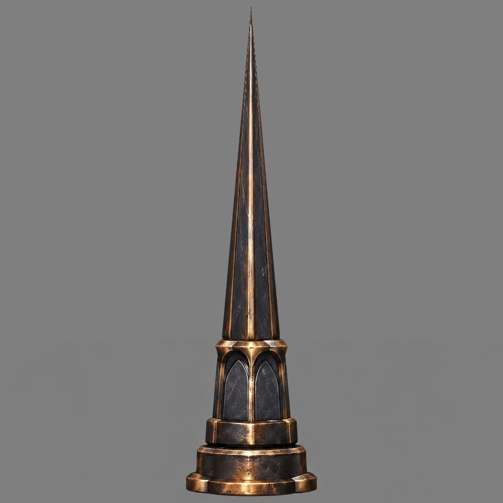</a> | <a href="images/a13-23-spike-design-chain.jpg"></a> | <a href="images/a13-31-spike-restyled.jpg"></a> |

## B-1. 紅圈 / 藍圈拆件:先用程式切開,再生成

| 使用者畫圈 | 程式切出:紅=尖刺 | 程式切出:藍=底座(擋住處填灰待補) |
|---|---|---|
| <a href="images/a13-24-spike-mark-red-blue.jpg">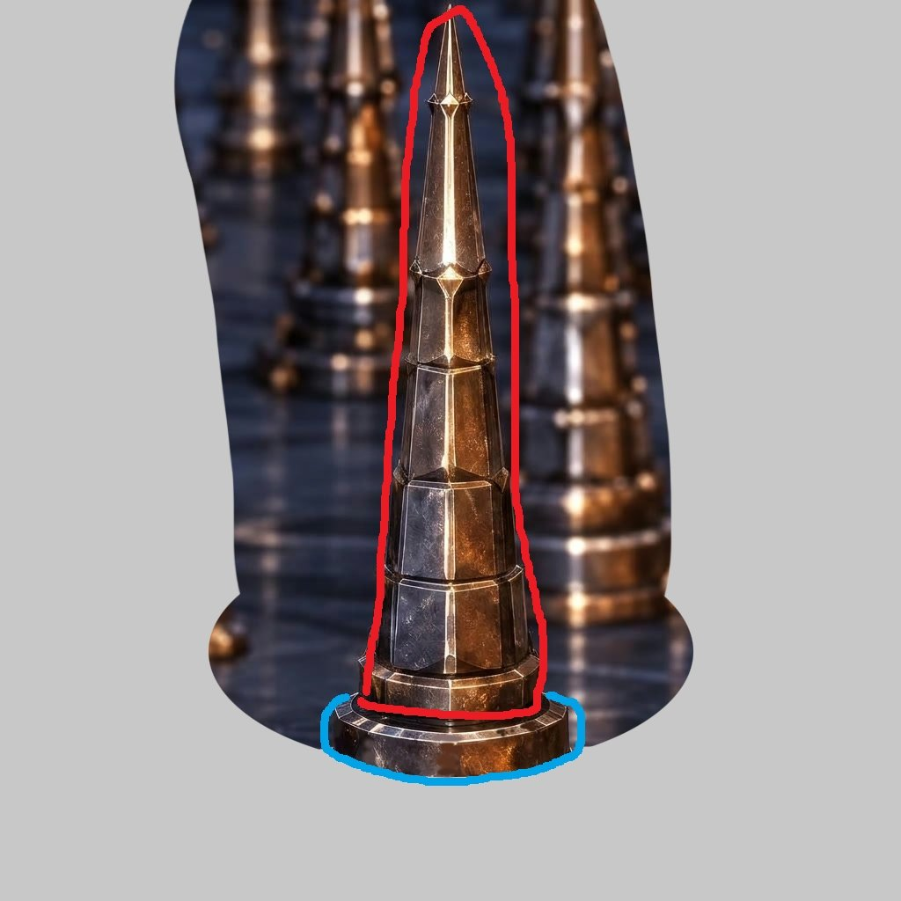</a> | <a href="images/a13-25-masked-red.jpg">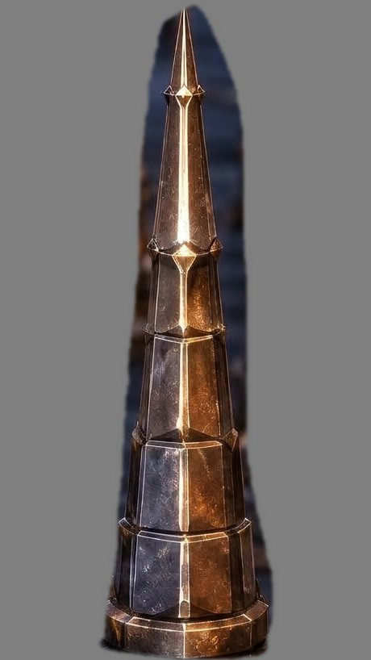</a> | <a href="images/a13-26-masked-blue.jpg"></a> |

只靠「紅圈 / 藍圈」文字讓 NB2 分界 → 兩次都失敗(尖刺帶進底盤、底盤被重新設計成藍鋼八角板)。
**改成每張輸入只留一個部件,prompt 只給這一張**,一次成功。

藍圈補圖 prompt:
```text
This image shows the FRONT part of a round, low base ring seen from a
slightly elevated angle. The grey area above it is where an object used
to stand. COMPLETE the ring: continue its rim around the back so it
becomes one full closed ring, keeping exactly the same shape,
thickness, perspective, bronze-and-dark-metal material and polished
edge highlights as the visible front part.
The center of the ring is an OPEN DARK HOLE going down into the floor:
near-black inside, with the inner wall of the ring visible at the back.
It is a hole, NOT a solid top, and nothing stands in it. ...
```

## B-2. 底座環:「八邊形」要用導引圖,不能用文字

| 文字寫 octagonal → 出 12 邊 | 程式畫正八邊形導引(角朝前、對齊尖刺稜線) | NB2 paint-over 成功 | 程式拆出頂面正俯視 |
|---|---|---|---|
| <a href="images/a13-27-ring-fail-12gon.jpg"></a> | <a href="images/a13-28-ring-octa-guide.png">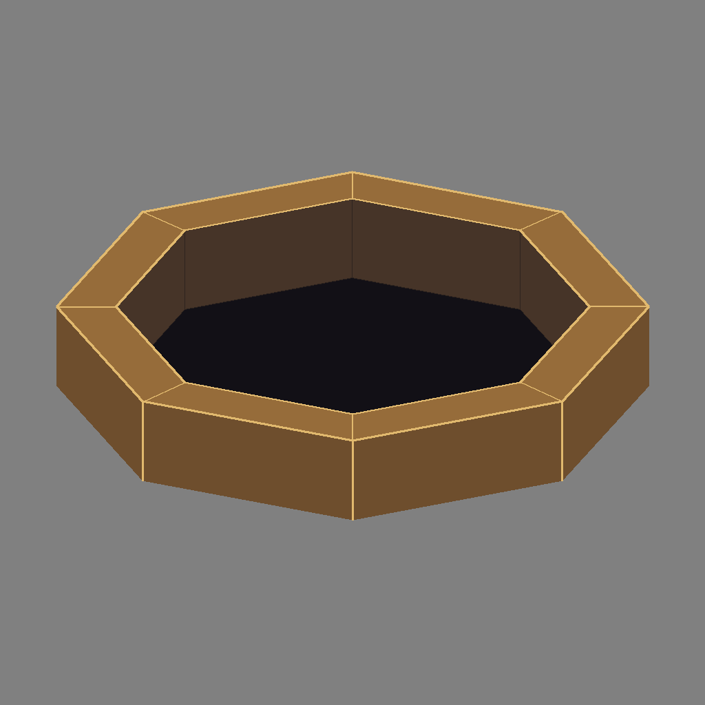</a> | <a href="images/a13-29-ring-octa-result.jpg"></a> | <a href="images/a13-30-ring-top-view.jpg"></a> |

```text
Image 1 (FIRST) = the EXACT geometry: a REGULAR OCTAGONAL ring — exactly
8 equal straight sides, one corner pointing straight at the viewer.
Keep its outline, the number of sides, the corner positions, the wall
height, the rim width and the camera angle EXACTLY. Do NOT round it,
do NOT add more sides. This is a PAINT-OVER of Image 1 only.
Image 2 (SECOND) = the material and style reference. ...
The center is an OPEN DARK HOLE ... It is NOT see-through ...
```
成品疊回導引幾何驗證 8 角都對上 → 程式反投影拆出**頂面(8 段旋轉複製)**與**側面單片**。
Max:Tube Sides=8、取消 Smooth、內徑 = 外徑 × 0.8、轉 22.5° 讓角朝前。

## B-3. 尖刺:建模 → 扇形 UV → 烘貼圖(本案最長的攻關)

| 增高 1.5×(底座不拉) | 使用者扇形 UV | 第一版投影:金邊掉到牆面(V 字透視) |
|---|---|---|
| <a href="images/a13-32-spike-tall.jpg"></a> | <a href="images/a13-33-model-fan-uv.png"></a> | <a href="images/a13-34-bake-misaligned.png">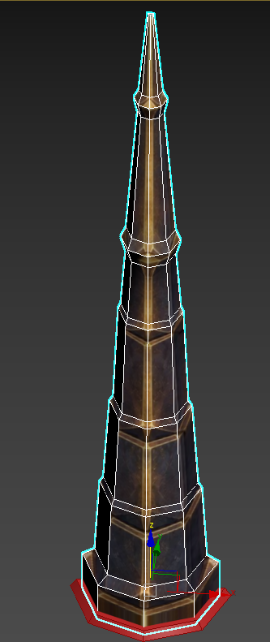</a> |

**根因**:AI 畫的「正面圖」其實是略俯視 → 每節頂邊是 V 字。投影到水平邊的模型必然錯位。
**解法:從使用者的 OBJ 算出真正正交的形狀底稿**,讓 NB2 照底稿上色。

| 程式從 OBJ 算的正交底稿 | 疊上使用者截圖輪廓(紅線)驗證比例一致 | 修正 pass + PS 合成後的正交圖 |
|---|---|---|
| <a href="images/a13-35-ortho-guide-from-model.png"></a> | <a href="images/a13-36-guide-vs-model-overlay.png">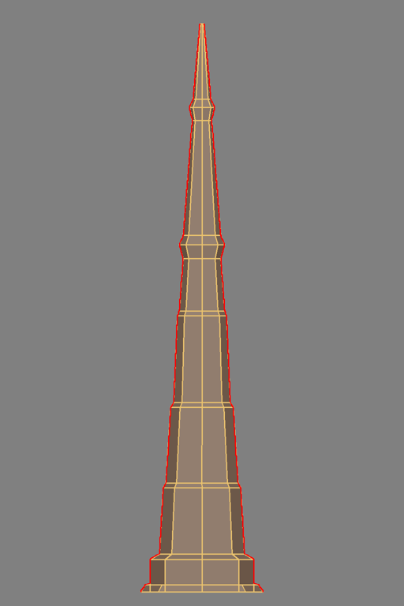</a> | <a href="images/a13-37-ortho-fix-ps-composite.jpg"></a> |

**底稿上色時不要給有透視的參考圖**(會把立體角度一起學走,B9 同理)。最後有效的是「修正 pass」——
拿接近正交的成品當唯一輸入,把錯誤逐條點名:
```text
Keep this exact spike — same outline, same width and height of every
tier, same position, same material, same colours. This is a CORRECTION
pass to make it a perfect FRONT ORTHOGRAPHIC ELEVATION. Change ONLY
the tier junctions and the base:
1. Every tier junction becomes ONE PERFECTLY STRAIGHT HORIZONTAL LINE
   across the whole width — no dip or point at the center ridge, no
   V-shape, no diamond or arrow shape where the vertical ridges meet
   the junction. The vertical ridge simply ends at the horizontal line.
2. NO visible top surface on any tier step: remove the thin lit band
   or ledge at each junction. Seen exactly from the side, a step is
   only a straight horizontal line where the width changes.
3. The base: its top edge is a straight horizontal line with NO
   visible top face or slanted rim. Its bottom edge is also straight
   and horizontal.
Each tier is a flat-sided trapezoid in this view: straight sides,
straight horizontal top and bottom. The camera is exactly level — it
does NOT look down at all. ...
```
**正交矯正實錄(使用者執行:提示詞兩輪 + PS)**——AI **不是畫不出正交,而是一次畫不到位**:

| ⓪ 原圖(略俯視,交界 V 字) | ① 正交抽取 prompt 重算 | ② 修正 pass 重算 | ③ PS 合成定稿 |
|---|---|---|---|
| <a href="images/a13-51-ortho-r0-src.jpg">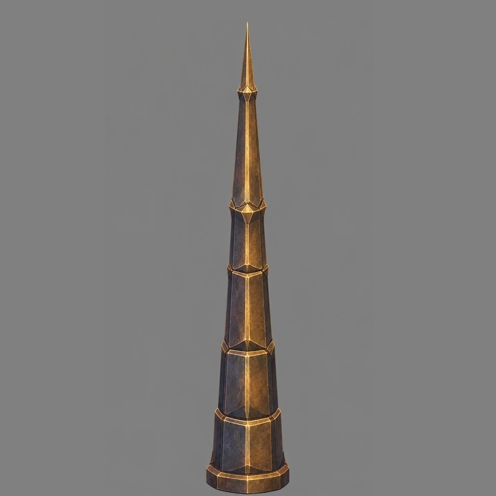</a> | <a href="images/a13-52-ortho-r1-prompt.jpg">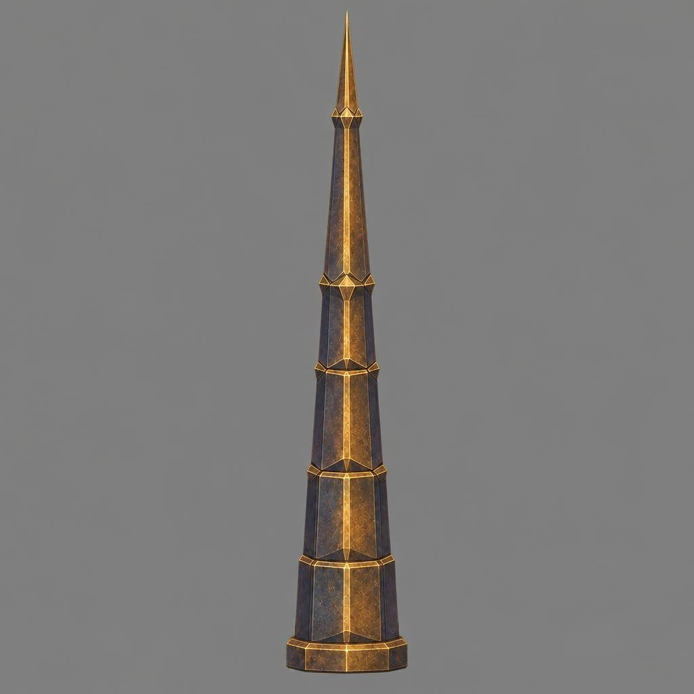</a> | <a href="images/a13-53-ortho-r2-correction.jpg">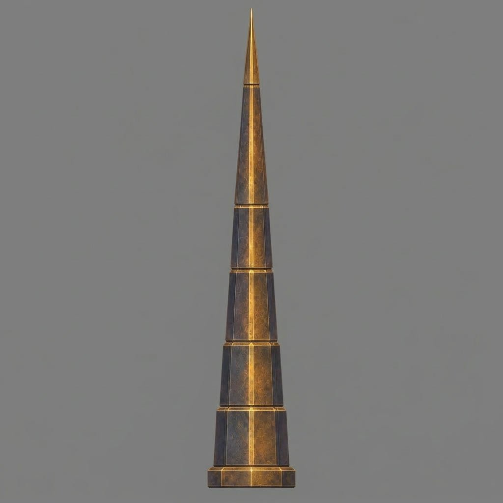</a> | <a href="images/a13-37-ortho-fix-ps-composite.jpg"></a> |
| 有透視 | 透視大幅減少,但交界仍有小 V 字、可見台階頂面 | 交界全部水平 ✅,但**凸環造型被簡化掉** ❌ | 交界取 ②、凸環 / 尖頂取 ① → 定案 ✅ |

- ① 用〈③ 正交抽取〉prompt(image-grounded + 正交鎖 + 點名否定來源俯角),ref 只給原圖。
- ② 用上方〈修正 pass〉prompt,ref 只給 ①。
- **教訓:矯正越強、細節越被吃掉**(② 把凸環當成「台階頂面」一起拉平)→ 不要追求一輪到位,**兩版各取所長在 PS 合成**最快。


**烘貼圖(`bake_front_to_uv.py`)**——不改使用者 UV:

| v5 預覽:左 v4、中 v5 正面、右 轉 40° | v4 的側面三角形 bug | 古銅 → 銀色(加強藍紫) |
|---|---|---|
| <a href="images/a13-38-bake-v5-preview.png"></a> | <a href="images/a13-39-side-triangles-bug.png"></a> | <a href="images/a13-40-silver-cmp.png">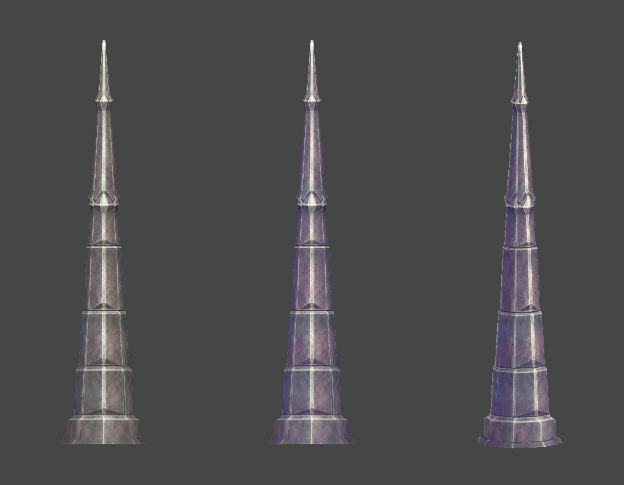</a> |

1. **逐節對高度**:量正交圖每節交界列,對應模型每圈頂點高度(分段線性),寬度也照每節輪廓。
2. **防拉扯**:正面投影時兩側面被壓到 cos67.5°≈0.38 → 拉長 2.6 倍。改成**每個面先旋轉到最近的中間面再取色**,8 面都是正面取色。
3. **側面壓暗**:全部取自最亮的中間面會整支一樣亮 → 量原圖側面/中間亮度比(R0.69 G0.73 B0.88)套到側面。
4. **側面跳過 V 字**:中間面每節底部畫了橫跨兩面的 V 字,側面取色時跳過那一帶,否則出現多餘三角形。
5. **解析度**:扇形 UV 只佔貼圖 27% 高度 → 1024 時細節被壓 5 倍;改烘 4096(長期解:UV 填滿 0~1)。
6. **古銅 → 銀色(`bronze_to_silver.py`)**:Lab 空間只減掉古銅色軸(保留 12% 暖光),正交的藍紫環境色保留並在中暗部加強 1.8 倍;高光保持中性(避免偏綠)。

### B-4. 底座頂面貼圖(使用者自行產出的路線)

> B-2 的八角環是**斜角立體圖**(拆頂面/側面用);實際貼在底座頂面的「正俯視古銅八角環」是使用者另外跑的一條 NB2 鏈。
> ⚠️ 第 2、3 輪 prompt 原文未留存,以「輸入 → 意圖 → 結果」記錄;第 1、4 輪附逐字 prompt。

| 輪 | 輸入(ref) | 意圖 | 結果 |
|---|---|---|---|
| 1 | 尖刺原圖 + 電鋸 atlas(軌道鋼條當材質) | 正俯視八角底盤,中間暗洞(prompt 見下) | <a href="images/a13-45-plate-r1-topdown-steel.jpg">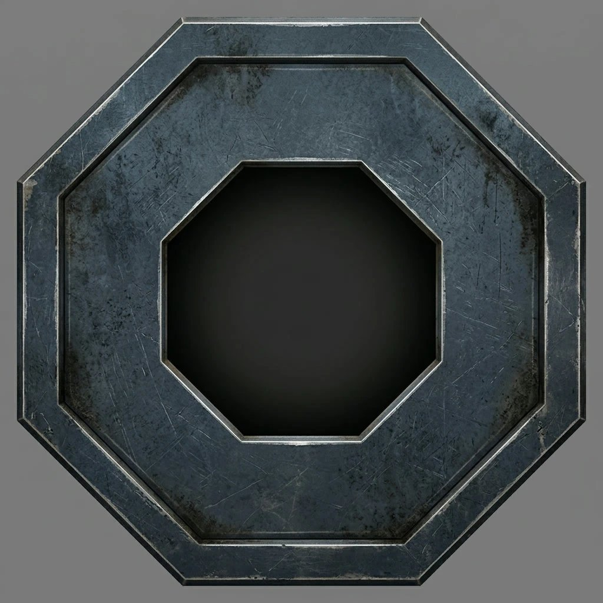</a> 藍鋼、暗洞 ✅、單層邊框 |
| 2 | 斜角立體藍鋼八角板(B-1 的失敗品) | 「給我正交上方視角」— 拿立體版轉正俯視 | <a href="images/a13-47-plate-r2-topdown.jpg"></a> 正交 ✅,但洞**透出灰底**、多一圈凸起內框 |
| 3 | 第 2 輪結果 + 古銅 12 邊環(色票) | 換成古銅材質 | <a href="images/a13-48-plate-r3-bronze-seethrough.jpg">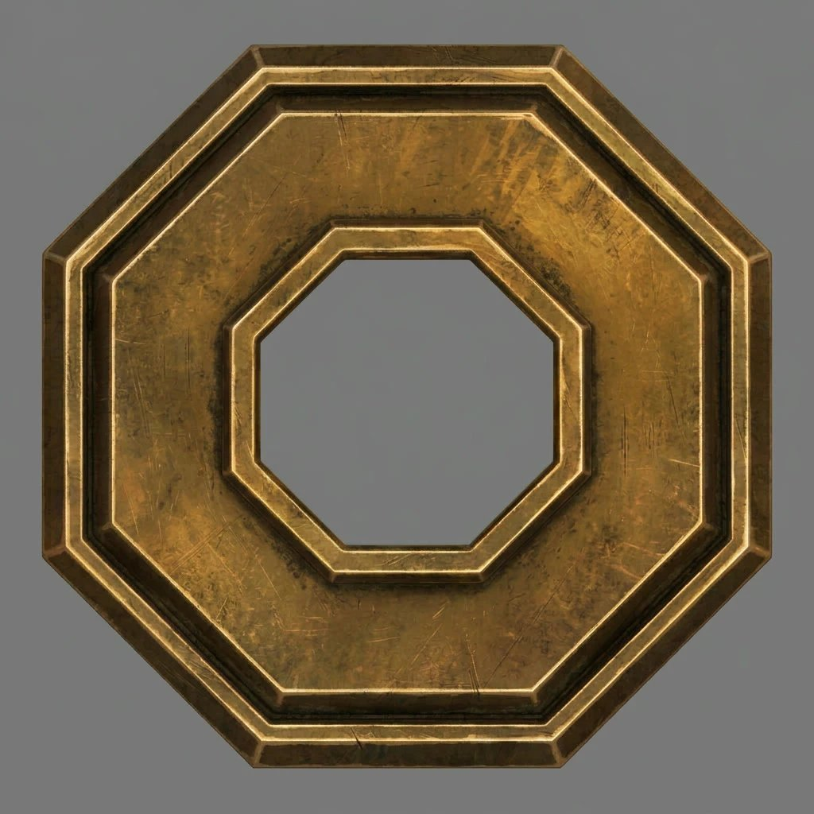</a> 古銅 ✅,洞仍透灰 ❌ |
| 4 | **第 1 輪結果**(暗洞版)+ 古銅 12 邊環(色票) | 換成古銅材質 | <a href="images/a13-49-plate-r4-bronze-darkhole.jpg"></a> 古銅 ✅、暗洞 ✅ → **採用** |

第 2 輪的輸入(斜角立體藍鋼板):

<a href="images/a13-46-plate-r2-src-3d.jpg"></a>

**第 1 輪 prompt(逐字)**:
```text
Design a TOP-DOWN ORTHOGRAPHIC texture of a flat octagonal floor plate,
seen from DIRECTLY ABOVE: the camera looks straight down, no
perspective, no side walls visible. A regular octagon, perfectly
centered and symmetric, filling about 90% of the square canvas.

DESIGN (based on the base plate under the spike in the FIRST image):
- a thin flat plate with two shallow concentric steps: an outer rim
  band, then a slightly raised inner ring
- in the center, an octagonal opening about 35% of the plate width,
  aligned with the outer octagon. The opening is a DARK PIT going down
  into the floor: near-black inside, with a soft dark gradient on its
  inner walls. It is NOT a see-through hole — no grey background shows
  through it
- NO raised collar around the opening, no bolts, no extra ornaments

MATERIAL — match the steel strips in the lower half of the SECOND
image: dark blue-grey worn steel, fine scratches, darker grime in the
corners, and a thin, crisp, bright highlight line along EVERY edge:
the outer octagon edge, the step edge, and the rim of the opening.

Soft even top lighting, no directional light, no cast shadows.
Flat neutral grey (#808080) outside the octagon. Stylized AAA game
texture. No spike, no text.
```

**第 4 輪(採用版)prompt(逐字,Leonardo 生成紀錄)**:
```text
參照這張的色調 調整
```
References:① 古銅 12 邊環(色票)② 第 1 輪藍鋼正俯視八角板(暗洞版)。

<a href="images/a13-50-plate-r4-leonardo-detail.jpg"></a>

> 💡 **換材質 pass 不需要長 prompt**:形狀已經由輸入圖鎖住時,一句中文「參照這張的色調 調整」+ 色票參考就成功(與 B9「極短 prompt + 材質特寫」同理)。長鎖句反而容易讓模型重畫幾何。

**這條鏈的教訓:**
- **「形狀對」和「材質對」分兩步**:先拿到形狀正確的版本(第 1 輪:正俯視 + 暗洞),再單獨做換材質 pass;換材質那輪的輸入要選**形狀已經對的那張**(第 4 輪成功、第 3 輪失敗的差別就在輸入選錯)。
- **透底洞會一路遺傳**:第 2 輪洞已透灰,後面換材質也修不回來 → 從暗洞版重來比補救快。
- **換色只要色票**:古銅 12 邊環只當材質參考,它的邊數沒有滲進結果(因為輸入 1 的八邊形輪廓夠強)。
- 最後再於 PS 加工(簡化成單圈古銅框 + 黑色中心)排進貼圖左上空白區,見下圖中間那張。

**最終貼圖組裝(使用者手修)**:烘焙原始素材 + 底座環頂面加工素材 → 合成完稿(底座環排進左上空白區,兩件共用一張貼圖)。

左 = Claude bake 的原始素材、中 = 底座環加工素材、右 = 完稿:

<a href="images/a13-44-trapB-texture-assembly.jpg"></a>

---

## 📌 踩坑紀錄

| # | 症狀 | 根因 | 解法 |
|---|---|---|---|
| 1 | 精修後尖刺變成整片刺林、電鋸位置變 | prompt 列了「加什麼細節」= 授權加物件(B1 #3/#9) | 保真定性 + 物件逐一列入 OBJECT LOCK |
| 2 | 「不夠精緻」只是變銳利 | 保真定性下模型不敢長材質(B1 #7)+ 像素預算不足 | 重繪定性 + 分區 Crop-Gen-Paste |
| 3 | 鋸齒不等距、22~26 齒 | NB2 不會數數 | 程式環形陣列,AI 每次重跑都會再壞 → 所有 NB2 pass 結束後才排齒 |
| 4 | 盤面中線接縫、溝線不圓 | 生成器的拼接痕 / 畫不出正圓 | 同心紋旋轉覆蓋 + 徑向拉圓 |
| 5 | 整張鏡射後下半齒鉤反向 | 鋸齒有旋轉方向 | 盤面鏡射、齒帶不翻 |
| 6 | 切 Unlit shader 變亮、PNG 拖不進 Cube | Cube 空 + Scale 1 + Alpha 預設 1;Texture Shape 是 2D | Scale 先歸零;Texture Shape 改 Cube |
| 7 | 14:1 裁切輸出補白邊 | 超出 NB2 比例範圍 | 裁 2:1 滿版段落,程式接長 |
| 8 | tile 重複感明顯 | 單一 tile | 螺栓單元重排 + 共用接縫 4 變化型 |
| 9 | 紅圈/藍圈拆件,兩部件互相滲入 | 文字分界不可靠 | 程式先依畫圈切開,一張輸入只留一件 |
| 10 | 寫 octagonal 出 12 邊 | 模型數不準邊數 | 程式畫正八邊形導引 → paint-over |
| 11 | 底座中間洞透出灰底 | 「hole」被畫成穿透;透底版再換材質也修不回 | 明寫 `OPEN DARK HOLE ... NOT see-through`;換材質時輸入選暗洞版(B-4 第 4 輪) |
| 12 | 形狀導引圖把古銅畫成灰鋼 | 導引圖色塊被當材質 | 材質參考另給 ref 2;或不用導引直接抽取 |
| 13 | 烘貼圖金邊掉到牆面中間 | AI「正面圖」是略俯視,交界為 V 字 | 提示詞兩輪矯正(正交抽取 → 修正 pass)+ PS 合成取兩版優點;程式補償俯角只能接近 |
| 14 | 依底稿上色仍出透視 | ref 2 有透視 → 構圖滲漏(B9) | 只給底稿一張 / ref 2 只給無邊無輪廓的材質特寫 / 修正 pass 逐條點名 |
| 15 | 側面貼圖拉扯 | 正面投影的側面被壓扁 | 每面旋轉到中間面取色 |
| 16 | 側面多出三角形 | 中間面的 V 字被帶到側面 | 側面取色跳過 V 字帶 |
| 17 | Max 裡糊、偏橘 | 扇形 UV 只用 27% 面積;Flat Color 無明暗 | 烘 4K / UV 填滿;側面壓暗;視圖 Texture Size 調高 |
| 18 | 「側面正交」其實不用算 | 八角柱角朝前時,轉 90° 也是角朝前 | 先檢查對稱性再決定要幾張視圖 |

## 🔒 本案新增鎖句

| 鎖 | 用途 | 關鍵句 |
|---|---|---|
| **去動態鎖** | 火花/煙/光痕完全移除並補背後 | `REMOVE ALL MOTION (completely gone, not reduced) ... paint what is behind them ... nothing new` |
| **旋轉補全** | 半埋物件補完整圈 | `Complete the hidden lower half by rotational symmetry of the visible upper half` |
| **邊數鎖(配導引圖)** | 正 N 邊形 | `exactly 8 equal straight sides, one corner pointing straight at the viewer ... Do NOT round it, do NOT add more sides` |
| **暗洞鎖** | 開口不透底 | `OPEN DARK HOLE going down into the floor ... NOT see-through — no grey background inside` |
| **正交修正鎖** | 消 V 字、消頂面 | `Every tier junction becomes ONE PERFECTLY STRAIGHT HORIZONTAL LINE ... NO visible top surface on any tier step` |
| **paint-over 定性** | 照底稿上色不改形 | `This is a PAINT-OVER of Image 1 — do NOT move, resize, redraw or add any edge` |
| **材質參考隔離** | ref 2 只取材質 | `Image 2 is only a small material swatch ... It contains no shape.` |

## ✅ 可複用結論

0. **⭐ 2D 正交正面圖 + 3D 模型/UV → 程式烘貼圖**(見本檔開頭核心流程):建模師的 UV 不用改,貼圖不用手畫展開。

1. **AI 出材質、程式修幾何**:齒數、正圓、對稱、無縫、正交、UV 對位,一律程式。
2. **程式修幾何要放在所有 NB2 pass 之後**——任何一次 NB2 都會重畫幾何。
3. **拆件先用程式切開**,一張輸入只放一個部件。
4. **「正 N 邊」「正交」靠導引圖**;導引圖最好**從 3D 模型直接算**,比例保證一致。
5. **參考圖帶透視 = 透視滲漏**;只給材質特寫,或乾脆不給。
6. **有 3D 模型時,貼圖用烘的**:每面取自正對的面(防拉扯)、逐節對高度、側面依原圖亮度壓暗。
7. **換色用 Lab 色軸分離**:只拿掉材質本色軸,保留環境光帶入的顏色。
8. **省貼圖用鏡射**:電鋸上下、軌道左右、尖刺前後;tile 用共用接縫做變化型。

---

## 🔍 檢討與改進(2026-11-26 結案檢討)

### 1. 陷阱 A:鋸齒用程式成功,中間輪狀仍需手工

| | 鋸齒 | 中間輪狀(中心軸 / 鐵圈) |
|---|---|---|
| 性質 | **重複單位**(一顆齒 × 24) | **單一個體**,細節各處不同(螺栓、環紋、反光、磨損) |
| 程式做法 | 複製一顆好齒 → 本來就該一模一樣 | 複製扇形 / 平均環紋 → 反光和磨損也被複製或抹平 |
| 結果 | ✅ 自然 | ❌ 過度規則、放射紋、反光重複,像人工 → 使用者改手工 |

- **檢討**:把「重複排列」的方法套到不該重複的東西上。中心軸只有**形狀**需要正圓,**細節**本來就不該對稱。
- **成功反例**:盤面溝線用「徑向拉成正圓、原像素保留」→ 自然。中心軸應比照:程式只拉邊緣成正圓 + 做遮罩,遮罩內細節保留原圖或手修 / AI 局部補,不要整塊重建。
- **判斷原則**:要「每一份都一樣」→ 程式複製;要「形狀正確、細節自然」→ 程式只動形狀 / 遮罩,細節留原圖。

### 2. 陷阱 B:烘貼圖成功,但前提是正交圖

走了太多冤枉路,錯在三點:

1. **沒有先檢查輸入圖是不是正交**:第一次烘之前沒量每節交界是否水平(幾秒就能判斷),烘了才補救。
   → **前置檢查 gate**:量交界直線度 / 頂面可見度,不是正交就先停下,要求先矯正。
2. **驗證自己騙自己**:預覽用同一套對應方式算,永遠「看起來對齊」,直到使用者 Max 截圖才發現錯位。
   → **獨立驗證**:把**模型邊線疊回原始正交圖**(而非只看自己算的預覽),並以使用者引擎 / Max 截圖為準。
3. **用「猜俯角」補救**:調俯角參數抵消透視,只能接近、不能根治。
   → 正解是**先把圖矯正成正交**(提示詞兩輪 + PS 合成);
   **備用路線**:手上只有透視圖、不想矯正時,可用 B6 的反解相機,以同一透視相機投影(被遮住的面仍無資訊)。本案未使用,一般流程仍以「先矯正正交再烘」最穩。
4. **說法要精確**:不是「AI 畫不出正交」,而是「一次畫不到位」;矯正越強細節越被吃掉 → 兩版取長在 PS 合成。

### 3. 這套方法的適用範圍(看形狀,不看大小)

關鍵:**從少數幾個正交方向,能不能看到模型大部分表面。**

| 類型 | 例子 | 適用 | 說明 |
|---|---|---|---|
| 旋轉對稱 / 多邊形柱狀 | 尖刺、柱子、燈柱、瓶罐、塔 | ✅ 最適合 | 一張正面圖烘全部面,大小不限 |
| 平面為主的大物件 | 牆面、門、建築立面、拱門 | ✅ 適合 | 正面正交圖 = 立面圖(同 A4) |
| 地面 / 大面積 | 地板、溝槽軌道 | ✅ 改用上視圖 + tile | 單張烘解析度不足(同陷阱 A 軌道) |
| 不對稱道具 | 箱子、機關、家具 | ⚠️ 要多張 | 正 / 側 / 背(必要時上)正交圖,依面朝向取最近視圖 |
| 凹凸多、互相遮擋 | 雕像、怪物、樹根、鎖鏈 | ❌ 不適合 | 很多面任何正交方向都看不到 → image-to-3D 或 3D 內直接畫 |

**大物件補充**:物件越大、每公分分到的像素越少 → 重複部分(牆磚、地板、金屬條)做 tile / trim sheet;獨特部分(門飾、雕花、標誌)用本方法單獨烘。

### 4. 流程改進清單

| 項目 | 改進 |
|---|---|
| 修幾何 | 先分類:「重複單位」→ 程式複製;「單一個體」→ 程式只做形狀 / 遮罩,細節保留 |
| 烘貼圖前 | 前置檢查是否正交;不是 → 先矯正(或備用:反解相機投影) |
| 驗證 | 獨立方法:模型邊線疊回原圖 + 使用者 Max / 引擎截圖,不只看自己的預覽 |
| 溝通 | 失敗時先講清楚原因與選項,不連續丟修正版;concept→3D 一律一步一步引導 |
| 生產 | UV 盡量填滿 0~1(本案扇形只用 27%,需烘 4K 才清楚) |

### 5. 本機網頁工具(bake-tool.html)的移植教訓

- 把 Python 版烘焙搬成網頁工具時,**漏搬了 v5 的「側面跳過 V 字帶」**,使用者烘出來側面又多出三角形。
- **教訓:移植 / 重寫工具時,要拿「上一版已驗收的成品」做回歸比對**(同一組 OBJ + 正交圖,新舊輸出疊圖比較),不能只看新工具「有跑出東西」。
- 修正後使用者實測通過:

<a href="images/a13-54-bake-tool-result.jpg">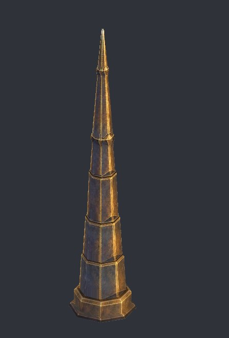</a>

---

## 🖥️ 工具化:不用 Claude 也能重複做(2026-11-26)

### 哪些可以做成 App、完全不需要 Claude

本案的程式計算都是**固定的數學運算**,寫好就能一直重複用:

| 功能 | 原理 | 需要 Claude? |
|---|---|---|
| 鋸齒等距排列 | 取一顆齒、環形複製 | ❌ |
| 正圓修正、去接縫 | 量半徑、徑向拉正 | ❌ |
| 上下 / 左右鏡射 | 翻轉像素 | ❌ |
| tile 切割、變化型 | 找重複長度、重排單元 | ❌ |
| 從模型算正交底稿 | 3D 投影 | ❌ |
| 正交圖烘進 UV | 每個 UV 像素回推 3D 位置取色 | ❌ |
| 古銅換銀色 | Lab 色彩空間調色 | ❌ |

Claude 在本案真正做的是**判斷與調參數**(挑哪顆齒、量交界、看預覽找錯、寫 NB2 prompt)。
做成工具時改成:**滑桿調參數**、**點選挑齒 / 標交界**、**自動檢查**(例:輸入圖不是正交就警告)。
只有遇到新類型問題、或要寫新 prompt 時才需要問 Claude。

### 工具形式比較

| 形式 | 優點 | 缺點 |
|---|---|---|
| 3ds Max 外掛(Python / MaxScript) | 直接讀場景模型與 UV,不用匯出 OBJ,烘完直接貼回材質 | 只能在 Max 裡用 |
| **本機網頁工具(已做)** | 雙擊 HTML 就能用、離線、檔案不上傳、可分享給同事 | 要匯出 OBJ、下載貼圖再貼回;4K 需數秒 |
| 桌面小程式(Python) | 大圖較快 | 要裝 Python 環境 |

### 已完成:`tools/trap-texture-tools/bake-tool.html`

- **本機使用**:存到電腦 → 雙擊用 Chrome / Edge 打開;不需網路、不需安裝,所有計算在本機瀏覽器,美術素材不外流。
- **流程**:載入 OBJ + 正交圖 → 對位檢查(黃線 = 模型輪廓與交界、輪廓寬度差異、逐節對齊結果)→ 烘焙(1024 / 2048 / 4096)→ 3D 預覽轉角度 → 下載 PNG。
- **內建 A13 的修正**:前置對位檢查、自動逐節對齊(偵測金色交界線)、每面轉正對面取色、側面跳過 V 字帶、側面壓暗偏冷、底面填暗、UV 補邊、只有前半時後半鏡射。
- **實測**(TrapB.obj + PS 合成正交圖):6 個交界全部自動配對、輪廓寬度差異 7.7%、2048 烘 0.4 秒;使用者在 Max 驗收通過(見上方〈5.〉截圖)。
- **限制**:只適用旋轉對稱 / 多邊形柱狀物;輸入必須是正交圖。
- **待做(可選)**:鋸齒、正圓、tile 變化型、換色等 2D 工具做成同一工具的分頁;或做 3ds Max 外掛版。

---

## 🪄 叫用詞速查

| 想做的事 | 說法 |
|---|---|
| 從概念圖做到 3D + 貼圖(完整鏈,一步一步引導、免問用途) | 附概念圖(物件畫圈)說「**拆掉這張概念圖,我要自己建模加貼圖**」(或「concept→3D」「三視圖重建」+「我要自己建模加貼圖」) |
| 只拆概念圖(先問用途) | 「拆掉這張概念圖」「concept→3D」「三視圖重建」 |
| 已有模型 + 正交圖,只烘貼圖 | 「照 A13 烘貼圖」「正面圖烘進 UV」(或直接用 `bake-tool.html`) |
| 圓形物件修齒數 / 正圓 | 「照 A13 修鋸齒」「修正圓」 |
| tile + 變化型 | 「照 A13 做 tile 變化型」 |
| 換色保留環境色 | 「照 A13 換色,保留環境色」 |
| 查整個案例 | 「A13」 |

> ⚠️ 叫用詞與引導規則需合併進 `main` 後,新工作階段才會生效。
