# 實戰紀錄 — A4 古堡 哥德大廳:概念圖拆解(建築四件)

> 概念圖拆資產 / 背景模組貼圖案例。對應工作流:`ai-media-generator`(concept-to-3D **保光影軌**)。
> 姊妹篇:**A5 — 古堡三視圖重建**(道具 turnaround + de-lit image-to-3D)。
> 平台:Leonardo.ai — **Nano Banana Pro**(+ Gemini 重製圖);Style / Prompt Enhance 一律 None。

---

## 結論(先讀)

**古堡_概念圖拆解與三視圖重建(成功)**
Claude 對話:`https://claude.ai/code/session_0139cX4BbLdhe5fdhLGcUfpF`

### 這輪驗證出的可複用招式
- **紅框定位 + 只還原框內 + 框外清空** → 治「重建整場景」
- **反裁切 FRAMING(留白/完整高度)** → 治上下被切
- **HEX 鎖色 + 鎖結構換色調(雙參考)** → 治變中性灰/結構漂移
- **廢墟參考 → 修復完整 → 局部壓亮** → 天井這種「原圖是霧」的救援鏈
- **鎖格 + 換色/換風格** → 地磚 10×10 準 + 味道對
- **地面走 B1 材質保真 pass**(Style/Enhance 都 None,Dynamic = 糊的元兇)

---

## 來源 / 需求定調

- **原始素材:** 哥德大廳室內概念圖([a4-concept-source.jpg](images/a4-concept-source.jpg))
- **用途定調(使用者原話):** 「我會使用簡單的 3D 模型搭建 mock,所以要有不需要再打光、不需要大氣的遊戲 asset 貼圖」
  → 貼圖要「**光已烘死、但不要大氣**」:烘 AO + 材質 + 立體光感,但**移除霧/大氣/遠近漸層**,做成乾淨可用的 game asset 貼圖(**保光影軌**,與 A5 de-lit 軌相對)。
- **道具納入本輪:** 吊燈、垂幔(建築四件之外,見 A5)。
- **日期:** 2026-10-25

---

## 框選四件 · 判讀(先對清單再開 prompt)

> 使用者需求起手:「我要拆這張圖 / concept→3D / 三視圖重建 / 我要先確定框選處的幾個物件正交鏡頭、遊戲物件設定圖清單」
> (CTRL+F 定位詞:`我要拆這張圖`)

 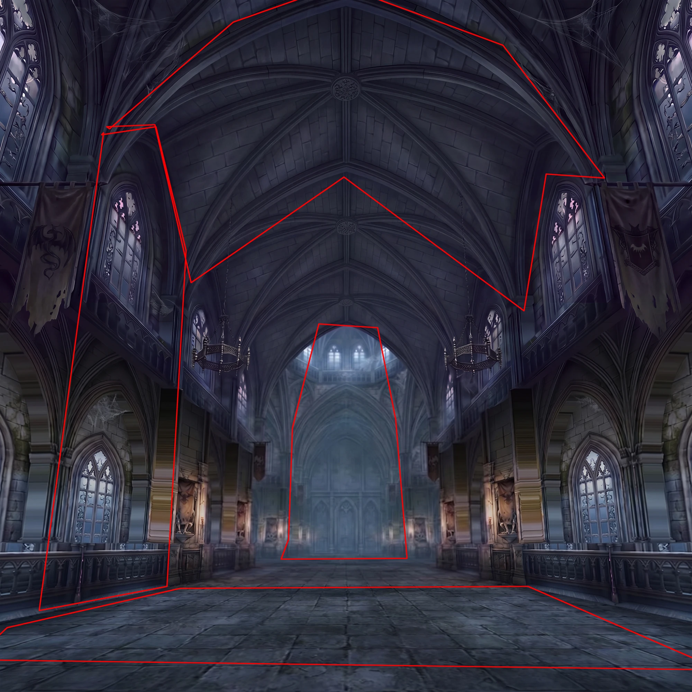

使用者另附 4 張手繪草圖確認框選,逐張對齊零分歧:

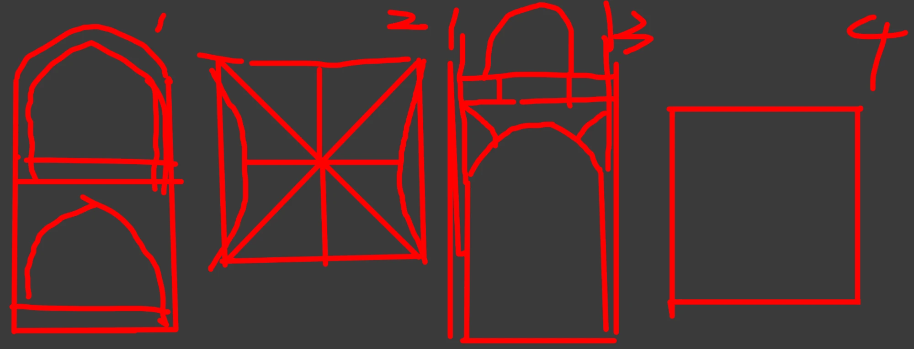

| 你的草圖 | = 框選區 | 草圖多告訴我的事 |
|---|---|---|
| ① 上尖拱窗 + 中橫檔 + 下小拱 | **#1 側廊牆體模組** | 兩層式牆件(上高尖拱窗/下矮拱龕),不是單一窗。立面含兩層 |
| ② 方盒 + 對角 X + 十字中線 | **#2 拱頂天花模組** | 單一交叉肋拱 bay cell(四片拱蹼 + 對角肋 + 橫縱肋),可四方連續 |
| ③ 大拱門 + 上層欄杆/拱 | **#3 遠景端景拱廊** | 含上層 gallery 帶 + 下層大拱洞兩段 |
| ④ 純方框 | **#4 地面石板** | 平鋪材質面板(top-down 貼圖),不走 mesh |

**出圖策略:** ①③ 走正交立面、② 走仰視單元(underside ortho)、④ 走 top-down 可平鋪材質;每件都餵原圖 + 明確否定原圖低角/透視相機。
**道具 / 平台決策:** 道具納吊燈 + 垂幔;平台 Nano Banana Pro。

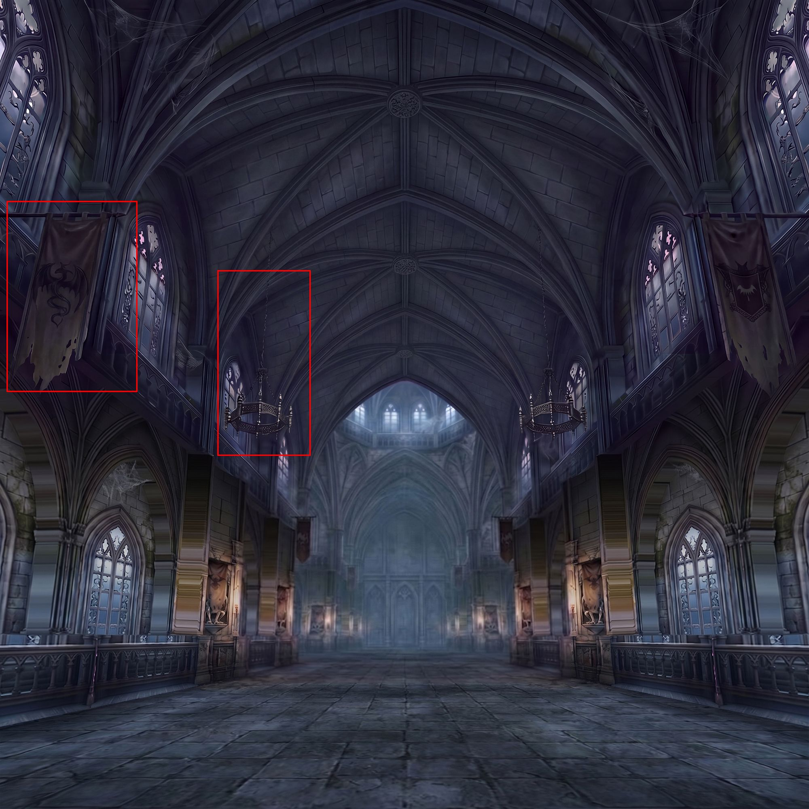

> Q：「我會使用簡單的3 d模型  搭建mock 所以要有 不需要再打光  不需要大氣的遊戲asset 貼圖」

清楚了——簡單 3D model 搭 mock + 不受光材質,所以貼圖要「光已烘死、但不要大氣」。這句把前面的 A/B 張力解決了:全部走同一規格——烘 AO + 材質 + 立體光感,但移除霧/大氣/遠近漸層,做成乾淨可用的 game asset 貼圖。不用再分檔,直接開跑。
以下 6 張,平台 Nano Banana Pro,每張都餵這張原圖當 reference。

> **使用者段尾反思:** 「是有釐清一些製作出圖的選項,但這一步後面浪費了一些製作方式的討論。」

---

## 場景拆解 1 — #1 側廊牆體(1+2 樓窗 + 牆壁)· 結果 MOCK 可用

產出溯源(Leonardo):
- `https://app.leonardo.ai/generation/image/use-first-image-source-second-locate-target-4f5bb571-33a4-4a4a-9862-d8fff9099599`
- `https://app.leonardo.ai/generation/image/use-first-image-source-second-locate-target-e7b467d1-2c7b-4f4c-9492-2bbf6bdae4d8`
- `https://app.leonardo.ai/generation/image/use-first-image-source-second-locate-target-11bdb2fe-0f0b-49f1-a963-872342128c08`
- `https://app.leonardo.ai/generation/image/use-first-image-source-second-locate-target-0940b11e-6931-432d-a005-a6f1e60e7c6b`
- `https://app.leonardo.ai/generation/image/use-first-image-source-second-locate-target-e6d59c66-4817-4ad0-8ca4-a64aa428b09a`
- `https://app.leonardo.ai/generation/image/use-first-image-source-second-locate-target-3ae9ea32-bf46-41cd-8a8c-545c68985206`

### 改善版 ①(反裁切 + 只還原框內,把兩個病一起治)
**第一張 = 乾淨原圖｜第二張 = 紅框圖｜比例改 9:16(高瘦,給上下留白空間)**

```text
Use the FIRST image as the source and the SECOND image ONLY to locate the target.
Reproduce ONLY the content inside the red outline — the LEFT side-aisle wall bay.
Do NOT draw the red line. Do NOT reconstruct any symmetric hall, and do NOT render
the central traceried window or the central archway. Everything outside the red
outline must become empty flat dark background.

The bay is the two-tier unit: the upper clerestory pointed-arch window, the carved
mid ledge / gallery, the lower aisle pointed window, and the base balustrade.

Deskew it to a true head-on FRONT orthographic elevation facing the viewer; correct
the source's low-angle vanishing-point perspective — do NOT copy any tilt,
foreshortening or 3/4 angle.

FRAMING — show the COMPLETE bay: its ENTIRE height from the base balustrade up to
the ceiling springer, fully contained inside the frame with generous empty margin
above, below and on both sides. NOTHING may be cropped or touch the frame edge. The
bay fills about 70% of the frame height, floating centered on empty dark background
like an isolated catalog cutout.

Preserve the source's baked lighting and material exactly: ambient occlusion in
every recess and joint, stone diffuse, metal specular and reflections, stained-glass
glow — full 3D depth for an UNLIT / emissive game material. PRE-LIT texture: do NOT
relight and do NOT add new shadows; REMOVE atmospheric haze, fog and distance
desaturation, even brightness overall. Flat dark neutral backdrop, no ground shadow.
High-resolution orthographic game asset plate.
```

<details><summary>中文對照(使用者留存)</summary>

```
使用第一張圖作為參考，僅使用第二張圖來確定目標位置。
僅複製紅色輪廓線內的內容物－左側側廊牆體。
不要繪製紅線。不要重建任何對稱的大廳，也不要繪製
中央的鏤空窗或中央拱門。紅色輪廓線以外的所有內容必須變為空白的深色背景。

此牆體由兩層組成：上層高側尖拱窗、雕刻的
中層壁架/廊台、下層側廊尖拱窗以及底部欄桿。

將其傾斜調整為面向觀察者的正立面；修正
參考影像的低角度消失點透視法－不要複製任何傾斜、
透視縮短或四分之三角度。

取景－完整展現整個隔間：從底部欄桿到
天花板拱梁，完全包含在畫面內，上下左右留出充足的空白邊距。
任何內容都不得裁切或觸及畫面邊緣。
隔間佔據畫面高度的約 70%，居中懸浮於空白的深色背景之上，
如同一個獨立的產品目錄剪貼圖。

精確保留素材的烘焙光線和材質：
每個凹槽和接縫處的環境光遮蔽、石材漫反射、金屬鏡面反射和反射、彩色玻璃的
光暈－為無光/自發光遊戲材質提供完整的 3D 深度。預光照紋理：
請勿重新光照，請勿添加新的陰影；移除大氣霧霾、薄霧和距離處的
飽和度降低，保持整體亮度均勻。使用平坦的深色中性背景，無地面陰影。
高解析度正交投影遊戲素材板。
```
</details>

**改了什麼、為什麼:**

| 改動 | 治的病 |
|---|---|
| `Reproduce ONLY the content inside the red outline … outside = empty background` | 治「又重建對稱大廳」——把生成綁死在紅框內容 |
| 點名 `do NOT render the central window / archway` | 中央大窗一直搶戲,直接禁掉 |
| `FRAMING` 整段 + `70% height` + `margin` + `nothing touch frame edge` | 治上下被切——強制留白、要求完整高度 |
| 比例 2:3 → 9:16 | bay 又高又窄,畫布給高一點才不會擠到切邊 |

**QA 驗收(四張排序):** 第1張(上下微切、右柱殘留)淘汰;**第2張最乾淨 → 建議當 master**(純牆模組、可鏡像);第3張好但側牆 return 略 3/4;第4張含道具(龍紋垂幔+吊燈+更寬柱拱)= 帶裝飾複合塊。

**#1 收法(二選一):** 要乾淨可鏡像牆模組 → 收**第2張**(master),垂幔留 A5 單拆;要帶氣氛成品牆 → 收**第4張**(垂幔+吊燈已綁進去)。

**收檔前兩提醒:** ① 這是 re-render(重繪)非像素級保留,磚縫/花窗是模型重畫,疊回原圖比例與窗花數量可接受才收;② 正交嚴格度:第2張頂拱腳/底欄杆仍帶一點透視收斂,貼簡單 3D mock 反而有利,要 image-to-3D 精修才需更平。

> **過程註記:** 中途使用者問「是不是用 PS 合成 / 角度太傾斜 / 元素跟原本有差異」;Claude Code 一度提議「自己做」結果失敗,使用者喊停 → 回到「4 個紅框範圍、修正提示詞、一個一個產出」的作法(本案例定調)。

 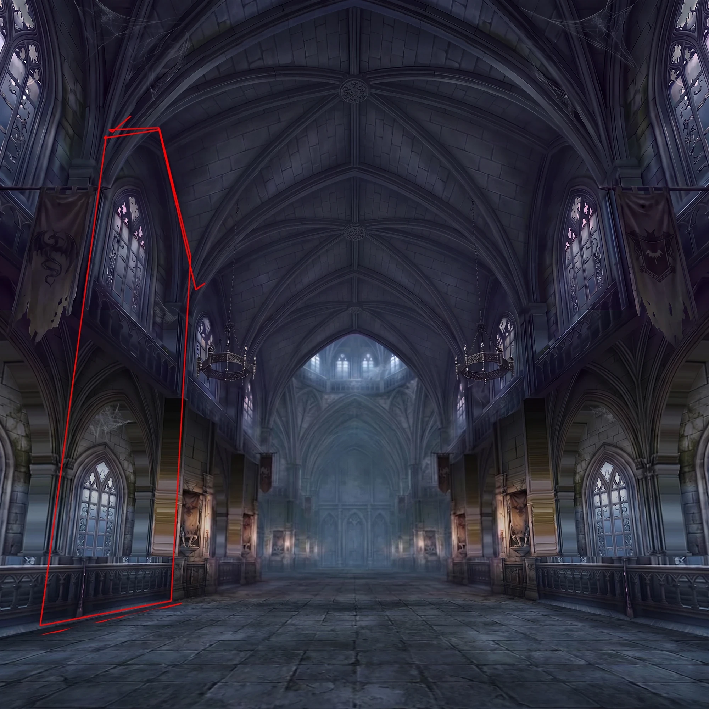

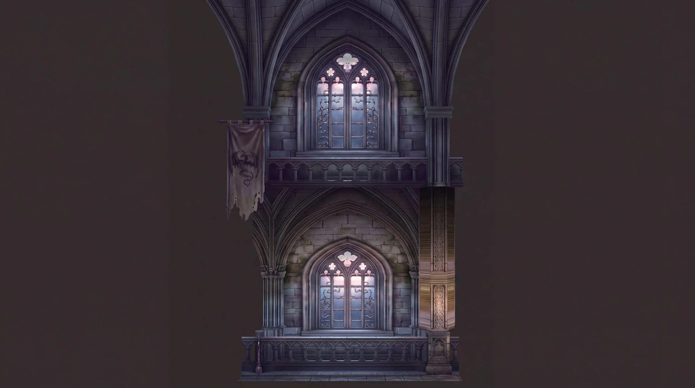 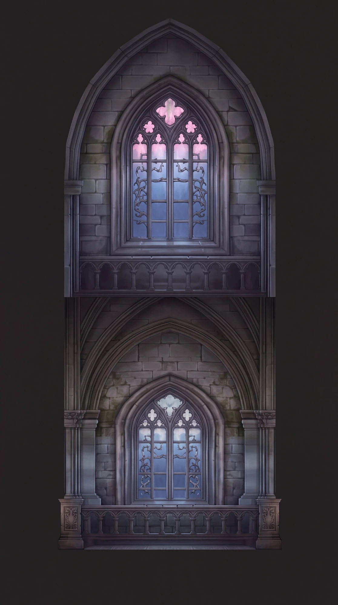 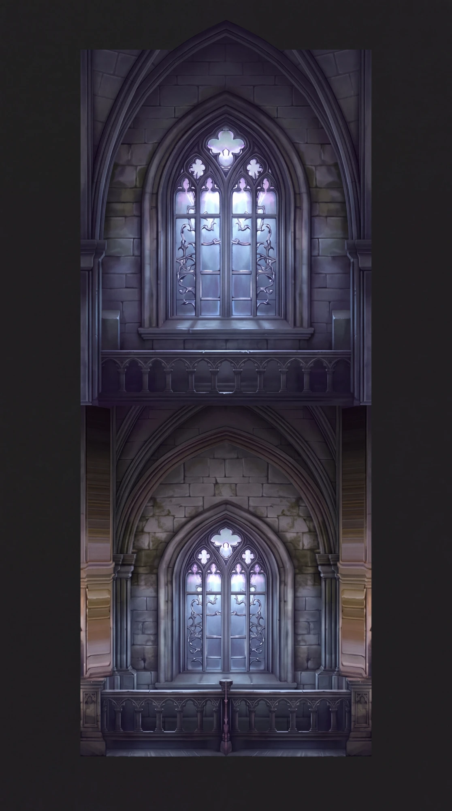
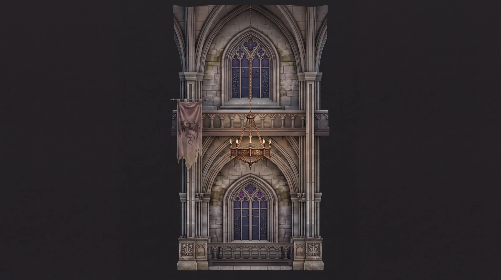 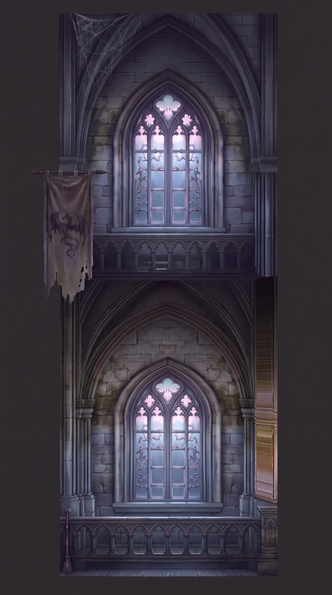 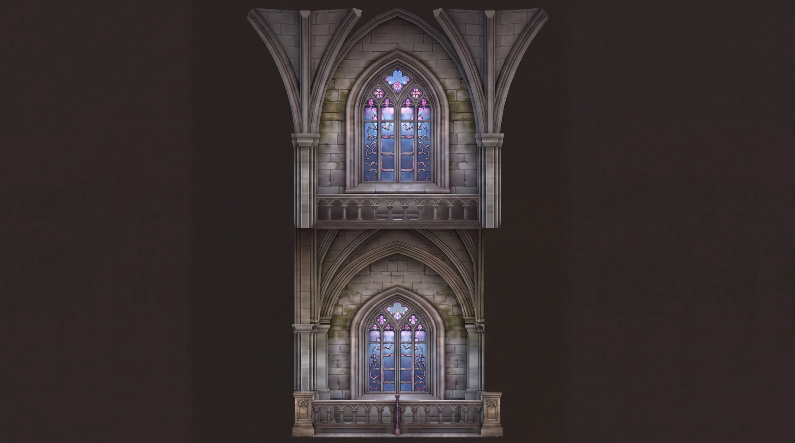

---

## 場景拆解 2 — #2 交叉尖拱天花 · 結構 + 鎖色成功

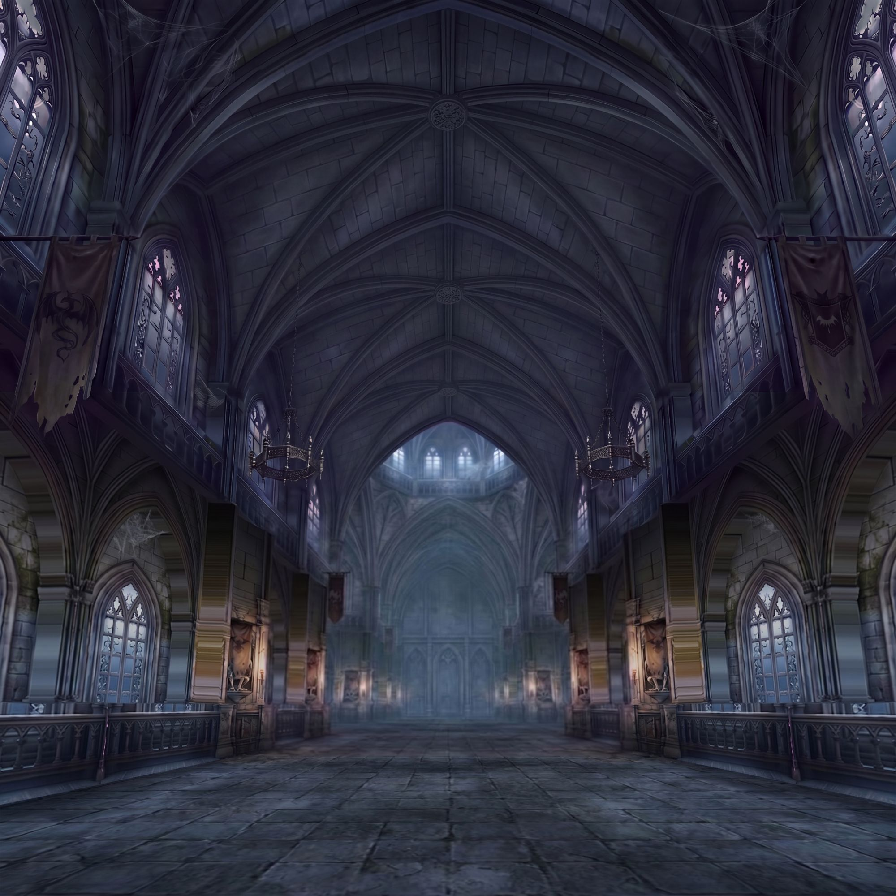 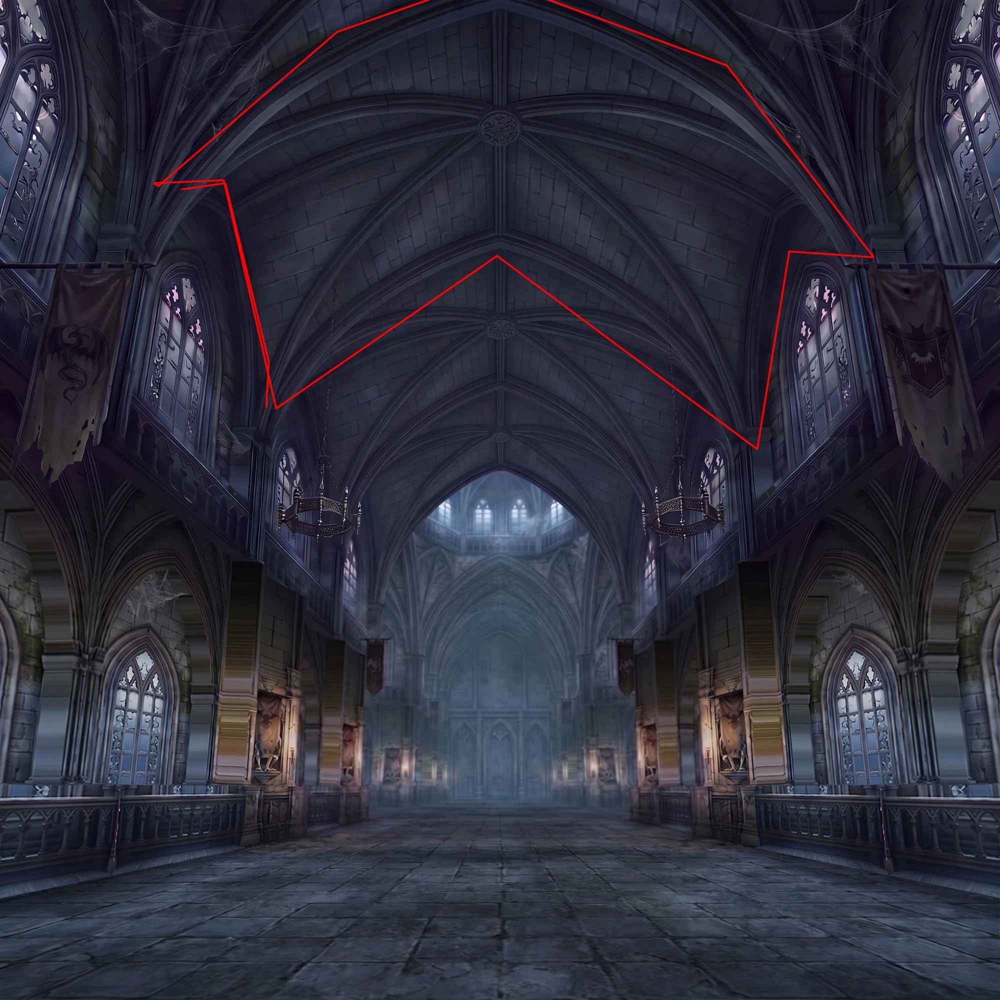

> Q：「交叉尖拱 請幫我出遊戲素材提示詞,維持原光影」
> 同一套修正配方(只還原框內 + 排除其餘 + 反裁切 + 維持原光影),視角改成由下往上仰視的單一 bay 單元。

### 2a 定稿 prompt(仰視單元)
**第一張 = 乾淨原圖｜第二張 = #2 紅框圖｜比例 1:1**

```text
Use the FIRST image as the source and the SECOND image ONLY to locate the target.
Reproduce ONLY the ceiling vault inside the red outline — ONE single cross-vault
(groin-vault) bay cell. Do NOT draw the red line. Do NOT reconstruct the whole nave
ceiling, and do NOT render the walls, windows, banners, chandeliers or floor.
Everything outside the red outline must become empty flat dark background.

The cell is one square bay: four curved vault webs (stone panels) with diagonal
stone ribs and transverse ribs radiating from a central carved boss / roundel at
the apex.

Re-orient to a straight worm's-eye orthographic view seen from directly below,
looking vertically up at the vault; correct the source's receding nave perspective
— do NOT copy the vanishing-point convergence or the tilted 3/4 angle. Present it as
ONE symmetric square tile, ribs meeting at the centered boss, edges squared so the
cell can tile as a repeatable ceiling module.

FRAMING — show the COMPLETE bay cell fully inside the frame with generous empty
margin on all four sides; NOTHING may be cropped or touch the frame edge; the vault
fills about 80% of the square, centered on empty dark background.

Preserve the source's baked lighting and material exactly: ambient occlusion deep in
the rib groins and web corners, the grey stone diffuse shading, subtle stone
specular — full 3D depth for an UNLIT / emissive game material. PRE-LIT texture: do
NOT relight and do NOT add new shadows; REMOVE the scene's atmospheric haze, fog and
distance desaturation — even brightness overall. Flat dark neutral backdrop, no
other scene elements. High-resolution overhead orthographic game asset plate.
```

溯源:`https://app.leonardo.ai/generation/image/use-first-image-source-second-locate-target-2eb79d93-dbcf-4662-81d9-3d694699f1a0`

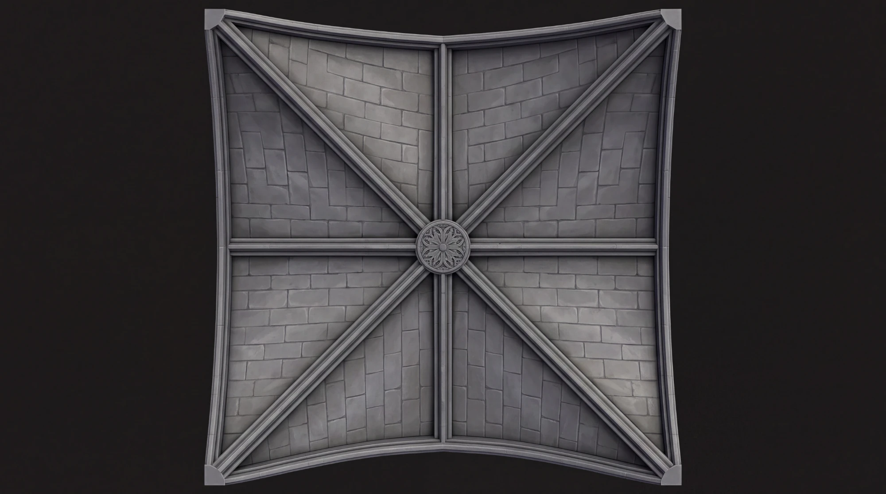 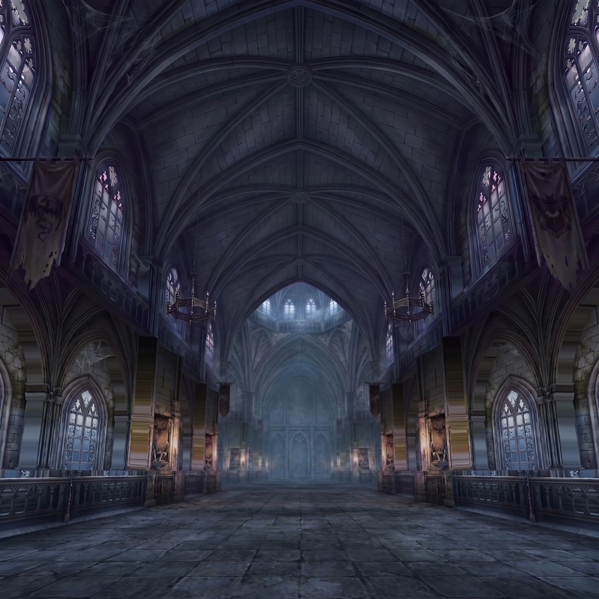

> Q：「結構對了,光影跟原來不同,我要照設定圖產生相同的光影色調 AO」

**根因:** `even brightness overall` + `overhead … game asset plate` 被 NB 讀成「中性 studio 打光 / 均光淺灰黏土」,丟掉原圖暗藍灰低調 + 肋溝 near-black 的調子。
**修法:** 補「對色對調子」強制句,把「打勻」改成「只去大漸層、保留原局部明暗」。

### 2b 對色對調子版
**第一張 = 乾淨原圖｜第二張 = #2 紅框圖｜比例 1:1**

```text
Use the FIRST image as the source and the SECOND image ONLY to locate the target.
Reproduce ONLY the ceiling vault inside the red outline — ONE single cross-vault
(groin-vault) bay cell. Do NOT draw the red line. Do NOT reconstruct the whole nave
ceiling, and do NOT render the walls, windows, banners, chandeliers or floor.
Everything outside the red outline must become empty flat dark background.

The cell is one square bay: four curved vault webs (stone panels) with diagonal
stone ribs and transverse ribs radiating from a central carved boss / roundel at the
apex, and a small carved boss at each of the four corners.

Re-orient to a straight worm's-eye orthographic view seen from directly below,
looking vertically up at the vault; correct the source's receding nave perspective —
do NOT copy the vanishing-point convergence or the tilted 3/4 angle. Present it as
ONE symmetric square tile, ribs meeting at the centered boss, edges squared so the
cell can tile as a repeatable ceiling module.

FRAMING — show the COMPLETE bay cell fully inside the frame with generous empty
margin on all four sides; NOTHING may be cropped or touch the frame edge; the vault
fills about 80% of the square, centered on empty dark background.

CRITICAL — match the SOURCE image's lighting, colour and tone EXACTLY; do not invent
new lighting. Keep the same dark blue-grey stone colour, the low-key moody value
range, and the deep near-black ambient-occlusion shadows sunk into the rib groins,
the web corners and around the boss. This is a PRE-LIT texture for an UNLIT /
emissive game material: reproduce the source's own baked shading and AO — do NOT
relight, do NOT brighten, do NOT desaturate to plain light grey, and do NOT produce a
neutral studio-lit or clay / matcap AO-render look. Keep the source's local
light-to-shadow contrast; only avoid a single large one-directional brightness
gradient across the tile so it can still tile. Remove the distant atmospheric fog
only.

Flat dark neutral backdrop, no other scene elements. High-resolution overhead
orthographic game asset plate — same material and same dark moody lighting as the
source.
```

溯源:`https://app.leonardo.ai/generation/image/use-first-image-source-second-locate-target-65797100-663a-47c5-aee2-36e957ce1fb2`

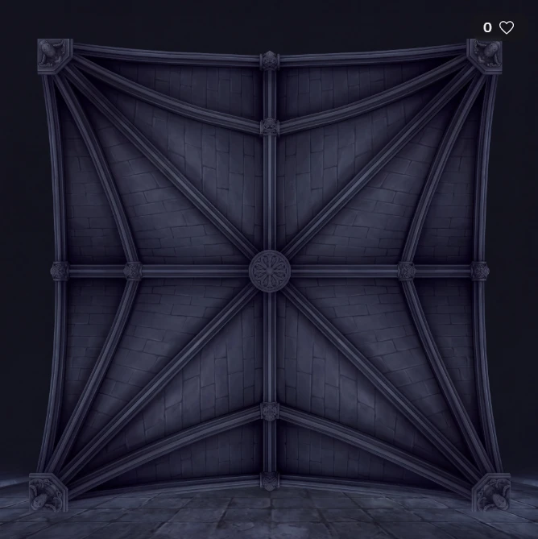

> Q：「結構跑掉了」 → 調子對了但結構被重畫複雜(肋變雙線、多雜肋)。**最穩解:別再重生成,把「第一版乾淨灰結構」當 Image A,只換色調。**

### 2c 鎖結構 + 轉色調(雙參考)
**第一張 = 第一版乾淨灰天花(結構正確)｜第二張 = 乾淨原圖(色調來源)｜比例 1:1**

```text
Image A (FIRST) is a clean vault tile with the CORRECT geometry. Image B (SECOND) is
the original scene, the colour and lighting reference.

Keep Image A's geometry EXACTLY as-is — the same single diagonal ribs, the same
horizontal and vertical transverse ribs, the same central boss, the same four corner
bosses, the same brick web layout and the same square composition. Do NOT add, remove,
double, split or rearrange any rib. Do NOT change any shape. This is a recolour /
relight pass only.

Recolour and relight Image A to MATCH Image B's look exactly: the dark blue-grey stone
colour, the low-key moody value range, and the deep near-black ambient-occlusion
shadows sunk into the rib groins, the web corners and around the bosses. Reproduce
that baked shading and AO as a PRE-LIT texture for an UNLIT / emissive game material —
do NOT keep the bright neutral grey, do NOT relight flat, do NOT produce a light
studio / clay look.

Keep it centered on a flat dark neutral background, complete with margin on all sides,
nothing cropped. High-resolution overhead orthographic ceiling tile — Image A's
structure, Image B's dark moody material and lighting.
```

**心法:** 結構鎖在「已經對的那張灰圖」→ 治結構漂移;色調從原圖搬 → 拿回暗調 AO。這招「鎖結構 + 轉色調」後來也救了 #3。

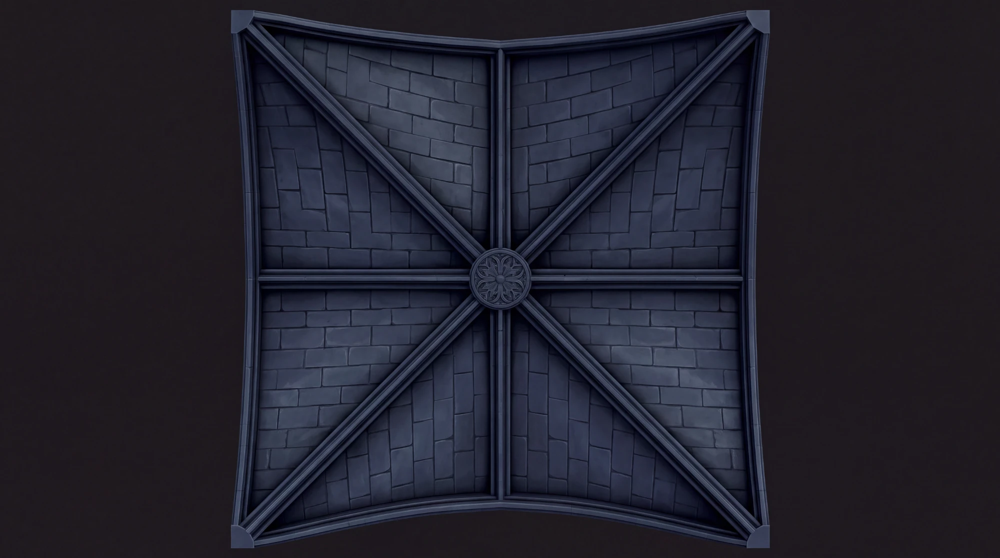
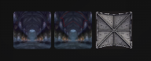

> Q：「顏色還是跟我要的不同」 → 直接從原圖天花抽實際色值鎖 HEX。

**原圖天花實際色值(很暗、偏灰,不是藍紫):**

| 部位 | HEX |
|---|---|
| 整體均值(很暗) | `#242433` |
| 石材中間調 | `#232432` ~ `#272836` |
| 肋溝深陰影(近黑) | `#171623` |
| 肋脊高光(最亮) | `#343544` ~ `#393B4B` |

### 2d 最終版(原圖 + 紅框單一 prompt,結構鎖 + HEX 色盤)
**第一張 = 乾淨原圖｜第二張 = #2 紅框圖｜比例 1:1**

```text
Use the FIRST image as the source and the SECOND image ONLY to locate the target.
Reproduce ONLY the ceiling vault inside the red outline — ONE single cross-vault
(quadripartite groin-vault) bay cell. Do NOT draw the red line. Do NOT reconstruct
the whole nave ceiling; do NOT render walls, windows, banners, chandeliers or floor.
Everything outside the red outline becomes empty flat dark background.

EXACT geometry (keep it simple, do NOT elaborate):
- exactly TWO diagonal ribs forming an X across the square,
- plus ONE horizontal and ONE vertical transverse rib forming a +,
- all meeting at ONE central carved circular boss,
- one small carved boss in each of the four corners,
- four plain brick-coursed stone webs between the ribs,
- square outline, gently curved (domed) webs.
Do NOT add, double, split or invent extra ribs or ornament.

Re-orient to a straight worm's-eye orthographic view from directly below looking
vertically up; correct the source's receding perspective — no vanishing-point
convergence, no 3/4 tilt. Symmetric square tile, boss dead-centre, edges squared so
it tiles.

FRAMING — the COMPLETE cell inside the frame with generous margin on all four sides;
nothing cropped or touching the edge; vault fills ~80% of the square, centered on
empty dark background.

Colour & lighting — match the SOURCE exactly, a very dark low-key look. Use this
stone palette and do NOT go brighter or more saturated:
- overall average value ~ #242433 (dark desaturated cool slate — NOT bright, NOT blue/purple),
- stone mid-tone #232432 to #272836,
- deep near-black ambient-occlusion shadows in the rib groins, web corners and around
  the bosses #171623,
- rib-crown highlights no brighter than #343544.
Reproduce this as baked shading / AO for an UNLIT / emissive game material — do NOT
relight flat, do NOT brighten, do NOT desaturate to light grey, do NOT produce a
studio or clay / matcap look. Remove distant atmospheric fog only.

Flat dark neutral backdrop, no other scene elements. High-resolution overhead
orthographic ceiling tile — same dark moody material and lighting as the source.
```

溯源(定案):`https://app.leonardo.ai/generation/image/use-first-image-source-second-locate-target-b84f7c5a-b596-446c-9ed3-331eb8b47fb3`

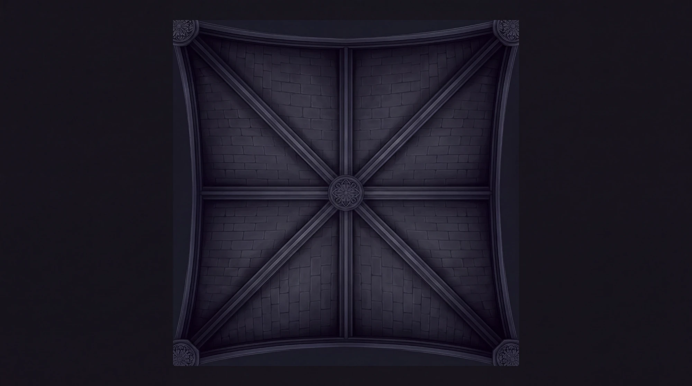

> **#2 完美收線** 🎯 結構乾淨(X 對角肋 + 十字肋 + 中央 boss + 四角 boss + 磚蹼)、暗調對上原圖、可平鋪、隔離乾淨。HEX 鎖色成功。**#2 定案。**
> ⚠️ 若 HEX 還壓不住:最後手段 = 上傳結構圖,用 Python 逐階對映色盤 100% 鎖死。

---

## 場景拆解 3 — #3 天井剖面(十字交會 light-well)· 救援鏈

### 3_1 遠景端景拱廊 · 失敗(需檢討)

> 初始方向:「#3 遠景端景拱廊,先畫 #3 紅框(框中央遠景大拱門 + 上層 gallery 帶),視角改回正交立面,比例 3:4」。
> **失敗原因(重要結論):** 中央那塊原圖**大半是霧 / 縱深走廊**,不是一片平面 → 要 AI 出「正交立面」只能亂編,每張不一樣。判讀修正為「**十字交會 + 挑高天井(lantern/crossing tower)**」結構,改走**廢墟參考 → 修復**路線(3_2)。

### 3_2 用 Gemini 重製素材 → 廢墟修復救援鏈 · 成功(堪用)

Gemini 重製(移除天花板 / 移除圈選建物結構 / 看到後方建物結構):
`https://gemini.google.com/u/1/app/1e4f3ed6bd0bf288`

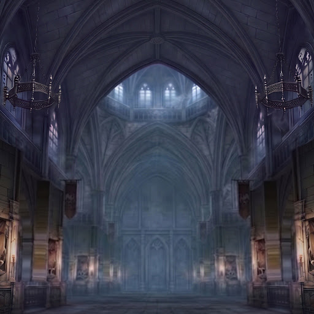 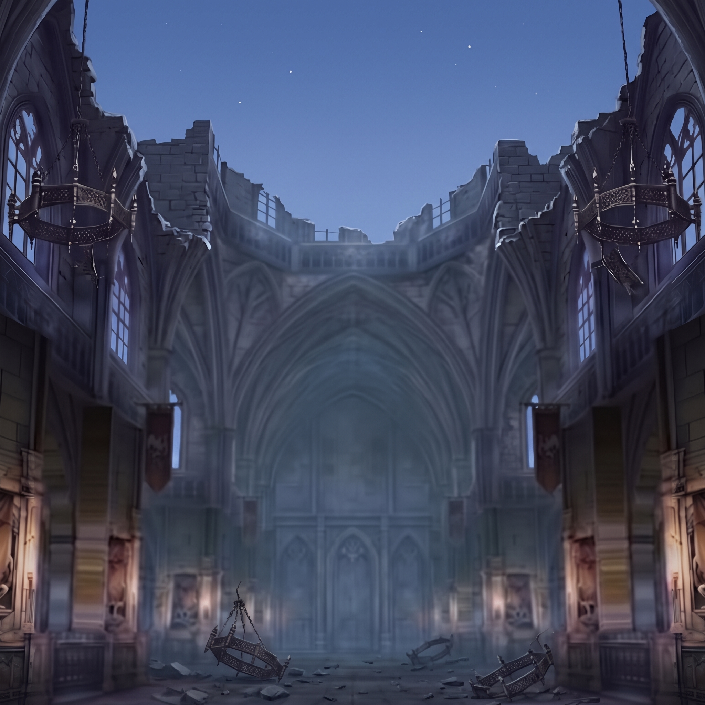
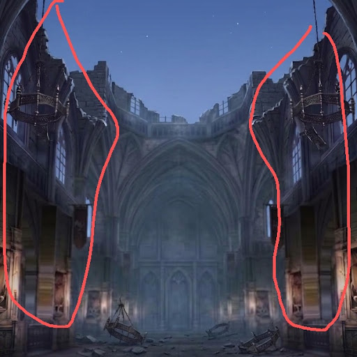 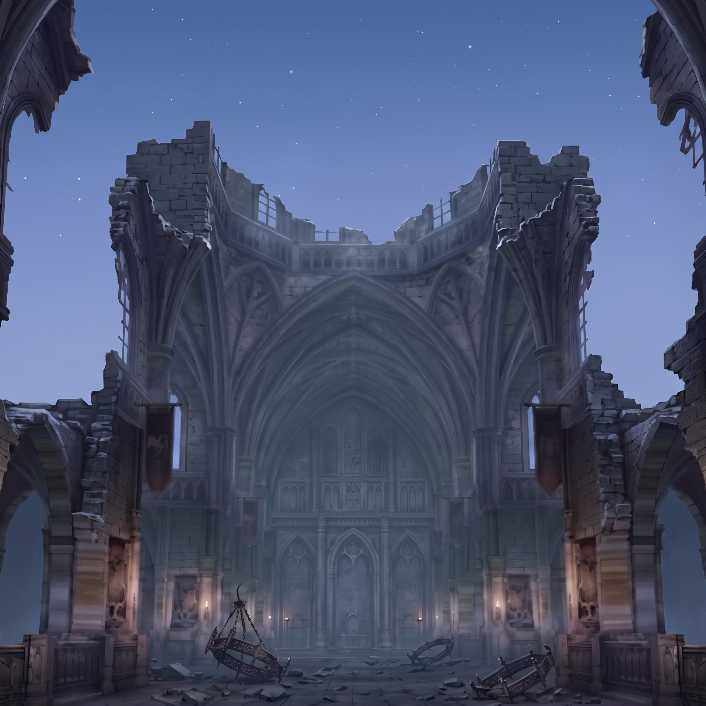
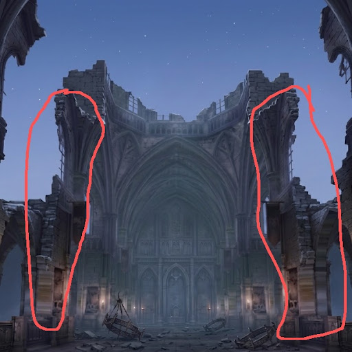 <!-- №26 a4-crossing-gem-back-after 待補上傳 -->

> Q：「我想把這個建物恢復成完整的天井剖面結構,請給我提示詞」
> 這張(廢墟圖)真的畫出了天井結構(四大拱交會、上方 lantern、側邊圓頂),有真實結構可依據,「修復成完整」就成立。

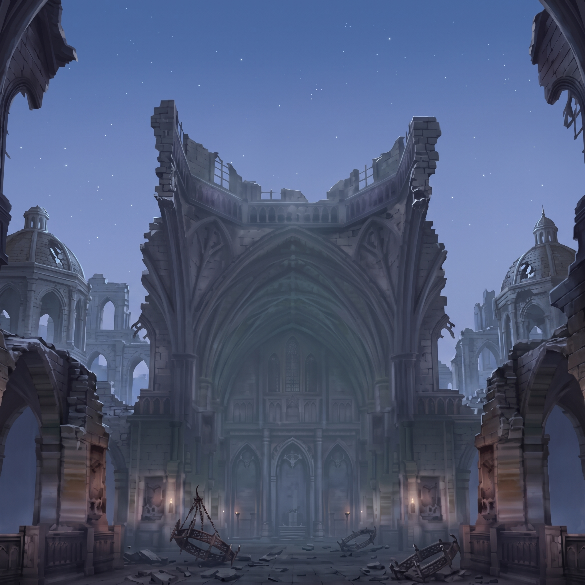

**3_2a 天井剖面修復｜第一張 = 廢墟圖(來源/結構依據)｜比例 1:1 或 4:5**

```text
Use the attached image as the source: a ruined gothic cathedral crossing. RESTORE it
to a COMPLETE, intact building and present it as a clean head-on FRONT architectural
SECTION of the central crossing light-well.

Rebuild every missing and broken part: complete the collapsed upper lantern into a
full intact lantern tower — a third-floor stone balustrade gallery, a row of tall
pointed lancet windows, and a complete ribbed groin vault above the crossing. Repair
the broken walls into FOUR complete great pointed arches meeting at the central
crossing. Remove ALL rubble, debris, fallen beams and jagged broken edges; close the
holes to the sky with an intact roof and vault.

Present it straight head-on as a flat FRONT orthographic section, perfectly
bilaterally symmetric about the vertical centre-line — flatten the 3/4 perspective
into a clean elevation. Show the full vertical structure bottom to top: ground-level
pointed archways → crossing piers → gallery balustrade → lancet windows → ribbed
vault lantern at the top.

Clean architectural reference — the complete symmetric crossing centered on a plain
dark neutral background: NO sky, NO landscape, NO ground, NO rubble, NO props, nothing
cropped, generous margin all sides. Keep the cool grey gothic stone material with soft
moody baked ambient occlusion in the recesses. High-resolution symmetric orthographic
section plate.
```

溯源:`https://app.leonardo.ai/generation/image/use-attached-image-source-ruined-gothic-cathedral-44eac512-69e1-42b9-99f2-494898244f05`
**為什麼成功:** 結構清楚 → 修復+補完有東西可抄;`FRONT orthographic section + 對稱 + flatten 3/4` 拉成正對剖面;`remove rubble / close holes / no sky` 從廢墟變完整。

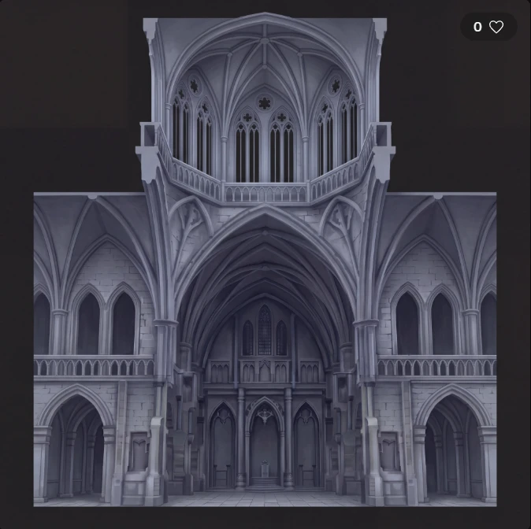

> Q：「我要的是不改變色調跟打光,幫我調整提示詞。打光跟色調要依照圖2;圖3 是算出圖1 的參考圖;圖1 是結果。」
> 結構終於對(圖1),只差色調(偏灰,要圖2 暗藍調)。**不要重跑,把圖1 鎖結構 + 換圖2 色調。**

 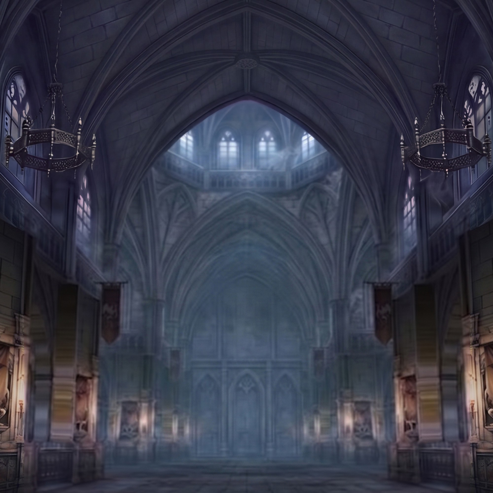 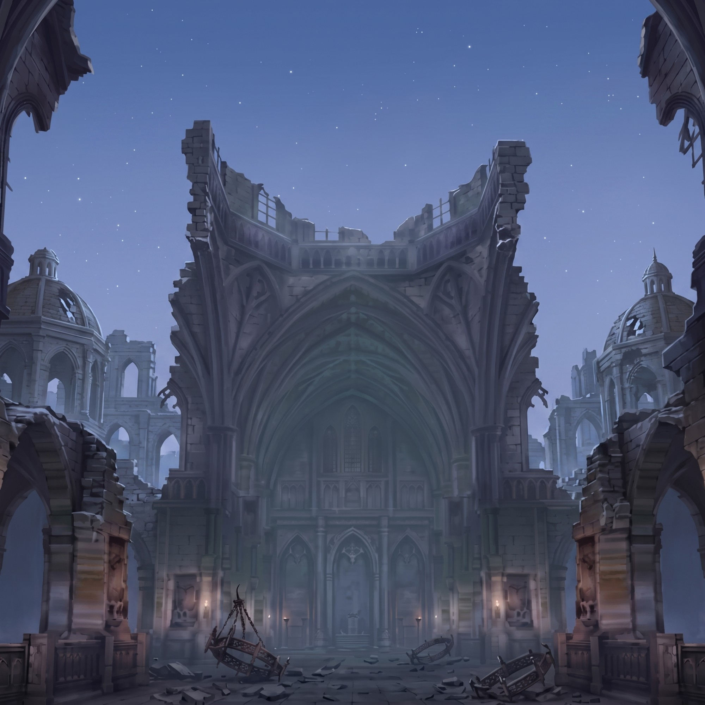

**3_2b 換色調版｜第一張 = 圖1(結構正確,鎖它)｜第二張 = 圖2(暗調來源)**

```text
Image A (FIRST) is the finished crossing-section structure — keep its geometry,
composition, proportions and every architectural detail EXACTLY as-is, pixel for
pixel. Do NOT change, add, remove or redraw any structure. This is a RECOLOUR /
RELIGHT pass only.

Recolour and relight Image A to MATCH Image B's dark, low-key mood exactly: a deep
desaturated cool blue-grey gothic interior at night. Use this palette and do NOT go
brighter or more neutral-grey:
- overall average value ~#242433 (dark, cool, low-key — NOT light grey),
- stone mid-tone #232432 to #2E303E,
- deep near-black ambient occlusion in every recess, vault groin, arch soffit and
  joint #171623,
- soft cool blue glow only inside the windows,
- keep the gentle top-down atmospheric light from the lantern windows as in Image B.

Reproduce it as baked shading and AO for an UNLIT / emissive game material — do NOT
relight flat, do NOT brighten, do NOT desaturate to light studio grey, do NOT add new
light sources. Keep Image A's exact shapes.

Flat dark neutral background, centered, complete, nothing cropped. High-resolution
symmetric orthographic crossing-section plate — Image A's structure, Image B's dark
moody colour and lighting.
```

溯源:`https://app.leonardo.ai/generation/image/image-first-finished-crossing-section-structure-3d8579fe-4db6-480c-be54-21e99405be5a`

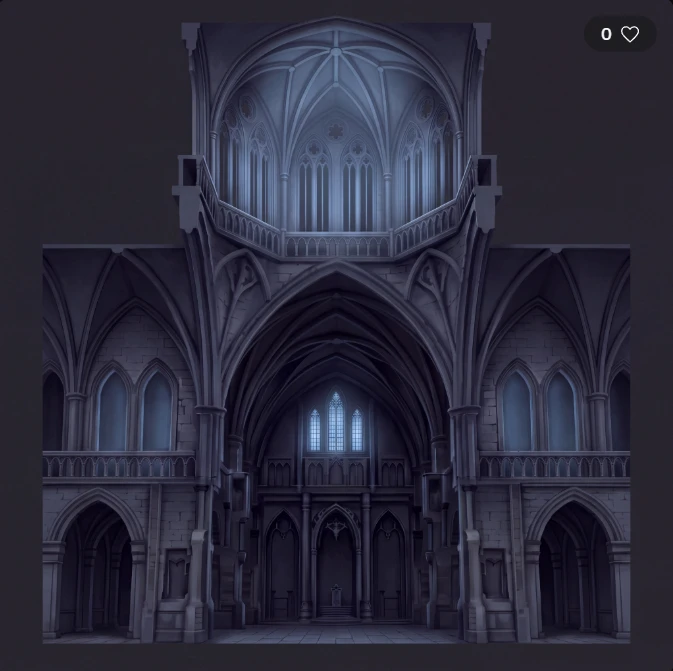

> Q：「上方還是差了一點」 → 下半暗調對,只有上方 lantern 塔偏亮偏灰(採光區亮度被 recolor 留住)。**補一刀,只壓上方。**

**3_2c 只壓上方塔 · 局部 recolor｜第一張 = 剛才暗調結果(鎖它)**

```text
Image A (FIRST) is the crossing section — keep its geometry and its already-correct
dark lower half EXACTLY. This is a recolour / relight pass only, do NOT change any
structure.

ONLY fix the UPPER lantern tower at the top: it is still too pale and bright. Darken
its STONE — the gallery arcade, the piers, the balustrade and the vault ribs — down
to the SAME dark low-key slate as the lower half (average value ~#242433, near-black
ambient occlusion #171623). Keep ONLY the tall lancet window openings emitting a soft
cool blue glow; the stone around and between them must be DARK, not pale grey. Remove
the bright pale haze/wash at the top so the upper tower sits in the exact same value
range as the rest of the image.

Do NOT brighten anything else, do NOT relight, do NOT alter the lower half. Dark
UNLIT / emissive baked look. Flat dark neutral background, centered, complete,
nothing cropped. High-resolution symmetric crossing-section plate.
```

溯源:
- `https://app.leonardo.ai/generation/image/image-first-crossing-section-keep-its-geometry-0186852d-baf8-483b-a418-b8940e005fbe`
- `https://app.leonardo.ai/generation/image/image-first-crossing-section-keep-its-geometry-55351957-4532-495e-b481-db859cc53780`(終版)

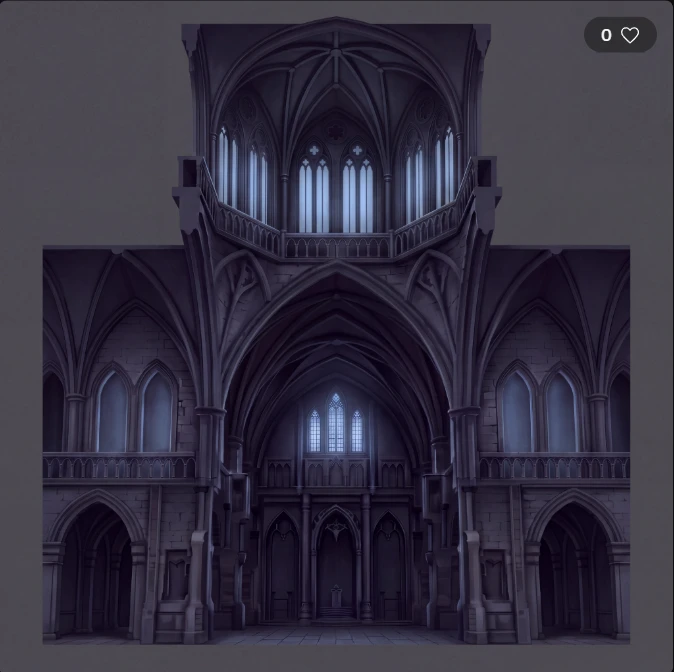 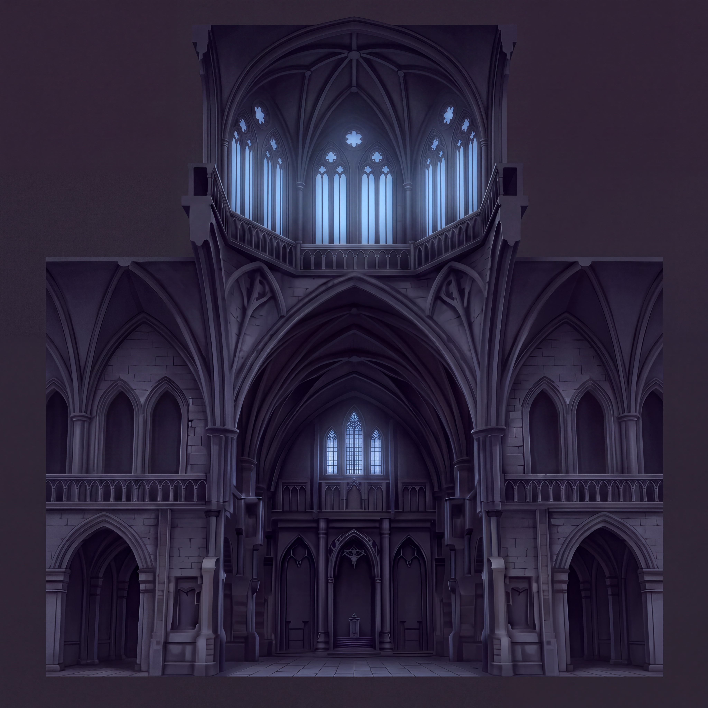

> **#3 天井完整收線** 🎯 上下暗調一致、窗孔冷光、結構完整對稱。救援鏈「**廢墟參考 → 修復完整 → 鎖結構換色調 → 局部壓亮**」成立。
> 💡 (上方壓暗這步 PS 30 秒也能做:上方塔框選區 → 曲線/色階拉暗 → 貼合下半。)

---

## 場景拆解 4 — #4 地面石磚(top-down 可平鋪)

### 4_1 直接拆原圖地板 · 失敗

**#4 地面(top-down 可平鋪)— 原圖拆地板｜第一張 = 乾淨原圖｜第二張 = #4 地面紅框圖｜比例 1:1**
> **失敗原因(使用者原話):** 「可能素材品質不好,產出來都不優。」原圖地板斜角 + 解析度不足,拉成 top-down 偏糊。

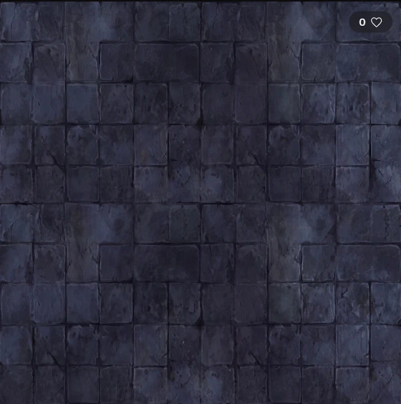

### 4_2 用其他素材 → 鎖格換色 · 成功

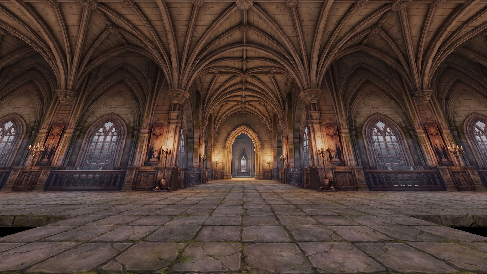

**top-down 地板 prompt**(⚠️ 使用者註記「提示詞要找出處 / 不知道從哪來,但要記錄」;比對本串後**疑為早期地面版本之改寫**,出處待考):

```text
From the attached concept art, extract ONLY the stone floor and re-orient
it to a true top-down orthographic view — camera pointing straight down,
perpendicular to the ground, looking directly at the floor from above;
IGNORE the concept's low camera angle and perspective (do NOT keep the
vanishing lines, tilt or foreshortening). Flatten it into a seamless,
tileable flagstone material plate: the SAME stones, cracks, mortar seams,
moss patches, colour and wear as in the concept, just seen flat from
above. Fill the whole frame edge to edge, no walls, no objects, no
horizon. Even diffuse lighting baked flat, NO cast shadows, NO rim light,
NO scene elements. High-resolution clean top-down reference plate for
image-to-3D / a tileable floor texture.
```

溯源:
- `https://app.leonardo.ai/generation/image/f0b1ef74-3d4b-4791-9a66-d58ec34e9e7d`
- `https://gemini.google.com/u/1/app/b5e4e09a101c765d`

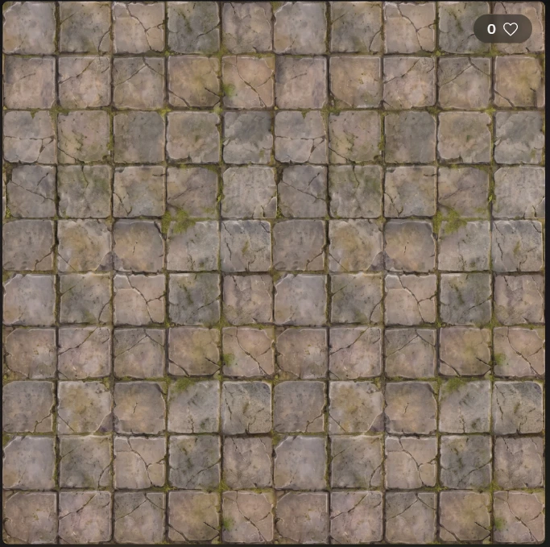

> Q：「我之前有算這張,也可以提供當參考嗎?」(一張暖砂岩 10×10 高細節磚)
> 這張超棒——**10×10 格準 + 裂痕/磨損/倒角細節豐富又銳利**,唯一問題只有顏色(暖砂岩+青苔)。拿它當「格線 + 細節」來源,**只換色、不動格不動細節**(最穩的一種 pass)。


**4_2 地磚終收 · 鎖格鎖細節 + 換暗冷色｜第一張 = 暖色 10×10 高細節磚(鎖它)｜Style None｜Enhance None**

```text
Image A (FIRST) is a high-quality 10×10 flagstone floor. KEEP everything about it
EXACTLY: the perfect 10×10 grid, every stone's shape and position, and ALL the surface
detail — the cracks, chipped bevelled edges, wear, mineral blotches and crisp sharpness.
Do NOT change the layout, do NOT blur, do NOT smooth. This is a RECOLOUR pass only.

RECOLOUR the warm tan / beige sandstone into DARK DESATURATED COOL SLATE gothic stone.
Shift the whole palette cool and dark: stone faces average ~#242433, mid-tone
#232432–#2E303E, deep near-black ambient occlusion in the joints and cracks #171623.
Remove the green moss (or reduce it to very sparse, dark, desaturated traces). Keep a
subtle damp specular sheen.

Keep the exact same crisp detail and 10×10 grid — only the colour and tone change to
match a dark gothic cathedral floor. UNLIT / emissive baked look, do NOT relight or
brighten. Seamless tileable, top-down, no perspective. High-resolution PBR floor.
```

**為什麼這張是正解:** 格 ✅(10×10 準)+ 細節 ✅(裂痕/倒角/磨損銳利)——兩個最難的已在圖裡,只差顏色,而換色是最穩的一種 pass(不動幾何、不重畫)。
**青苔:** 哥德陰森大廳通常去綠苔;要潮濕苔痕把 `remove the green moss` 改成 `keep sparse dark moss in the joints only`。

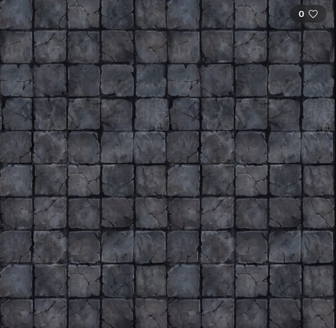

> **🎉 地磚完美收線** —— 10×10 格準、裂痕/倒角/磨損銳利、暗冷石板色對上大廳。格準 + 細節 + 色調三全,可直接進引擎。

---

## 四件收齊 · 總表

| # | 資產 | 走法 | 狀態 |
|---|---|---|---|
| **#1** | 側廊牆體(兩層彩窗+欄杆) | 正交立面 + 反裁切 | ✅ |
| **#2** | 交叉尖拱天花(可平鋪 bay) | 仰視單元 + 鎖結構 + HEX 鎖色 | ✅ |
| **#3** | 天井剖面(十字交會) | 廢墟修復 → 鎖結構換色調 → 局部壓亮 | ✅ |
| **#4** | 地面石磚(10×10) | 換素材 + 鎖格換暗冷色(B1 pass) | ✅ |

> 道具 #5 吊燈 / #6 垂幔 → 見 **A5**。

---

## 踩坑 / 教訓(可複用結論)

1. **只還原框內 > 泛詞隔離。** `Reproduce ONLY inside the red outline, outside = empty background` + 點名禁掉搶戲物件(中央大窗/拱門),才治得了「NB 自動補成對稱大廳」。
2. **反裁切要明寫。** `FRAMING … entire height … 70–80% … nothing touch edge` + 高瘦比例(9:16)治上下被切。
3. **`even brightness overall` 會被讀成「中性均光淺灰黏土」** → 丟原圖暗調。要保光影得明寫「match SOURCE lighting/colour/tone EXACTLY + near-black AO + do NOT clay/matcap/studio」。
4. **重生成會重畫幾何 → 結構漂移。** 結構一旦對了,改用「**鎖結構(Image A)+ 轉色調(Image B / HEX)**」雙參考 pass,不要再重跑整張。
5. **NB 對 HEX 仍可能讓步** → 底線手段:Python 逐階對映色盤 100% 鎖死。
6. **「原圖是霧 / 縱深」的區域(天井)拉不出正交立面** → 換路線:找/做一張**結構清楚的參考(廢墟圖)→ 修復成完整**,再鎖結構換色調。
7. **地面別硬拆爛素材** → 用高品質 10×10 現成磚,**只換色不動格**;B1 配方(Style/Enhance = None;Dynamic = 糊的元兇)。
8. **這些都是 re-render,非像素級保留** → 疊回原圖比例/數量,可接受才收;要像素真值走 3D 烘。

---

## 圖檔清單(待補 — 請依名存入 `docs/asset-cases/images/`)

> 紅筆 № = 使用者原始紀錄的圖序(逐圖點數,一張截圖多圖就多名)。共 **39 圖**;№5/6/13 為輸入重貼(= №1/№2),實際上傳約 36 檔。

| № | 檔名 | 內容 | 狀態 |
|---|---|---|---|
| 1 | `a4-concept-source.jpg` | 哥德大廳乾淨原圖 | ✅ 已入庫 |
| 2 | `a4-redframe-placement.png` | 4 區紅框 placement map | ✅ |
| 3 | `a4-sketch-a.png` | 4 區手繪草圖(① ② ③ ④) | ✅ |
| 4 | `a4-prop-redframe.png` | 道具紅框(垂幔 + 吊燈) | ✅ |
| 5 | `a4-wall-in-source.png` | #1 改善版① 輸入:原圖(= №1) | ✅ |
| 6 | `a4-wall-in-redframe.png` | #1 改善版① 輸入:紅框(= №2) | ✅ |
| 7 | `a4-wall-01.png` | #1 改善版① 成果 1 | ✅ |
| 8 | `a4-wall-02.png` | #1 成果 2 = **master**(純牆模組) | ✅ |
| 9 | `a4-wall-03.png` | #1 成果 3(側牆 return 略 3/4) | ✅ |
| 10 | `a4-wall-04.png` | #1 成果 4 = **含道具**(垂幔+吊燈) | ✅ |
| 11 | `a4-wall-05.png` | #1 成果 5 | ✅ |
| 12 | `a4-wall-06.png` | #1 成果 6 | ✅ |
| 13 | `a4-vault-in-source.png` | #2 定稿 輸入:原圖(= №1) | ✅ |
| 14 | `a4-vault-in-redframe.png` | #2 定稿 輸入:#2 紅框 | ✅ |
| 15 | `a4-vault-grey-structure.png` | #2 §2a 結果(乾淨灰結構) | ✅ |
| 16 | `a4-vault-coloref.png` | #2 需再調色的對照圖 | ✅ |
| 17 | `a4-vault-2b-recolor.png` | #2 §2b 重跑(結構錯) | ✅ |
| 18 | `a4-vault-2c-dualref.png` | #2 §2c 鎖結構 + 轉色調 | ✅ |
| 19 | `a4-vault-hex-compare.png` | #2 調顏色比照(HEX) | ✅ |
| 20 | `a4-vault-final.png` | #2 §2d HEX 鎖色定案(暗調) | ✅ |
| 21 | `a4-crossing-gem-ceiling-before.png` | #3 Gemini 移天花板 before | ✅ |
| 22 | `a4-crossing-gem-ceiling-after.png` | #3 Gemini 移天花板 after | ✅ |
| 23 | `a4-crossing-gem-struct-before.png` | #3 Gemini 移圈選結構 before | ✅ |
| 24 | `a4-crossing-gem-struct-after.png` | #3 Gemini 移圈選結構 after | ✅ |
| 25 | `a4-crossing-gem-back-before.png` | #3 Gemini 看後方結構 before | ✅ |
| 26 | `a4-crossing-gem-back-after.png` | #3 Gemini 看後方結構 after | ☐ **待補上傳** |
| 27 | `a4-crossing-ruin-ref.png` | #3 霧藍廢墟(修復來源) | ✅ |
| 28 | `a4-crossing-restored-grey.png` | #3 修復成完整(灰結構) | ✅ |
| 29 | `a4-crossing-qa-result.png` | #3 Q/A 圖1(結果) | ✅ |
| 30 | `a4-crossing-qa-toneref.png` | #3 Q/A 圖2(色調來源) | ✅ |
| 31 | `a4-crossing-qa-ruinref.png` | #3 Q/A 圖3(廢墟參考) | ✅ |
| 32 | `a4-crossing-recolored.png` | #3 §3_2b 換暗色(上方差一點) | ✅ |
| 33 | `a4-crossing-final-v1.png` | #3 §3_2c 終版 a | ✅ |
| 34 | `a4-crossing-final-v2.png` | #3 §3_2c 終版 b | ✅ |
| 35 | `a4-floor-fail.png` | #4 §4_1 原圖拆地板失敗 | ✅ |
| 36 | `a4-floor-concept-source.png` | #4 §4_2 概念源(top-down prompt) | ✅ |
| 37 | `a4-floor-warm-10x10.png` | #4 暖色 10×10 高細節磚 | ✅ |
| 38 | `a4-floor-warm-10x10-ref.png` | #4 暖磚參考(Q「之前算過」) | ✅ |
| 39 | `a4-floor-final.png` | #4 鎖格換暗冷色定案 | ✅ |

> 圖補齊後,把上面各段的 `<!-- 待補 -->` 換成 `` 即可。
