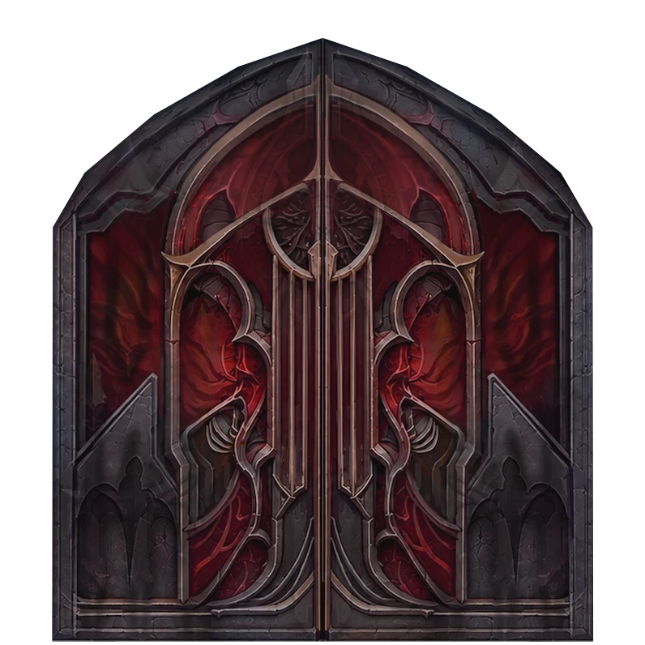
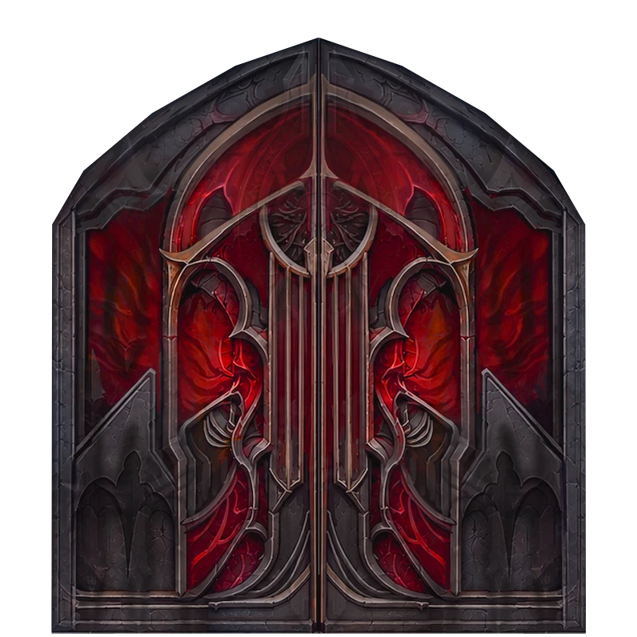
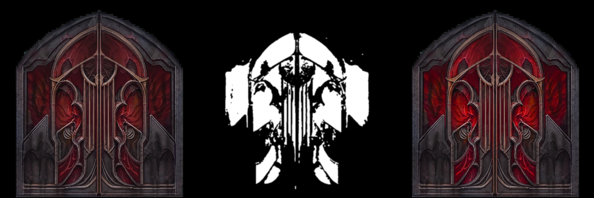
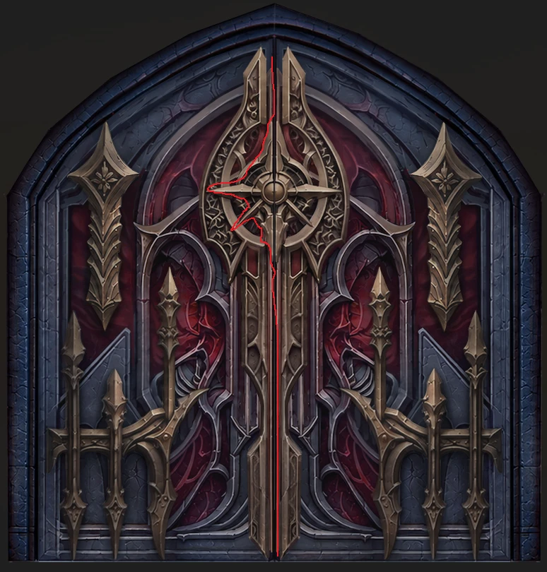

# 實戰紀錄 — A4 哥德雙開門:顏色範圍自動遮罩(紅色區域加強)

> 資產局部調色案例。需求:「門上紅色的部分要更強調」,但紅色區塊被金屬框條切得很碎,手工框選很難。
> 解法:**不用手選、不用 AI** — 按 HSV 色相/飽和度/亮度門檻,逐像素自動抓遮罩,再只在遮罩內調色。
> 腳本:[`tools/color-range-mask/color_mask.py`](../../tools/color-range-mask/color_mask.py)

## 來源(索引)
- **日期:** 2026-10-19 ~ 2026-10-26
- **素材:** 哥德暗紅雙開門(透明背景 webp,800×796)
- **工具:** Python(Pillow + NumPy)出遮罩 → Photoshop 調整圖層微調(使用者自行收尾)

---

## 結果

| 原圖 | 遮罩 | 加強版 |
|---|---|---|
|  |  |  |

- 遮罩佔畫面 **約 24%**:上方拱形、左右側板、中央框條後的紅色全數抓到;灰黑石框、底部哥德尖拱、金屬框條全數排除 → **使用者驗收:遮罩 OK**
- 加強版只在遮罩內 **飽和度 ×1.3、亮度 ×1.35**,其他像素不動;**保留原 alpha**

---

## 原理:遮罩是怎麼來的(不是 AI 判斷)

一段程式按**固定顏色規則逐像素判斷**;人的工作只是**挑門檻數值 + 跑完看對照圖驗收**。

1. 每個像素 RGB → **HSV**(H 色相 = 哪種顏色、S 飽和度 = 多鮮豔、V 亮度)
2. **三條件全中才算紅色:**

   | 條件 | A4 定案值 | 作用 |
   |---|---|---|
   | 色相 | **335°～360° 或 0°～20°**(紅,略帶洋紅) | 排除金屬(偏棕)、石材 |
   | 飽和度 | **> 45%** | 排除灰黑石框(近無彩色) |
   | 亮度 | **> 10%** | 排除近黑的陰影雜訊 |

3. **清理:** 5×5 中值濾波去零星雜點 → 1.5px 高斯模糊羽化邊緣

### 為什麼這張圖能抓這麼準
三種材質剛好落在**不同顏色區間**:石框飽和度低、金屬框色相不對、紅色區塊色相與飽和度都集中 → 一條規則整片抓到。

### 門檻怎麼挑(同系列兩張門的實測差異)

| 圖 | 色相 | 飽和度門檻 | 理由 |
|---|---|---|---|
| 第一張(藍灰石框 + 金飾) | 330°～20° | > 35% | 石框偏藍,離紅很遠 → 可放寬 |
| **第二張(暖灰石框,本案定案)** | **335°～20°** | **> 45%** | 石框帶暖色,怕吃到 → 收緊 |

> 經驗法則:**周圍材質越接近目標色,飽和度門檻越高、色相範圍越窄。** 每次都要看「原圖|遮罩|加強」三聯對照圖驗收。


> 對照圖背景是黑色,是因為預覽時去掉了 alpha;成品 `a4-red-boost.png` 是透明背景。

---

## 用法

### A. 腳本(預設參數 = A4 定案值)
```bash
python3 tools/color-range-mask/color_mask.py door.webp --out-dir out/
# 輸出 out/door_mask.png、out/door_boost.png(保留 alpha)、out/door_compare.png
# 換顏色/放寬門檻:--hue-min 330 --hue-max 20 --sat-min 0.35 --val-min 0.10
# 調強度:--sat-gain 1.3 --val-gain 1.35
```
色相參考:紅 ≈ 335～20、橘 ≈ 20～45、黃 ≈ 45～70、綠 ≈ 90～150、青 ≈ 170～200、藍 ≈ 200～250、紫 ≈ 260～300。

### B. Photoshop 收尾(建議 — 強度可隨時改、不破壞原圖)
1. 開 `*_mask.png` → Ctrl+A、Ctrl+C → 回門的檔案,色版面板新增 Alpha 色版 → 貼上
2. Ctrl + 點該 Alpha 色版 → 變選取範圍
3. 新增「色相/飽和度」或「曲線」調整圖層(選取自動變成圖層遮罩)
   - 起點:飽和度 +15～25、明度 +5～10(≈ 腳本 ×1.3 / ×1.35 的效果)
4. 修遮罩:要補的(例如中央圓窗暗紅雕紋)用白筆刷;框條邊緣溢紅用黑筆刷擦

### C. 純 Photoshop 等價做法
「選取 → 顏色範圍」,吸管點紅(Shift 加選亮紅/暗紅)、朦朧度 40～60 起調 — 同一原理,只是門檻用滑桿調。

---

## 學到的(可複用結論)

- ✅ **碎片化的單色區域,先試顏色門檻,不要先手選。** 被框條切碎的區塊,手選最慢、顏色規則最快。
- ✅ **遮罩當調整圖層用,不要直接改原圖。** 腳本出的加強版只是試做,定案強度在 PS 裡拉。
- ✅ **透明背景資產要保留 alpha。** 用 RGB 處理會把透明變黑,輸出時要把原 alpha 貼回去(腳本已處理)。
- ⚠️ **只看顏色、不懂物件。** 以下情況會失敗,改走 AI 分割(SAM 類)或手補遮罩:
  - 目標色與其他材質相近(紅銅、暗紅木頭、紅棕石材)
  - 目標區內有大片近黑暗部 — 本案中央圓窗的暗紅雕紋只抓到一部分(亮度低於門檻)
- ⚠️ **AI 區域編輯(NB2)也能做,但可能動到金飾。** 只是「加強既有顏色」時,PS 調色零漂移、最穩。

---

## 附錄:雙開門左右扇切分(向內開會不會穿模)


> 紅線 = 使用者畫的不對稱接縫(繞過中央輪盤左臂)。

- **接縫形狀本身不會撞:** 鉸鏈繞垂直軸轉,每個高度各自是平口對接;零厚度下,接縫怎麼曲折都只會各自退開。
- **真正會撞的兩種情況:**
  1. **厚度 + 浮雕深度的弧線外擴** — 接縫外側角先往對面推進約 `√(r² + D²) − r`
     (r = 接縫點到鉸鏈的水平距離,D = 門板厚 + 浮雕凸出深度)。
     例:r = 0.9m、D = 0.25m → 每扇推進約 3～4 cm;同時開需約 6～7 cm 縫或斜切接縫面。
     接縫越靠近鉸鏈(r 越短),推進量越大。
  2. **一扇的浮雕在深度上蓋到另一扇前面** — 往內開必撞,只能切開浮雕或規定開門順序。
- **建議:** 接縫走正中線,中央輪盤/雙尖塔對半切(關門時圖案仍完整)。
- **驗證:** Blender/UE 把 pivot 放外側鉸鏈,0°/15°/30°/90° 各轉一次查交疊;最易撞在 10°～25°。
