# 實戰紀錄 — A5 古堡 哥德大廳:三視圖重建(道具 turnaround + image-to-3D)

> concept→3D turnaround / 道具三視圖重建案例。對應工作流:`ai-media-generator`(concept-to-3D)。
> 姊妹篇:**A4 — 古堡概念圖拆解**(建築四件、保光影軌)。
> 道具:① 石像鬼 ② 火把 ③ 吊燈(環形金屬吊燈)。平台:Nano Banana Pro;Style / Prompt Enhance 一律 None。
>
> **相關案例:** [A4 概念圖拆解](A4-castle-concept-decomposition.md)(姊妹篇,保光影軌)· [A2 浮雕牆](A2-buddhist-relief-wall.md)(**de-lit 逐字句 + height pass 模板**)· [A1 陵墓](A1-mausoleum.md) · [A3 枯樹去背](A3-forest-tree-cutout-inpaint.md) · [B6 三相機](B6-three-camera-pipeline.md) / [B7 Unreal 相機重現](B7-unreal-camera-port.md)(turnaround 真正交從 3D)· [B9 樹重上色](B9-tree-trunk-restyle.md)(Crop-Gen-Paste 像素鎖)
>
> **相關 SKILL:** `ai-media-generator`(concept-to-3D pipeline:`references/concept-to-3d.md` + `templates/concept-to-3d-pipeline.md`)· `asset-cutout`(去背 SOP)

> 🚧 **此為整理初版** —— 文字/過程/教訓已整理;**逐字 prompt(📌 待貼)與圖片(待補)留空位**,由使用者補上(prompt 一字不改)。

---

## 結論(先讀)

**古堡_三視圖重建(道具)**
Claude 對話:`https://claude.ai/code/session_0139cX4BbLdhe5fdhLGcUfpF`

### 雙軌架構(本篇核心)

每個道具跑兩條軌,順序固定 **先保光影 → 再 de-lit**:

| 軌 | 內容 | 給誰用 |
|---|---|---|
| **A 保光影軌** | 保留原概念圖的烘焙光影 / 色調,出 turnaround(正 / 側 / 背 / 3-4) | 「不受光材質球」的簡單 3D mock 直接貼 |
| **B de-lit 軌** | 均勻漫射攝影棚照明、**去光但保 albedo**、無陰影 / 無輪廓光 / 無光束、置於 #808080 無縫底 | image-to-3D 的輸入參考 |

> ⚠️ **順序不可反:** 先保光影再 de-lit —— de-lit 把光資訊拿掉後,**無法再「補回」**原概念圖的打光(使用者原問:「我是要先算保留光影 再做 de-lit 這樣會比較好嗎」→ 是)。

### 這輪驗證出的可複用招式
- **先保光影 → 再 de-lit**(反過來救不回原光)
- **de-lit = 去光保 albedo**,不是去 albedo 變黏土 / matcap;底色 **#808080 固定不換**
- **鏡射出左視:** 世界光固定下,右視鏡射 = 成功左視(不用重算)
- **turnaround 世界光固定:** 正面受光、背面背光(光從右前方)、側面半側光
- **正交 NB 只能近似:** 要真正交從 3D 正交相機出(同 A4 / A2)
- **高空物件大膽簡化:** 太精細的細節在高處表現不出來(吊燈八角化)
- **樓空 → 填背板 / 填洞成浮雕:** 利於建模、避免透空破面
- **畫風崩掉就止損回退:** edit-chain 會漂,回退到最佳版再分支
- **紅圈 / 紅線定位:** 改結構、改尺寸、標調整處
- **de-lit 去雜訊 pass:** NB de-lit 常帶雜訊,補一句專門降噪、分階段洗乾淨

---

## 來源 / 需求定調

- **原始素材:** 哥德大廳概念圖(同 A4)裡的三個道具:石像鬼、火把、環形金屬吊燈。
- **用途:** A 保光影軌 → 不受光材質球 mock 貼圖;B de-lit 軌 → image-to-3D 輸入。
- **平台:** Nano Banana Pro;Style / Prompt Enhance = None。
- **de-lit 規格(使用者原話,逐字):**
  > 置於平坦的中性灰 (#808080) 無縫背景。使用均勻漫射的攝影棚照明，去除真實反照率，無陰影、無輪廓光、無光束
  >
  > ⚠️ **踩坑 + 正解:** 原句「**去除真實反照率**」被 NB 照字面連**材質本色也去掉 → 變灰黏土**(使用者:「我不是要黏土材質」)。de-lit 真正要的是「**去光但保 albedo**」= 拿掉陰影 / 高光 / 輪廓光 / 反光,**只留材質本色與花紋**(≠ 變黏土 / matcap)。→ 這句應改成「**保留反照率(材質本色),只移除光影**」。
- **參照:** de-lit 逐字句可對照姊妹案 **A2**(`A2-buddhist-relief-wall.md` STEP 1 的 de-lit 句)。

<!-- 待補圖:a5-concept-source(概念圖,標出三道具位置) -->

---

## 道具 1 — 石像鬼(Gargoyle)

**拆圖起手式**

> Q 我要拆石像鬼 拆掉這張概念圖」「concept→3D」「三視圖重建 保留原來的光影 不要改變色調 也不要改變打光

### A 保光影軌 · turnaround(正 / 側 / 背 / 3-4)

#### ① 正面 plate(保留原光影)
第一張 = 乾淨概念圖 ｜(可選)第二張 = 紅框指左邊那隻 ｜ 比例 3:4

```text
From the attached concept art, extract ONLY the LEFT wall-mounted gargoyle statue —
 the carved winged demon figure sitting on its stone corbel bracket. Do NOT include the
 wall sconce / torch, the flame, the niche, the window, the balustrade or the wall.
 Everything else becomes empty flat dark background.
Re-orient to a true head-on FRONT view of the statue, facing the viewer; IGNORE the
 concept's angle and perspective — do NOT copy any tilt or 3/4 view. One complete,
 isolated, centered statue with its corbel.
CRITICAL — preserve the source's baked lighting, colour and tone EXACTLY as painted:
 keep the same warm torch-lit glow on one side and cooler shadow on the other, the exact
 stone colour, the ambient occlusion in every crevice, and the material shading. Do NOT
 relight, do NOT change the tone or palette, do NOT flatten to neutral studio light, do
 NOT add or remove shadows. This is a PRE-LIT asset for an UNLIT / emissive material —
 reproduce the original lighting as-is.
FRAMING: the complete statue fully in frame, generous margin on all sides, nothing
 cropped or touching the edge, centered on empty dark background. High-resolution
 game asset plate.
The corbel bracket base is smooth, solid and INTACT — no cracks, no fractures, no
 chips, no weathering damage on the base.
```

溯源:`https://app.leonardo.ai/generation/image/attached-concept-art-extract-left-wall-mounted-f77461bd-96d9-40ba-a07e-707202f73d71`

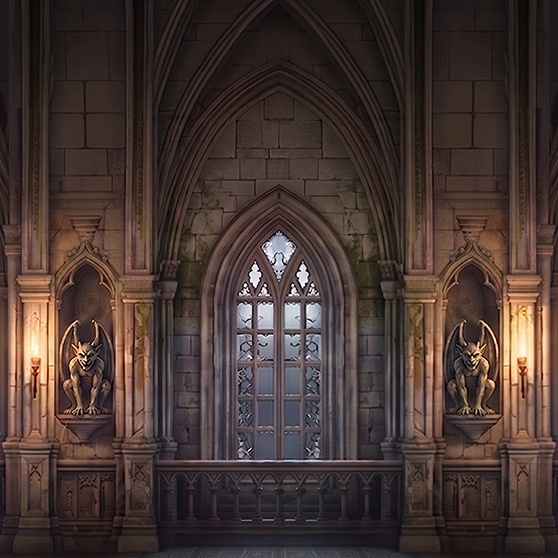 

#### ② 左視圖(嚴格正側面 → 正交)

> Q:「我要左視圖」
> A:了解——你要的是正規的「左視圖」= 嚴格 90° 正側面(只看到側剖影:臉的側臉、翅膀、背、蹲姿從側面),不是現在這種還看得到胸口正面的3/4 角。修正重點就是「壓成純側面、禁 3/4」。

第一張 = 正面 plate(一致性錨)｜第二張 = 乾淨概念圖｜固定同 seed｜比例 3:4 —— **產生非正交圖**

溯源:`https://app.leonardo.ai/generation/image/using-first-image-finished-front-plate-reference-63b342c2-5aa8-408a-b677-cd0ede383b3e`

 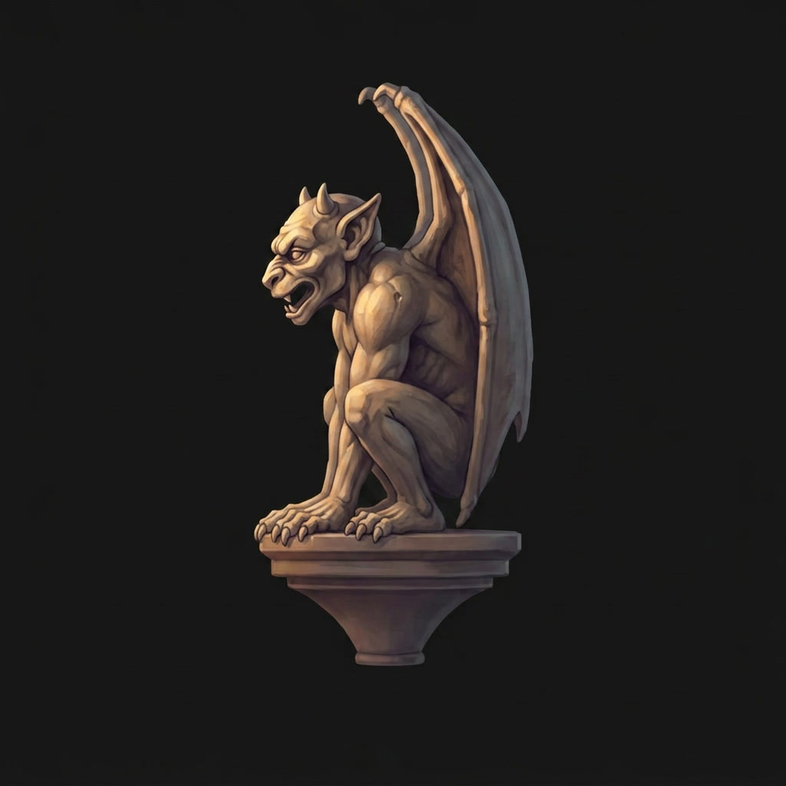

> Q:「這個不是正交鏡頭 我要正交鏡頭」
> A:你抓到重點——NB 預設是有透視的戲劇鏡頭(近大遠小、翅膀往後收、略仰角),不是真正交。要壓成正交,得狠狠堆正交詞 + 否定透視。

**🔑 正交鎖(這段之後每個視角都套):**

```text
Render in TRUE ORTHOGRAPHIC PROJECTION (parallel projection), like a technical
model-sheet / turnaround elevation or an engineering orthographic drawing. NO
perspective, NO perspective foreshortening, NO vanishing point, NO lens distortion,
NO wide-angle, NO dramatic low-angle or high-angle. The camera axis is perfectly
horizontal, at the statue's mid-height, perpendicular to the view. Every part is
drawn at the SAME scale regardless of depth — near and far parts are the same size,
all parallel edges stay parallel. Flat, even, undistorted elevation.
```

**左視圖(正交版)** — 第一張 = 正面 plate(錨)｜第二張 = 乾淨概念圖｜固定同 seed｜比例 3:4

```text
Using the FIRST image (front plate) as the reference, re-render the SAME gargoyle
statue as a TRUE ORTHOGRAPHIC LEFT-SIDE elevation.

[貼上上面「正交鎖」整段]

Show ONLY the side silhouette (profile of face/snout, horns, wing edge-on, curved back,
chest in profile, crouching legs and claws from the side). STRICTLY flat 90° side — do
NOT show the front of the chest or face, do NOT use a 3/4 angle, do NOT rotate toward
the viewer.

SAME statue — identical proportions, wings, horns, face, musculature and corbel as the
reference; do NOT redesign or resize. Keep the SAME warm stone colour, tone and lighting
mood as the front plate (same warm key + cooler shadow, same AO/material); do NOT
relight to neutral, do NOT change the palette. PRE-LIT for UNLIT / emissive. Corbel base
smooth and INTACT, no cracks.

Complete, isolated, centered, generous margin, nothing cropped, empty flat dark
background. High-resolution orthographic side-view model-sheet plate.
```

> **老實說(先講清楚):** 生成模型畫不出「數學上真正交」——它本質是透視渲染器,上面這堆詞只能把它逼近正交(壓平透視、減少近大遠小)。要100% 真正交只有一條路:拿去做成 3D 模型,再用正交相機 render(這也正是這張 plate 的用途——當建模參考)。
> 所以策略是:用這版逼近正交的 plate 當「建模參考」(比例、造型、光影都夠準)→ 建完模在引擎/DCC 裡開正交相機,才有像素級真正交三視。
> 先跑這版逼近正交的左視圖,夠當參考就收;要更平我再加重 flatten 詞。

> ✅ **讚 👍 側面對了(鏡射即左視)。** 正面 + 左側 兩視到手。補上背視就湊齊三視圖(model sheet 核心)。

溯源:`https://app.leonardo.ai/generation/image/using-first-image-finished-front-plate-reference-cdb64564-08dc-4535-bd85-4b20783ab413`

 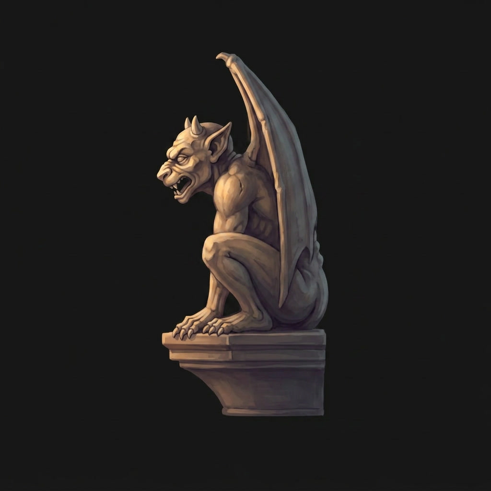

#### ③ 背視 · 修正光源(固定右前光 → 背光)
第一張 = 正面 plate｜第二張 = 乾淨概念圖｜固定同 seed｜比例 3:4

```text
Re-render the SAME gargoyle statue as a TRUE ORTHOGRAPHIC BACK view (180° from front),
seeing the rear of the head/horns, spine, shoulder blades, the outer back of both wings,
haunches and the back of the corbel.

CRITICAL LIGHTING — the light source is FIXED in world space, coming from the FRONT-RIGHT
(the same warm key light as the front plate). Because this is the BACK view, the statue
is BACKLIT: all the back-facing surfaces are in deep shadow / dark, and ONLY a thin warm
rim-light catches the top edges and silhouette (the tops of the wings, the shoulders, the
back of the head, the spine ridge) where the light wraps around. Do NOT light the back
brightly, do NOT put the key light on the back — the back is mostly in shadow with a warm
edge rim only. Keep the same stone colour and material as the front plate.

TRUE ORTHOGRAPHIC PROJECTION — no perspective, no foreshortening, no vanishing point, no
dramatic angle; camera axis horizontal at mid-height, parallel projection, flat.

SAME statue — identical proportions, wings, horns, build and corbel as the front plate;
do NOT redesign or resize. PRE-LIT for UNLIT / emissive material. Corbel base smooth and
INTACT, no cracks. Complete, isolated, centered, generous margin, nothing cropped, empty
flat dark background. High-resolution orthographic back-view plate.
```

溯源:`https://app.leonardo.ai/generation/image/re-render-same-gargoyle-statue-true-orthographic-9082b7a6-e270-41c2-95f0-d15531e9d50f`

> ✅ **背視對了 👍 背光 + 邊緣暖 rim,跟固定右前光完全連戲。** 正 + 左 + 背 三視齊、光源一致。補最後的 3/4 iso,這次把固定右前光的明暗寫進去(右前半受光、左後半入陰)。

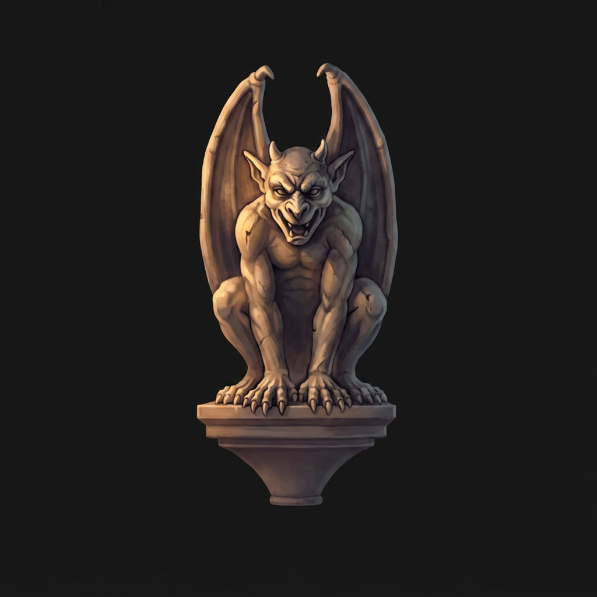 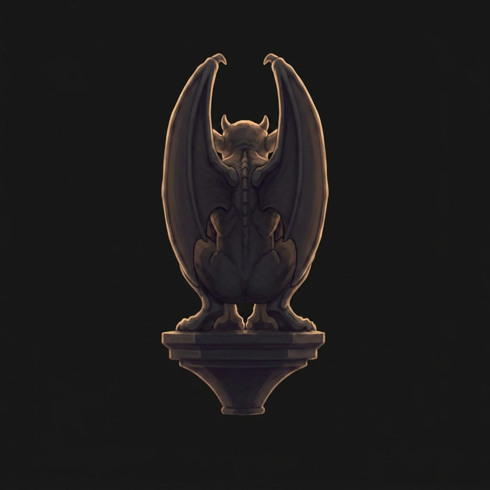

#### ④ 3/4 ISO(固定光連戲)
第一張 = 正面 plate｜第二張 = 背視 plate｜第三張 = 側視 plate｜固定同 seed｜比例 1:1

```text
Using the front, back and side plates as references, re-render the SAME gargoyle statue
in a 3/4 three-quarter view — rotated ~45° between front and left side, seen slightly
from above, so its full 3D form reads (face, chest, the near wing turned toward the
viewer, the far wing receding, the crouch and the corbel).

Use ISOMETRIC / PARALLEL projection — no strong perspective, no vanishing point, no lens
distortion, no foreshortening exaggeration; near and far parts stay close to the same
scale, a clean 3/4 iso model-sheet pose.

LIGHTING — the SAME fixed world-space warm key light from the FRONT-RIGHT as the plates.
So the statue's front-right surfaces (right side of the face, chest, near wing) are warmly
lit, while the left and rear surfaces fall into cooler shadow, with a soft warm rim on the
upper-right edges. Keep it consistent with the front plate's exact stone colour, tone and
material. Do NOT relight to neutral, do NOT flatten, do NOT change the palette. PRE-LIT for
UNLIT / emissive.

SAME statue — identical proportions, wings, horns, face, build and corbel as the references;
do NOT redesign or resize. Corbel base smooth and INTACT, no cracks. One complete, isolated,
centered statue, generous margin, nothing cropped, empty flat dark background.
High-resolution 3/4 isometric model-sheet plate.
```

溯源:
- `https://app.leonardo.ai/generation/image/using-front-back-side-plates-references-re-render-308230fd-4a6c-444a-a7d6-4e14bcefaaf9`
- `https://app.leonardo.ai/generation/image/using-front-back-side-plates-references-re-render-d1481994-f53f-4b1b-9d5c-9e59bb68b3cc`

  
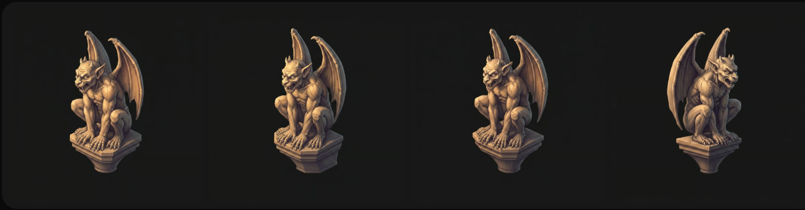

> Q:「太亮了」 → 在 3/4 prompt 末尾加 **EXPOSURE LOCK**:

```text
[同上 3/4 prompt 整段]

EXPOSURE LOCK: keep the same dark, low-key overall exposure as the front plate — do NOT
brighten. The lit front-right is warm but the left and rear fall into DEEP near-black
shadow. This is a moody dark statue, not an evenly-lit bright render.
```

溯源:`https://app.leonardo.ai/generation/image/using-front-back-side-plates-references-re-render-111d31cf-1b9a-4317-b9c5-d2ca33a1b58e`

  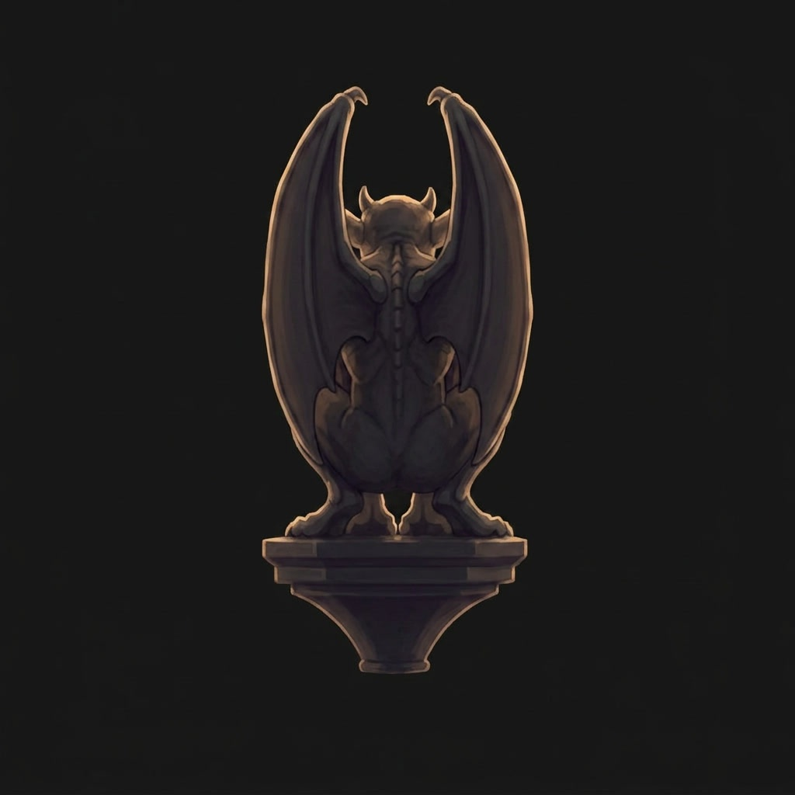


#### 底座調整 / 標示 → 最後走 PS

> Q:「我想調整底座 讓圓弧更明顯」

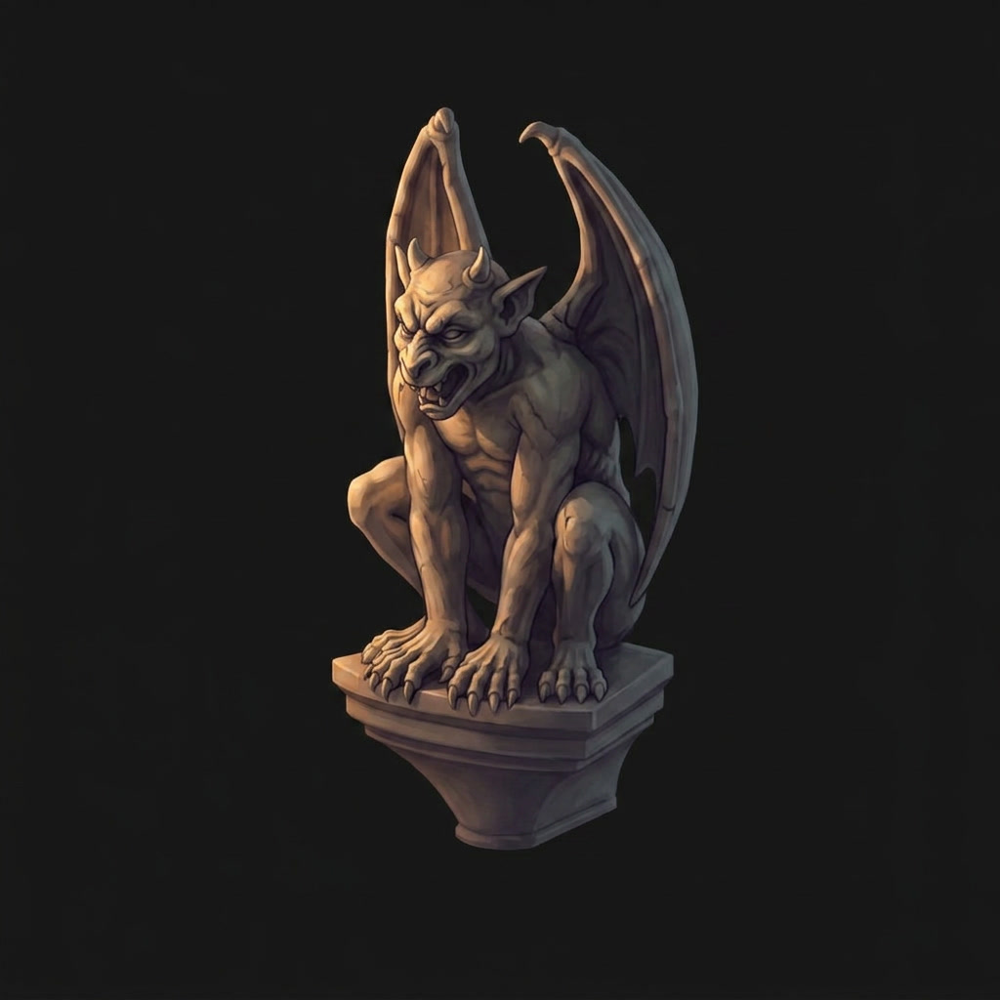

> Q:「我要給這樣的 3 張圖 標示調整」

 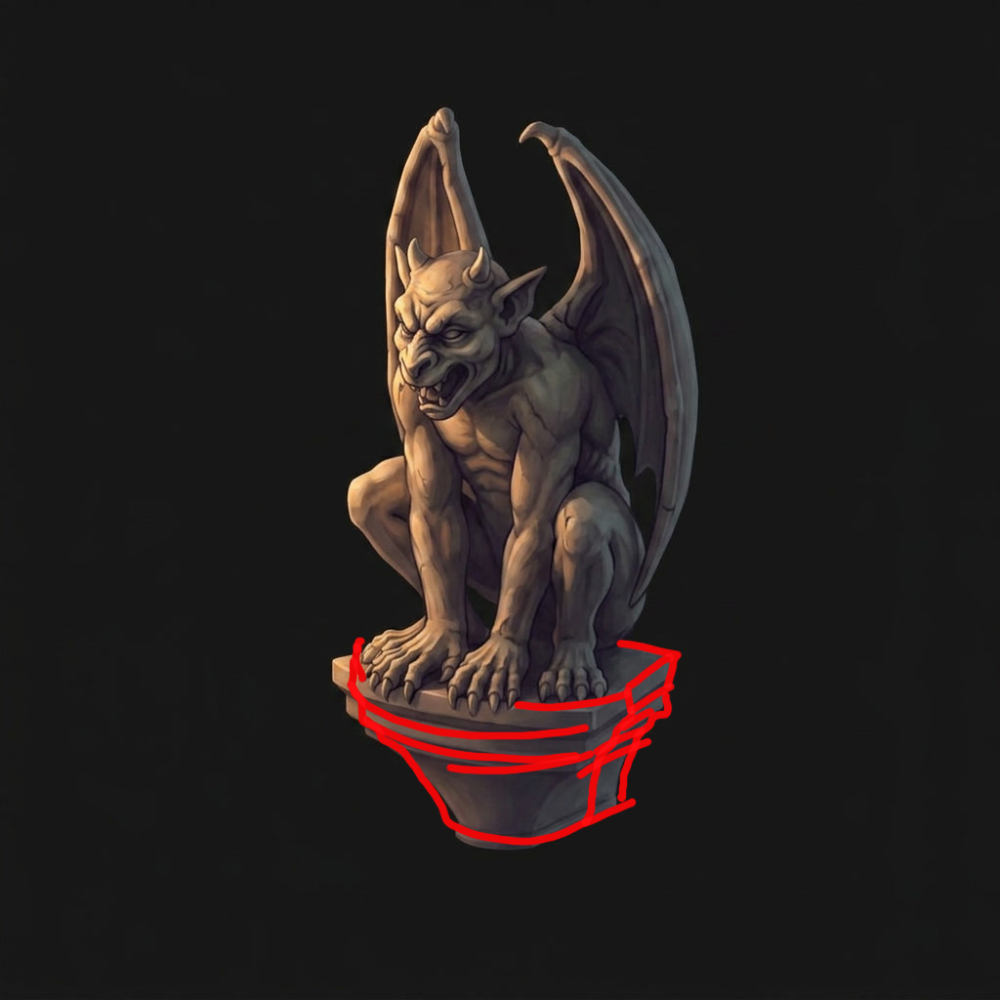 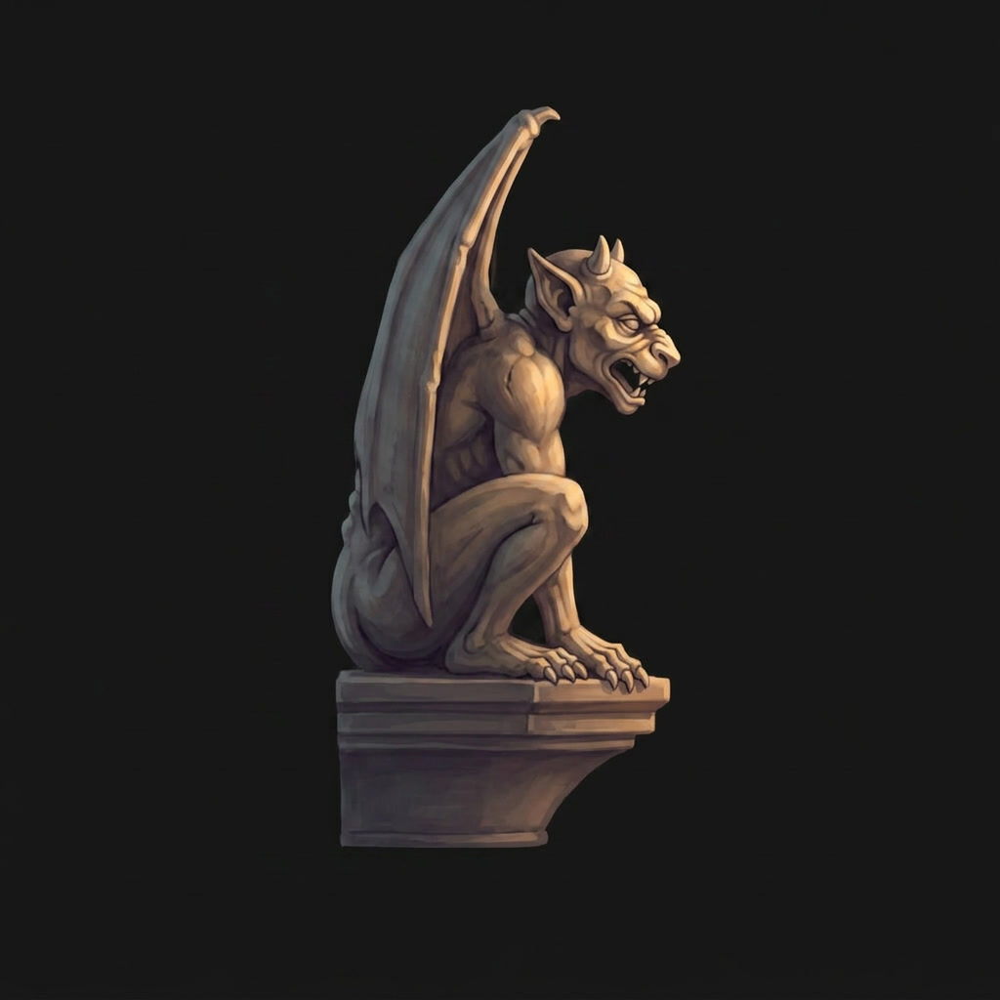

> ⚠️ **這部份後來用 PS 合成,算圖失敗**(底座微調 + 標示改動,NB 重算不穩,改走 PS)。

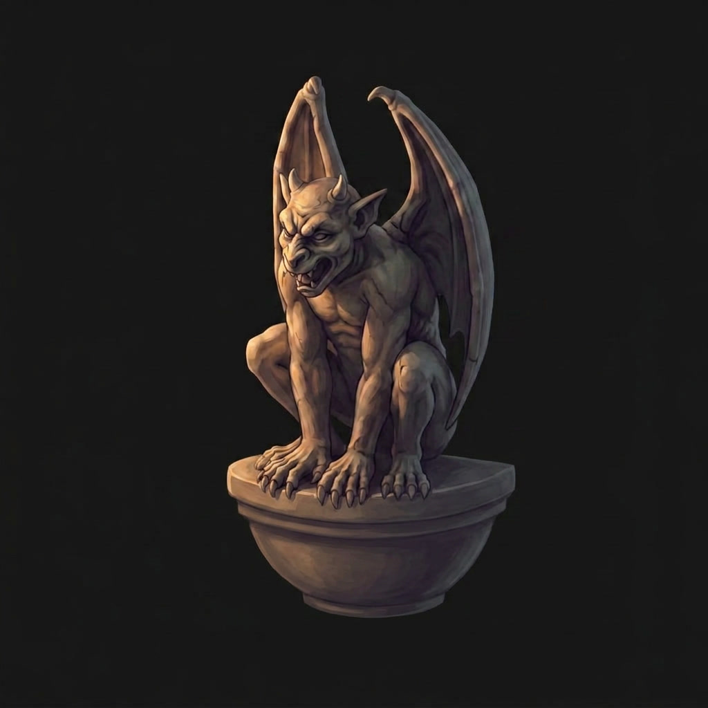

### B de-lit 軌 · image-to-3D(流程 2:3D 模型素材)

> Q
> 石像給也給我提示詞  3d ai 模型產生使用
> 要改成  使用均勻漫射的攝影棚照明，去除真實反照率，無陰影、無輪廓光、無光束

> A:石像鬼同一套 de-lit 平光處理(保石材、去打光),做成 image-to-3D 乾淨板:

#### de-lit ① 正面 平光板
輸入 = 這張石像鬼正面

```text
From the attached gargoyle statue, re-render it as one complete, isolated object,
centered and fully visible, in a true head-on FRONT orthographic view, on a flat neutral
grey (#808080) seamless background.

KEEP the real carved-stone material, its true colours and all sculpted surface detail
(do NOT turn it into flat grey clay, do NOT remove the stone texture). DE-LIT it: remove
all the baked-in lighting — no warm key light, no cool shadow side, no dramatic
highlights, no bright/dark direction. Light it ONLY with perfectly even, uniform, flat
diffuse studio lighting so the whole surface reads at even exposure. NO cast shadows,
NO rim light, NO god rays or light beams, NO scene elements.

Keep the exact shape, pose, wings, face, proportions, the corbel base and all sculpted
detail. High-resolution clean de-lit albedo reference plate for image-to-3D.
```

> **要點(跟火把同):** 保 albedo(石材色/紋理)、去打光(把之前烘的暖側光/暗面全洗掉,改均勻平光)、`do NOT turn into grey clay`、無影/無rim/無beams、灰底 #808080。
> **📌 提醒(兩套用途別混用):**
> - 石像鬼已有 正/左/背/3-4 四視——每張套這段 de-lit(把「輸入」換成該視角)就有整組 de-lit 多視圖。
> - 之前四視是**固定世界光**(正面迎光、背面背光…);de-lit 後明暗差異會被抹平(這正是 image-to-3D 要的——它不要方向光)。
> - **保光影版 = 引擎不受光材質直接貼;de-lit 版 = 餵 AI 建模。別混用。**

溯源:`https://app.leonardo.ai/generation/image/attached-gargoyle-statue-re-render-it-one-complete-079615d4-d2a8-4e8d-b5d0-4e3098625e15`

<!-- 待補圖:石像鬼 de-lit 正面 -->

#### de-lit ② 側面 平光板
> Q:「側面提示詞」
> A:石像鬼側面同一套 de-lit:

輸入 = 這張側視

```text
From the attached LEFT-SIDE view of the gargoyle statue, re-render it as one complete,
isolated object, centered and fully visible, KEEPING the same left-side orthographic
view, on a flat neutral grey (#808080) seamless background.
KEEP the real carved-stone material, true colours and all sculpted surface detail (do
NOT turn it into flat grey clay, do NOT remove the stone texture). DE-LIT it: remove all
the baked-in lighting — no warm key light, no cool shadow side, no dramatic highlights,
no bright/dark direction. Light it ONLY with perfectly even, uniform, flat diffuse studio
lighting so the whole surface reads at even exposure. NO cast shadows, NO rim light, NO
god rays or light beams, NO scene elements.
Keep the exact shape, pose, wing, face, proportions, the corbel base and all sculpted
detail. High-resolution clean de-lit albedo reference plate for image-to-3D.
```

> 同規格:保石材色/紋理、去打光、均勻平光、無影/rim/beams、灰底 #808080、鎖側視。背視 / 3-4 把 `LEFT-SIDE` 改 `BACK` / `3/4` 即可。

溯源:`https://app.leonardo.ai/generation/image/attached-left-side-view-gargoyle-statue-re-render-065ab35d-41a9-43d6-b033-542368147a27`

<!-- 待補圖:石像鬼 de-lit 側面 -->

#### de-lit ③ 3/4 平光板
> Q:「3/4提示詞」
> A:石像鬼 3/4 de-lit,用正面 + 側面當參考出:

FIRST = 正面 de-lit 板｜SECOND = 側面 de-lit 板｜比例 1:1

```text
Using the FIRST (front) and SECOND (side) de-lit plates as references, render the SAME
gargoyle statue in a 3/4 three-quarter view — rotated ~45° between front and side,
slightly from above — so its full 3D form reads (face, chest, the near wing forward, the
far wing receding, the crouch and the corbel base). SAME statue, identical proportions,
wings, horns, face and corbel as the references.

Place it centered and fully visible on a flat neutral grey (#808080) seamless background.

KEEP the real carved-stone material, true colours and all sculpted surface detail (do NOT
turn it into flat grey clay, do NOT remove the stone texture). DE-LIT it: remove all
baked-in lighting — no warm key, no cool shadow side, no dramatic highlights, no
bright/dark direction. Light it ONLY with perfectly even, uniform, flat diffuse studio
lighting. NO cast shadows, NO rim light, NO god rays or light beams, NO scene elements.

Use ISOMETRIC / PARALLEL projection — no strong perspective (approximate is fine). Keep
the exact shape and all sculpted detail. High-resolution clean de-lit albedo reference
plate for image-to-3D.
```

> 同規格:雙參考鎖造型、保石材色/紋理、去打光、均勻平光、無影/rim/beams、灰底 #808080。
> ✅ 石像鬼 de-lit 有 正 / 側 / 3-4 三張,整組餵 multi-view image-to-3D。
> ⚠️ 註:使用者原文此步 URL 與側面同(`065ab35d`),疑貼錯;待補圖時以實際 3/4 de-lit 圖為準。

<!-- 待補圖:石像鬼 de-lit 3/4 -->

---

## 道具 2 — 火把(Torch)· 流程 1(保光影 turnaround)

**拆圖起手式**

> Q 我要拆火把 拆掉這張概念圖」「concept→3D」「三視圖重建 保留原來的光影 不要改變色調 也不要改變打光

火把跟石像鬼同套(獨立道具、turnaround、保原光影)。差別:它有活焰 + 暖光暈——這在你的不受光材質裡就是烘進去的自發光,要保留。一樣兩支左右鏡像,做左邊那支、右邊鏡射。


**先確認 2 件:**
1. 只抽壁式火把(鐵托座 + 火把柄 + 火焰),排除牆、壁龕、石像鬼、窗。
2. 火焰要一起留(含它的暖光暈)——它是道具的自發光部分。日後若要在引擎做動態火焰,可把火焰當獨立 emissive 層另拆,但這批先整支含焰烘進去。

### A 保光影軌 · turnaround

#### ① 正面 plate(保留原光影 + 火焰)
第一張 = 乾淨概念圖 ｜(可選)第二張 = 紅框指左邊那支 ｜ 比例 3:4(直幅)

```text
From the attached concept art, extract ONLY the LEFT wall-mounted torch sconce — the
iron wall bracket, the torch shaft, and its burning flame. Do NOT include the wall, the
niche, the gargoyle, the window or the balustrade. Everything else becomes empty flat
dark background.
Re-orient to a true head-on FRONT view of the sconce, facing the viewer; IGNORE the
concept's angle and perspective — do NOT copy any tilt or 3/4 view. One complete,
isolated, centered torch with its wall bracket.
CRITICAL — preserve the source's baked lighting, colour and tone EXACTLY as painted:
keep the burning flame glowing warm, the warm firelight falling on the iron bracket and
shaft, the exact metal colour and the ambient occlusion in the crevices. Do NOT relight,
do NOT change the tone or palette, do NOT flatten to neutral studio light, do NOT remove
the flame or its warm glow. This is a PRE-LIT asset for an UNLIT / emissive material —
reproduce the original firelit look as-is, flame emissive.
FRAMING: the complete torch fully in frame, generous margin on all sides, nothing
cropped or touching the edge, centered on empty dark background. High-resolution game
asset plate.
```

溯源:`https://app.leonardo.ai/generation/image/attached-concept-art-extract-left-wall-mounted-d33e911f-443e-4db5-9e74-ac669f596a61`

 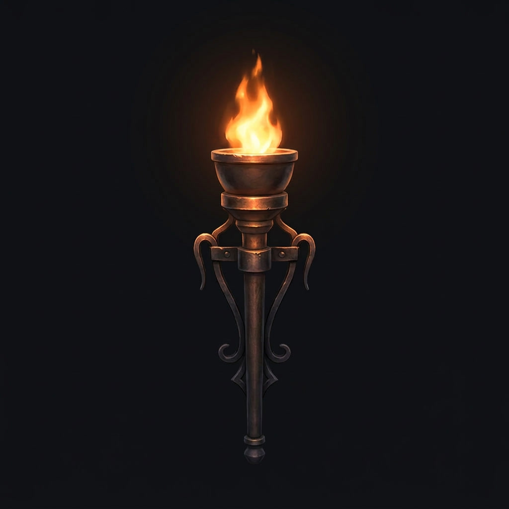

#### ① 正面(正交修正:上方「彎彎的」→ 碗口變直線)
> Q:「我要改成正交鏡頭 上方還是彎彎的」
> A:對,這張還是有透視——上方火盆是從斜上方看,所以碗口變成橢圓「彎彎的」。正交正面應該是平視火盆、碗口變一條水平直線(看不到碗內)。修正=堆正交鎖 + 專門講碗口。

第一張 = 剛才的火把 plate(當錨)｜第二張 = 乾淨概念圖｜固定同 seed｜比例 3:4

```text
Re-render the SAME torch sconce as a TRUE ORTHOGRAPHIC FRONT elevation.

TRUE ORTHOGRAPHIC PROJECTION (parallel projection), like a technical model-sheet
elevation: NO perspective, NO foreshortening, NO vanishing point, NO lens distortion,
NO looking down from above, NO 3/4 or high angle. The camera axis is perfectly
horizontal, at the height of the torch bowl, perpendicular to the front. Every part at
the same scale, parallel edges stay parallel, flat and undistorted.

IMPORTANT — the torch bowl / cup is seen EDGE-ON from the front at eye level: its rim
reads as a straight horizontal line, NOT an ellipse; do NOT reveal the inside of the
bowl, do NOT tilt it to show the opening. The iron bracket arms and shaft are seen
straight from the front.

SAME torch — identical bracket, bowl, shaft, scrollwork and flame as the reference;
do NOT redesign or resize. Preserve the source's baked firelit look EXACTLY — the warm
glowing flame (emissive), the warm firelight on the iron, the exact metal colour and AO.
Do NOT relight to neutral, do NOT change the palette, do NOT remove the flame.

Complete, isolated, centered, generous margin, nothing cropped, empty flat dark
background. High-resolution orthographic front-view asset plate.
```

> 關鍵兩句:`NO looking down from above` + `bowl rim = straight horizontal line, NOT an ellipse, do NOT reveal the inside` → 治「上方彎彎的」。
> 老話一句:生成模型只能逼近正交(壓平透視),要數學上真正交得建模後用正交相機 render。這張逼近版當建模參考夠用。

溯源:`https://app.leonardo.ai/generation/image/re-render-same-torch-sconce-true-orthographic-53108c11-83aa-4e34-8415-7b32121bab41`

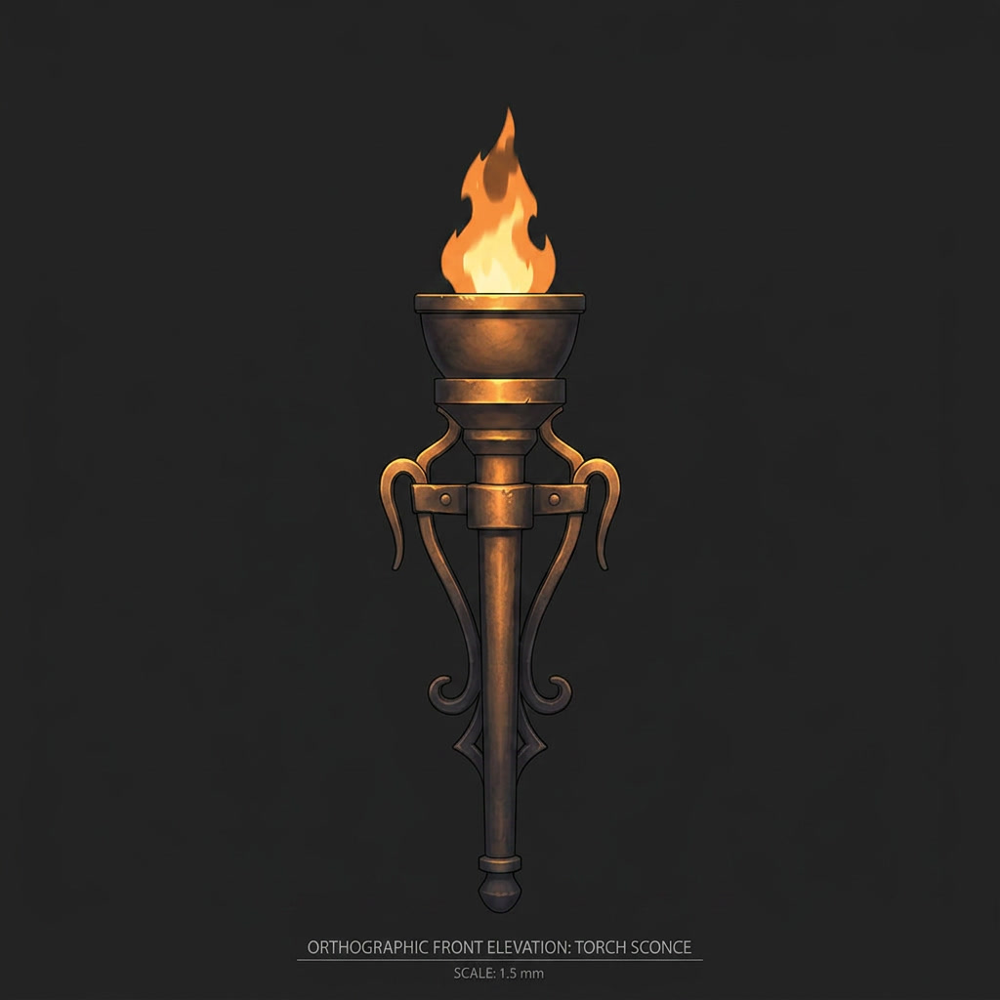 

#### 增加結構 + 補火焰 → 失敗走 PS
> Q:「我想增加結構 並補上火焰」
> ⚠️ **結果失敗,後來使用 PS 調整。**

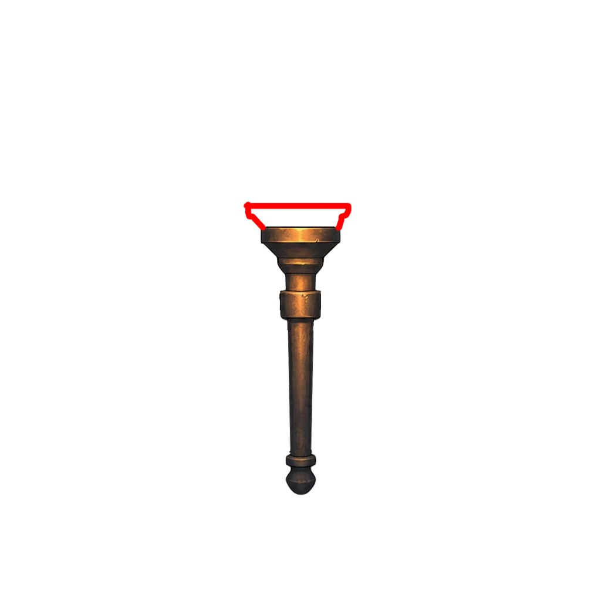  

#### ② 側面正交 + 牆架(指定結構)
> Q:「火把 側面正交 + 指定結構」
> A:照這張更清楚的紅標——牆架 = 兩根水平托臂(一根接上方束環、一根接下方束環)+ 右側一片直立壁掛板。給你精準版:

FIRST = 風格統一好圖(造型/畫風基準)｜SECOND = 這張紅標(牆架)｜比例 3:4

```text
Using the FIRST image (finished front torch) as the style and proportion reference,
render the SAME torch as a LEFT-SIDE elevation (90° side profile).

TOP PRIORITY — keep the FIRST image's rich hand-painted bronze look: same detailed
painterly metal, patina, warm firelit dark tone and level of detail. Do NOT simplify,
flatten, darken or reduce it to a plain silhouette. Same asset, same artist, just
turned to the side.

ADD the wall-mounting bracket exactly as the RED markup in the SECOND image shows:
- TWO horizontal iron support arms projecting sideways from the torch — the upper arm
  from the top collar, the lower arm from the lower collar/band,
- both arms connecting to ONE vertical rectangular wall-mounting plate standing behind
  the torch (the fixture bolted to the wall).
Make it clean carved bronze matching the torch. Do NOT draw or keep the red lines
(guide only).

Orthographic side elevation — keep it as flat and side-on as possible, collars roughly
edge-on, minimal perspective. (Approximate ortho is fine — do NOT sacrifice the
painterly detail to force it.)

SAME torch proportions as the FIRST image. Dark bronze, UNLIT / emissive baked look,
no relight. No text, no labels. Isolated, centered, generous margin, nothing cropped,
empty background.
```

> 重點:
> - 牆架結構明確描述(兩水平臂:上接頂環、下接下環 + 一片直立壁板)→ NB 才組對。
> - 保畫風寫最前 + 正交 approximate → 不重蹈上次崩 style。
> - `do NOT draw the red lines` 必留。

> ✅ 側面 + 牆架成功 👍 兩根托臂(上接頂環、下接下環)+ 直立壁板都到位,而且畫風這次沒崩(保細節寫前面 + 正交只求逼近的策略對了)。

溯源:`https://app.leonardo.ai/generation/image/using-first-image-finished-front-torch-style-f83006e6-bf2d-4a5b-8c58-9c6412eb7864`

> **實務點(壁掛火把通常不用背視):** 它背面貼牆(壁板那面就是靠牆),所以 model sheet 正面 + 側面就夠建模了——背視看不到、3/4 有需要才補。
> 收法:
> - 收正 + 側(含牆架)← 建議,壁掛件夠用
> - 要更完整 → 再補 3/4 iso(看立體關係),我給 prompt
> - 要更平的正交 → 拿好圖 PS 微調(別再讓 NB 壓)

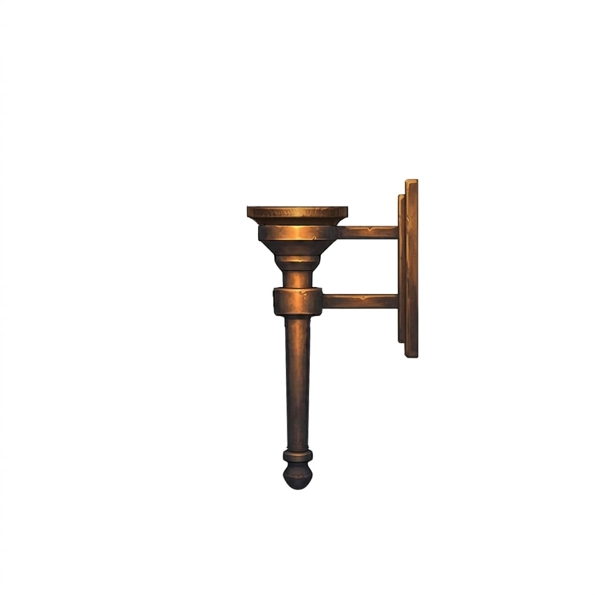 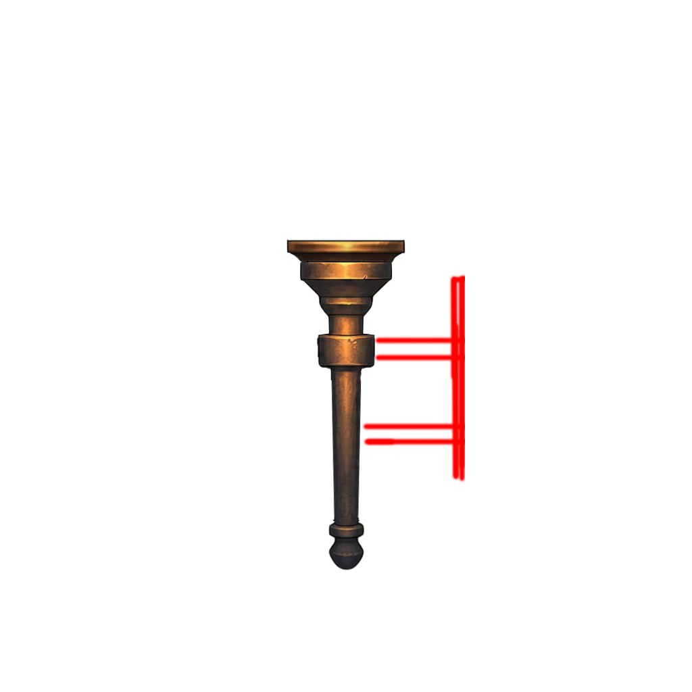

#### ② 側面 · 差異化打光(固定世界光)
> Q:「我要側面的火把 光源跟正面有所區別」
> A:對,跟石像鬼同邏輯——光固定在世界空間,側面看到的明暗就該跟正面不同,不能整支平均打光。火把掛牆上,光從房間側(正面、離牆那側)來,所以側視:朝房間的前緣受光、靠牆的後側(牆架/壁板那面)入陰。

FIRST = 風格統一正面(畫風基準)｜(可選)SECOND = 側面含牆架那張(結構參考)｜比例 3:4

```text
Render the SAME torch as a LEFT-SIDE elevation with the wall-mounting bracket (two
horizontal arms to a vertical wall plate) behind it, matching the FIRST image's
painterly bronze style and proportions.

TOP PRIORITY — keep the rich hand-painted bronze detail of the FIRST image; do NOT
simplify, flatten or darken into a plain silhouette.

CRITICAL LIGHTING — the light source is FIXED in world space, coming from the FRONT
(the room side, away from the wall). Because this is the SIDE view, light it DIFFERENTLY
from the front plate: the front-facing surfaces of the torch (the front of the bowl,
collar and shaft, facing away from the wall) are warmly lit, while the REAR surfaces
near the wall — the back of the bracket, the wall plate and the wall-side of the shaft —
fall into deeper shadow. A clear light-to-shadow gradient across the depth, front bright
→ back dark. Do NOT light it flat or evenly like the front view.

Orthographic side elevation, approximate ortho is fine (do NOT sacrifice detail to force
it). Dark bronze, UNLIT / emissive baked look, no relight beyond the fixed front light.
No text, no labels. Isolated, centered, generous margin, nothing cropped, empty background.
```

> 關鍵:`light fixed from the FRONT` + `front surfaces lit / rear (wall side) in shadow` + `do NOT light flat like the front view` → 側面明暗跟正面拉開,連戲。
> 📌 **通則:** 「固定世界光 → 各視角明暗不同」是 turnaround 保光影的通則:正面迎光、側面前亮後暗、背面背光(石像鬼也是這樣收的)。

溯源:`https://app.leonardo.ai/generation/image/render-same-torch-left-side-elevation-wall-09083647-a11f-4b64-b780-7f81e48b10e3`

 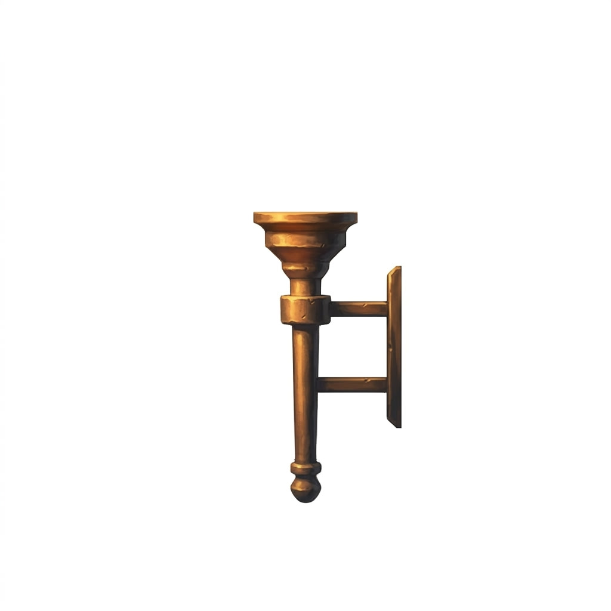

### B de-lit 軌 · image-to-3D(流程 2:3D 模型素材)

> Q
> 我要改變方針 
> 要改成3d模型使用的素材 
> https://github.com/TinaChen94/01/blob/main/docs/asset-cases/A2-buddhist-relief-wall.md
>
> 火把 我要算成
> 置於平坦的中性灰 (#808080) 無縫背景。使用均勻漫射的攝影棚照明，去除真實反照率，無陰影、無輪廓光、無光束

> ⚠️ 「**去除真實反照率**」= 踩坑句(見開頭「de-lit 規格」註解):實際要的是「**保留本色、只去光影**」,否則會變黏土。
> A:你要的其實是「去掉原本的打光/高光,不是去掉材質色」。給你這版:

#### de-lit ① 正面 平光板(保材質、去打光)
輸入 = 這張火把

```text
From the attached torch, re-render it as one complete, isolated object, centered and
fully visible, in a true head-on FRONT orthographic view, on a flat neutral grey
(#808080) seamless background.

KEEP the real bronze material and its true colours and surface detail (do NOT turn it
into grey clay, do NOT remove the metal). But DE-LIT it: remove all the original baked-in
lighting — no warm firelight, no dramatic highlights, no bright/dark light-and-shadow
side. Light it ONLY with perfectly even, uniform, flat diffuse studio lighting so the
whole surface reads at even exposure. NO cast shadows, NO rim light, NO god rays or light
beams, NO scene elements, NO flame.

Keep the exact shape, proportions and sculpted detail. High-resolution clean de-lit albedo
reference plate for image-to-3D.
```

> **講清楚術語(避免又跑成黏土):**
> - 要保留的 = 材質(青銅色、金屬、表面細節)= albedo。
> - 要去掉的 = 打光(方向光、高光、火光、明暗面)。
> - 講法是 `KEEP the bronze albedo, DE-LIT the lighting`,不是 `remove albedo`(那會變灰黏土)。

溯源:`https://app.leonardo.ai/generation/image/attached-torch-re-render-it-one-complete-isolated-daca856c-6a68-4acc-a3fd-adefcf6f43c9`

<!-- 待補圖:火把 de-lit 正面 -->

#### de-lit ② 側面(含牆架)平光板
> Q:「過來是處理這張」
> A:對,同一套 de-lit 平光處理套到側面(含牆架)這張。保青銅、去打光、平光、灰底、保留牆架:

輸入 = 這張側視

```text
From the attached LEFT-SIDE view of the torch with its wall-mounting bracket, re-render
it as one complete, isolated object — the torch AND the full wall bracket (the two
horizontal arms and the vertical wall plate) — centered and fully visible, KEEPING the
same left-side orthographic view, on a flat neutral grey (#808080) seamless background.

KEEP the real bronze material, true colours and surface detail (do NOT turn it into grey
clay, do NOT remove the metal). DE-LIT it: remove all baked-in lighting — no warm
firelight, no dramatic highlights, no bright side / dark side. Light it ONLY with
perfectly even, uniform, flat diffuse studio lighting so the whole surface reads at even
exposure. NO cast shadows, NO rim light, NO god rays or light beams, NO scene elements,
NO flame.

Keep the exact shape, proportions, the wall bracket and all sculpted detail.
High-resolution clean de-lit albedo reference plate for image-to-3D.
```

> 要點(跟正面同):保 albedo(青銅)、去打光、均勻平光、無影/無rim、灰底 #808080,並保留牆架(兩水平臂 + 直立壁板)。

溯源:`https://app.leonardo.ai/generation/image/attached-left-side-view-torch-its-wall-mounting-5b9442c7-5175-481e-9b55-f08e54f631a6`

<!-- 待補圖:火把 de-lit 側面(含牆架) -->

#### de-lit ③ 3/4 平光板
> Q:「我也要一張3/4 我會用正面跟側面產生」
> A:好,3/4 用正面 + 側面兩張當參考出,同一套 de-lit 規格:

FIRST = 正面 de-lit 板｜SECOND = 側面(含牆架)de-lit 板｜比例 1:1

```text
Using the FIRST (front) and SECOND (side with wall bracket) de-lit plates as references,
render the SAME torch in a 3/4 three-quarter view — rotated ~45° between front and side,
slightly from above — so its full 3D form reads: the bowl, collar, tapered shaft and base
knob in front, and the wall-mounting bracket (two horizontal arms + vertical wall plate)
turning away behind it. SAME object, identical proportions and details as the references.

Place it centered and fully visible on a flat neutral grey (#808080) seamless background.

KEEP the real bronze material, true colours and surface detail (do NOT turn it into grey
clay, do NOT remove the metal). DE-LIT it: remove all baked-in lighting — no warm
firelight, no dramatic highlights, no bright/dark side. Light it ONLY with perfectly even,
uniform, flat diffuse studio lighting. NO cast shadows, NO rim light, NO god rays or light
beams, NO scene elements, NO flame.

Use ISOMETRIC / PARALLEL projection — no strong perspective (approximate is fine). Keep
the exact shape, proportions and all sculpted detail. High-resolution clean de-lit albedo
reference plate for image-to-3D.
```

> 要點:雙參考(正+側)→ 3/4 造型/牆架跟前兩張一致;de-lit 規格整組沿用;牆架帶著轉。
> ✅ 火把三張 de-lit 平光板(正 / 側含牆架 / 3-4)整組餵 multi-view image-to-3D 最穩。

溯源:`https://app.leonardo.ai/generation/image/using-first-front-second-side-wall-bracket-lit-b24ad770-096d-4d94-99f7-d3a086132130`

<!-- 待補圖:火把 de-lit 3/4 -->

---

## 道具 3 — 吊燈(環形金屬吊燈 → 八角哥德)

> 需求:「我要拆這張圖的吊燈…」(環形金屬吊燈)

### A 保光影軌 · 結構重設計(圓 → 八角)+ 多視圖

📌 **待貼:吊燈 保光影 逐字 prompt**

```text
(貼這裡)
```

**過程 / 踩坑:**
- **材質更正:** 「寫錯材質顏色,圖中是**金色金屬 + 使用過的材質**」(aged gold / brass,不是原寫的顏色)。
- **結構改八角:** 「吊燈我要**八角型**的結構,哥德風格」。
- **高空物件要簡化:** 「我想要結構更簡單,這是一個高空的物件,太精細的細節無法表現」→ 把細節合理化、大膽簡化。
- **對齊原設計:** 「我要接近原圖(圖2)的設計,只是把細節合理化;圖1 是之前算出來的圖」;「下方把圓的改成八角形,加上上方的燭台設計」。
- **花紋錯誤** → 修正(雙參考:圖1 之前結果 + 圖2 原設計)。
- **轉正視正交:** 「改成正視、正交視角」→ 「失敗了」→ 重寫「八角 + 正交 + 正面 + 保光影」;另出 **3-4**。
- **邊數錯:** 要八邊形卻給十邊形(「變成 10 邊形 / 我要 8 邊形」)→ 明寫邊數鎖死。
- **樓空填背板:** 「用這張反推,把樓空的結構填上背板」;「內側也加上跟外側相同的花紋」→ 反推正交正視。

📌 待貼:八角重設計 / 材質更正 / 正交正視 / 3-4 / 填背板 等逐字 prompt(各步)

```text
(貼這裡)
```

<!-- 待補圖:吊燈 原設計(圖2)/ 八角定版 / 正面正交 / 3-4 / 填背板前後;10 邊形反例 -->

### B de-lit 軌 · image-to-3D(含去雜訊 + 填洞成浮雕)

📌 待貼:吊燈 de-lit 逐字 prompt(均勻漫射 / **#808080 固定底色不換** / 去光保 albedo)

```text
(貼這裡)
```

**過程 / 踩坑:**
- **固定底色:** 「固定底色,不要換來換去」→ #808080 鎖死。
- **確認性質:** 「這張會像沒打光的 PBR 模型貼圖嗎」→ 說明:這是 **image-to-3D 的輸入參考**,不是最終 PBR albedo(PBR albedo 從建好的 3D 網格烘)。
- **去雜訊(分段):** 「有很多雜訊,寫提示詞移除雜訊」→「還要再乾淨一點」→「還是很多雜訊,需要降低雜訊」(NB de-lit 常帶雜訊,分階段洗)。
- **填洞成浮雕:** 「我要填補洞,變成浮雕」→ 把樓空填實成浮雕,利於建模。

📌 待貼:de-lit / 去雜訊 ×N / 填洞成浮雕 等逐字 prompt(各步)

```text
(貼這裡)
```

<!-- 待補圖:吊燈 de-lit(含雜訊反例 / 去噪後 / 填洞成浮雕) -->

---

## 三道具 · 雙軌總表

| 道具 | A 保光影軌(mock 貼圖) | B de-lit 軌(image-to-3D) | 狀態 |
|---|---|---|---|
| **石像鬼** | ✅ 正 / 左 / 背 / 3-4 + 底座微調(PS) | ✅ de-lit prompt(正/側/3-4)· 圖待補 | 保光影 21 圖入庫 |
| **火把** | ✅ 正面 / 正交 / 側面+牆架 / 側面差異化打光 + 結構(PS) | ✅ de-lit prompt(正/側牆架/3-4)· 圖待補 | 保光影 12 圖入庫 |
| **吊燈** | 八角重設計 / 正交正視 / 3-4 / 填背板 | de-lit + 去雜訊 + 填洞成浮雕 | ⏳ 待補 prompt / 圖 |

---

## 踩坑 / 教訓(可複用結論)

1. **先保光影 → 再 de-lit,順序不可反。** de-lit 去掉光資訊後補不回原打光。
2. **de-lit = 去光保 albedo,不是變黏土。** 明寫「均勻漫射、無陰影 / 輪廓光 / 光束、保 albedo、#808080 無縫底」;**不要** clay / matcap。
3. **左視 = 右視鏡射。** 固定世界光下鏡射即可,不用重算一張。
4. **turnaround 世界光固定。** 正面受光、背面背光(光從右前方)、側面半側光 —— 每視角光向要一致。
5. **正交 NB 只能近似。** 上緣 / 下方常殘留透視;要精準正交從 3D 正交相機出。
6. **高空 / 遠處物件大膽簡化。** 吊燈八角化 —— 太精細在高處表現不出,反而雜。
7. **邊數 / 結構要鎖死寫。** 要八角卻給十角 → prompt 明寫邊數與結構,不然 NB 自由發揮。
8. **樓空填背板 / 填洞成浮雕。** 透空結構進 3D 會破面;填實成浮雕好建模。
9. **edit-chain 會漂 → 畫風崩掉就止損回退。** 回到最佳版再分支,別硬接著改。
10. **de-lit 去雜訊要分段。** NB de-lit 常帶雜訊,一句洗不乾淨就多跑幾階。
11. **紅圈 / 紅線定位。** 改尺寸(沿紅線)、標調整處(紅圈)、比照參考改另一張。
12. **這些都是 re-render,非像素級保留。** 要像素真值 / 真正交 → 走 3D 建模烘。

---

## 圖檔清單(待補 — 請依名存入 `docs/asset-cases/images/`)

> 命名建議前綴 `a5-`;實際張數 / 名稱待補圖時依截圖點數定(同 A4 做法)。

| 檔名(建議) | 內容 | 狀態 |
|---|---|---|
| `a5-concept-source.*` | 概念圖(標三道具位置) | ☐ 待補 |
| `a5-gargoyle-*`(21 張) | 石像鬼 保光影 turnaround(正/左/背/3-4 + 底座/標示/PS) | ✅ 入庫 |
| `a5-torch-*`(12 張) | 火把 保光影(正面/正交/側面牆架/側面差異化打光/結構PS) | ✅ 入庫 |
| `a5-chandelier-*` | 吊燈 八角重設計 / 多視圖 / 填背板 + de-lit(去噪 / 浮雕) | ☐ 待補 |

> 補圖時我照「一截圖幾張圖就幾個名」點數、逐步內嵌(同 A4)。
