# 實戰紀錄 — B15 熔岩要塞:正面牆 + 直向走道 + 柱子設定稿(主題翻譯 → 柱子拆解 → de-lit)

> 一個 3ds Max 灰盒場景(哥德教堂內牆,藍磚 + 6 根佔位柱)翻成**地獄熔岩要塞**:
> 先做**正面牆**(橫向卷軸立面),再做**直向走道**(一點透視),
> 柱子在中途被拆出來做成**正面 / 3/4 設定稿**,最後整理成 **8 格柱子板**,並做 de-lit 與寶石修正。
> 對應工作流:`ai-media-generator`(NB2 灰盒上材質 / concept→3D);
> 前置知識:[B2](B2-greybox-module-pipeline.md)(貼材質灰盒、Crop-Gen-Paste)、
> [B8](B8-scene-obstacle-placement.md)(紅圈定位法、尺寸錨定)、
> [B9](B9-tree-trunk-restyle.md)(參考圖裁成材質特寫)、
> [A5](A5-castle-turnaround-image-to-3d.md)(保光影 → de-lit 雙軌)、
> [SOP AI PBR](SOP-ai-delight-pbr.md)(Metallic 設定)。
>
> ⚠️ **編號說明:** 對話中一直稱為「B14」,但 `image-style-analysis` 分支已有
> `B14-realistic-forest-floor-style-dna.md`,為免合併撞號(同 B8→B12、B8→B13 前例)改編 **B15**。

**🔑 關鍵字(日後對 Claude 說這些詞即可叫出本紀錄):**
`B15`、`B15 紀錄`、`照 B15 配方`、`熔岩要塞`、`地獄要塞`、`lava fortress`、`熔岩走道`、
`柱子設定稿`、`柱子三視圖`、`8 格柱子板`、`柱子 de-lit`、`火盆扭曲`、`寶石鑲嵌`、
`灰盒壓過參考圖`、`AI 不會轉設定稿`、`先拼貼再融合`

---

## 來源(索引)

- **素材:**
  - 場景:3ds Max 灰盒正面圖(藍磚哥德內牆,1920×1080 viewport 截圖)+ 桃紅柱子遮罩版
  - 風格:熔岩地獄要塞參考圖 ×5(透視走廊),最後改用一張**接近正面、裁掉地板**的參考圖
  - 柱子設計:參考圖裡的牛角火盆柱特寫
  - 走道:3ds Max 直向走道灰盒 render + 熔岩走道概念圖(氣氛用)
- **平台:** Leonardo.ai / **Nano Banana 2**(Prompt Enhance None、Style None);
  走道一段並行測 **GPT Image 2.6 Flare / Sunburst**
- **Claude 對話:** `https://claude.ai/code/session_01W4Q9GoVbYnCSZVUZ3jK4R3`
  (2026-11-05 ~ 11-12;11-13 對話被 `/clear` 後從本機 transcript 復原、整理成本紀錄)
- **日期:** 2026-11-05 ~ 2026-11-13
- **結果:**
  - ✅ 正面牆定稿(PS 合成)
  - ✅ 直向走道定稿(柱頭配件、柱燈由 PS 收尾)
  - ✅ 4 款柱子 × 正面 / 3/4 = 8 格設定稿(點燈版 + de-lit 灰底版,PS 整理完成)
  - ⏳ 待辦:de-lit 版底部淺灰線修掉 → 裁 8 張 → image-to-3D → Blender 火盆 Metallic=1

---

## 結論(先讀)

### 十條可複用教訓

| # | 教訓 | 出處 |
|---|---|---|
| 1 | **一個 pass 只做一件事。** 主題翻譯 + 柱子換造型放同一 pass 會互搶。最後穩定的做法是:柱子單獨做成成品 → PS 貼進場景 → AI 只翻牆面(柱子寫成 FINISHED ASSETS)→ 原柱子再貼回最上層 | Part 1–3 |
| 2 | **灰盒帶什麼光影 / 明度,成品就帶什麼。** 白柱 → 畫成白石頭;平光柱 → 畫成浮雕。灰盒要先**壓暗到牆的明度、保留正側面明暗差、加落影和 AO 暗縫** | Part 1、4 |
| 3 | **配件位置用色框定位圖,不要用文字。** 「two of the four balcony pilasters」→ AI 四根對稱全畫。框線要粗、要和底圖同裁切範圍、顏色避開底圖主色(藍牆上藍框看不到 → 改亮青) | Part 1、4 |
| 4 | **被 GEOMETRY LOCK 鎖住的輪廓,參考圖改不動。** 「柱子完全不像」= 提示詞要求「維持灰盒細柱輪廓」又要「照參考圖粗柱畫」,自相矛盾 | Part 2 |
| 5 | **灰盒幾何一定贏過參考設定稿。** NB2 與 GPT 2.6 都一樣,改提示詞無解。生圖模型**不會把設定稿在腦中轉成每根柱子的透視角度**。唯一解:讓**輸入圖本身**帶正確形狀(改 3D 灰盒,或 PS 拼貼稿) | Part 4 |
| 6 | **小物件畫不清楚 = 像素預算不足**,不是提示詞問題。壁柱只有約 70×430 px → 裁切放大 3 倍 → 生成 → 縮回貼回(Crop-Gen-Paste) | Part 3、4 |
| 7 | **AI 對百分比不可靠。** 寫「側面寬 40%」→ 實際 2 倍。純幾何微調(拉寬、壓窄、縮放)一律交給 PS Ctrl+T | Part 5 |
| 8 | **尺寸用比例錨定,不要寫「小一點」。** 寶石用「約為碗高的 1/3,完全在碗口下方」寫死(同 B8 尺寸錨定法) | Part 6 |
| 9 | **de-lit 時「拿掉火」會讓火擋住的幾何被重新設計。** 火盆扭曲的解法 = 加 **BRAZIER SHAPE LOCK**,只准畫碗內;整張 8 格一起跑 + **LAYOUT LOCK** 換一致性 | Part 6 |
| 10 | **局部光、加燈、厚度、配件,PS 比 AI 快又準。** 用 AI 全圖重畫修小地方,其他地方會跟著漂;要嘛 PS 手做,要嘛 AI 跑完只用遮罩取那一塊 | 全程 |

### 什麼該交給 AI,什麼該交給 PS

| 交給 AI(NB2 / GPT) | 交給 PS(或腳本) |
|---|---|
| 整張主題翻譯(材質 / 色 / 光) | 柱子模組重新堆疊到灰盒比例 |
| 灰盒上材質(結構已在輸入圖) | 柱子貼進場景、透視變形貼合 |
| 單一物件換角度(正面 → 3/4)| 側面拉寬 / 壓窄、物件縮放 |
| 局部重畫(裁切放大後) | 火光暈、邊緣光(Linear Dodge 柔邊刷) |
| 指名對象的局部補光(rim light) | 柱燈、燈框厚度(圖層樣式) |
| 整張 de-lit(8 格一次跑) | 遮罩取局部貼回、調色、裁邊 |

---

## 管線總圖

```
[Part 1 正面牆:主題翻譯]
3ds Max 灰盒正面 ──前處理(裁 viewport 邊、柱子加落影/AO、柱子壓暗)──┐
熔岩參考圖 ──裁成「接近正面、無地板」──────────────────────────┤
色框定位圖(橘=火盆 紅=尖刺 綠=暗角 青=發光縫)──────────────┴→ NB2 主題翻譯
                                                                 → 牆面 OK,柱子「不像」
[Part 2 柱子定稿]
概念圖柱子特寫 → ①正面抽取(保光影、綠底)→ 5 張挑 #3 + PS 合成
   → 灰盒比例(白模)+ 元素圖 → 細長版 → 修火 / 石托承托 → 柱 A、柱 B 定稿
[Part 3 正面牆收尾]
柱子 PS 貼進灰盒場景 → NB2「柱子=FINISHED ASSETS」只翻牆 → 原柱子貼回最上層
   → 局部補光(rim light)→ 最左壁柱 Crop-Gen-Paste → ✅ 正面牆定稿
[Part 4 直向走道]
走道灰盒(柱子壓暗、保留厚度)+ 概念圖(氣氛)+ 柱子參考 + 火盆定位圖 → NB2 5 張圖 ✅
   → 柱頭配件一直錯:灰盒形狀贏過設定稿(NB/GPT 皆然)→ 接受現狀
   → 柱燈 / 燈框厚度 / 尖角 PS 收尾 → ✅ 走道定稿
[Part 5 柱子設定稿]
走道裡的石托結構 → 加回正面柱 → 正面轉 3/4(側面 = 正面 2 倍深,深咖啡底)
   → 4 款柱子 × 正面 / 3/4 = 8 格板(點燈版)
[Part 6 de-lit + 寶石]
8 格板整張 de-lit(LAYOUT LOCK + BRAZIER SHAPE LOCK)→ 3 張挑 #3
   → 寶石統一(de-lit 版設計)→ 搬到點燈版 → 縮到碗高 1/3 → 鑲嵌 + 受火光 → PS 整理 ✅
```

---

## Part 1 — 正面牆:主題翻譯(2026-11-05)

### 1.1 風格 DNA(熔岩參考圖)

| 層 | 特徵 |
|---|---|
| 定位 | 3D 手繪風暗黑奇幻地獄要塞 / 熔岩地城,遊戲美術 |
| 色彩 | 主色偏暖炭灰石(陰影帶**紫褐**,不是純黑);點綴熔岩橘黃(中心亮黃、外圍橘紅);天空暗紅 |
| 光 | **沒有天光,只有發光物在照**:熔岩、火盆、柱上小發光窗;朝熔岩面有橘色輪廓光,其餘沉暗 |
| 材質 | 大塊石磚、倒角崩口、手繪邊緣高光;鍛鐵(鍊、支架);牛角 / 尖刺;地縫透熔岩細紋 |
| 母題 | 牛角火盆、柱身發光龕窗、柱間粗鐵鍊、彎角尖刺、熔岩瀑布、地面熔岩縫、碎石、煙火星(⚠️ 會動的特效不烙進背景,進引擎做粒子) |

元素對照:藍磚 → 炭灰大石塊;彩窗 → 保留窗花、玻璃改熔岩光;欄杆 → 鍛鐵;桃紅柱 ×6 → 牛角火盆石塊柱;窗上小角 → 暗色彎角。

### 1.2 前處理(全部是踩坑後才補上的)

| 處理 | 原因 |
|---|---|
| **裁掉 viewport 邊框**(上方灰條、左右灰邊、左下黑塊),裁完約 1.91:1(1862×975),輸出 Custom 3824×2000 | 不裁會被畫成地板 / 畫面內容;使用者兩次誤用未裁原圖,邊框又跑回來 |
| **參考圖裁成「接近正面、只留牆和柱、裁掉地板」** | 5 張透視走廊參考會把構圖一起帶進來(B9 教訓);留地板會長出透視地面 |
| **柱子加落影 + AO 暗縫 + 左亮右暗**(用遮罩自動加,不用開 3ds Max) | 正交正面看不出柱子離牆多遠;平光白柱只會被畫成貼牆浮雕 |
| **柱子先壓成炭灰**(和牆同明度) | 圖生圖沿用輸入明暗:淺灰柱 → 淺色石頭,「柱子太白」 |
| 白灰盒柱要寫明是 PLACEHOLDER | 否則會畫成白色大理石柱 |

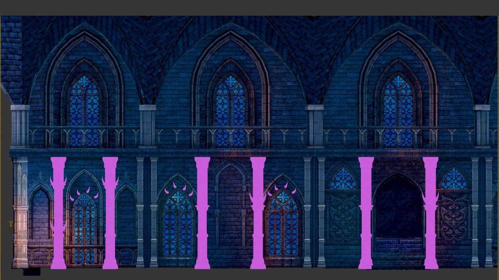 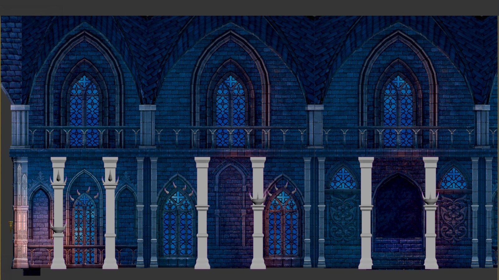 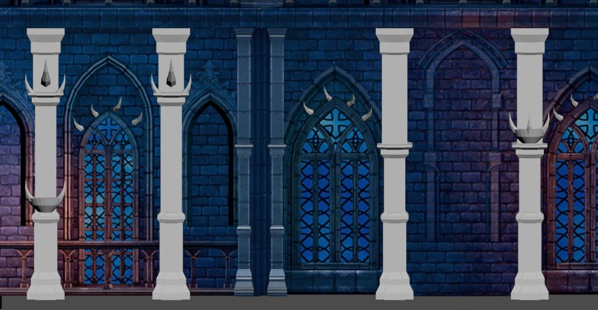

*左:桃紅遮罩版 · 中:白灰盒柱(平光,AI 讀不出深度)· 右:viewport 著色版,有正側面明暗,AI 讀得懂柱子是立體的*

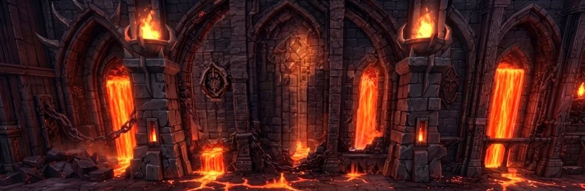

### 1.3 v1 提示詞(兩張圖:場景 + 風格)— 牆面翻譯穩定的基底

> 使用者在 4 版提示詞 × 多組素材的對照後,認定**這版牆面效果最好**,之後各階段都以它為基底改寫。

```text
Two reference images.
IMAGE 1 = SOURCE SCENE: a flat, front-facing orthographic elevation of
a gothic cathedral interior wall for a side-scrolling game — ribbed
vaults, three tall upper windows with a balcony, lower arched windows,
relief panels, a large dark archway on the right. The six plain
light-grey pillars and the small grey horn shapes above three windows
are greybox PLACEHOLDERS: they define the exact position, width,
height and bracket heights of new elements — they are not white
marble.
IMAGE 2 = STYLE, MATERIAL AND PILLAR-DESIGN REFERENCE ONLY. Ignore its
composition and floor.

TASK 1 — THEME TRANSLATION to a hellish lava fortress, in the style of
IMAGE 2: all blue brick becomes heavy charcoal stone blocks with
chipped bevelled edges and hand-painted edge highlights; shadows are
warm purple-brown, never pure black. No sky light — the scene is lit
only by lava and fire glow: orange rim light on stone edges, darker
toward the ceiling vaults. Keep every window tracery exactly; the
glass now glows molten orange / ember red. Railing and metal parts
become dark forged iron.

TASK 2 — repaint every grey placeholder pillar as a hell-fortress
pillar like those in IMAGE 2: stacked heavy charcoal stone blocks;
where the greybox has a bracket, a dark forged-iron horned brazier
with fire; pillars without brackets get one small glowing slit
niche. Each pillar keeps its own variation from the greybox — not six
identical copies. The small horn shapes above the windows become
curved dark horns with ember-lit tips.

GEOMETRY LOCK: flat orthographic front view — no perspective, no
floor plane, no vanishing point. Every arch, window, railing, panel
and pillar keeps its EXACT position, size and silhouette from
IMAGE 1. Do not add chains, statues, rubble or lavafalls. Do not crop,
zoom or extend.
```

需要表現柱子深度時,在 TASK 2 後加 DEPTH 段:

```text
DEPTH: the pillars stand freestanding about one metre IN FRONT of the
wall, not attached to it. Keep the shadow each pillar casts onto the
wall behind it, and the dark ambient-occlusion gap between pillar and
wall. The stepped bases and capitals project forward: their top
ledges catch warm rim light, their undersides fall into shadow. The
horns project toward the viewer, with a highlight on their tips and
a shadow at their roots. Follow the light and shadow of the greybox
pillars in IMAGE 1 exactly — they define the volume.
```

### 1.4 定位圖版(三張圖:場景 + 風格 + 色框)— 配件位置

> 只用文字描述位置時:柱 1、柱 2 上方被畫成火盆、二樓 4 根短柱全部發光、窗上小角變火紅。
> 加上色框定位圖(B8 紅圈定位法)後配件位置約 80% 正確,剩下用 PS 仿製印章收。

```text
Three reference images.
IMAGE 1 = SOURCE SCENE: a flat, front-facing orthographic elevation of
a gothic cathedral interior wall for a side-scrolling game. The six
dark grey shaded pillars on the lower floor and the small grey horn
shapes above three lower windows are greybox PLACEHOLDERS that define
exact position, size and volume.
IMAGE 2 = STYLE AND MATERIAL REFERENCE ONLY: painterly hand-painted 3D
game art, chunky charcoal stone, lava glow. Ignore its composition.
IMAGE 3 = PLACEMENT MAP: the same scene with coloured boxes. Use it
ONLY to know WHAT goes WHERE. The coloured box lines must NOT appear
in the output.
BOX LEGEND (follow exactly):
- ORANGE boxes (3: lower part of pillar 1, middle of pillar 4, middle
  of pillar 6) = a dark forged-iron horned brazier bowl WITH FIRE.
  These are the ONLY three open flames in the whole image.
- RED boxes (2: upper part of pillar 1 and pillar 2) = a decorative
  spike ornament: a stone collar with one central downward-pointing
  dark iron blade, flanked by two curved horns. NO fire, NO glow.
- GREEN boxes (3: above three lower windows) = small curved horns in
  matte dark charcoal stone / blackened bone, only a faint edge
  highlight. NOT glowing, NOT orange, NO ember tips.
- CYAN boxes (exactly 6: the carved pilaster at the far left; the
  2nd, 3rd and 4th upper balcony pilasters counted from the left;
  upper part of pillar 3 and pillar 5) = a self-illuminated
  flame-coloured inlay: a narrow vertical slot set INTO the stone,
  glowing molten orange-yellow from within. NO open flame, NO bowl.
  The 1st upper balcony pilaster (far left) and pillars 1, 2, 4 and 6
  have NO glowing inlay.
PILLARS — DARK AND VOLUMETRIC:
- The six lower pillars are deep charcoal stone, the SAME dark value
  as the wall or darker — never pale beige or light grey.
- Built from large, irregular stacked stone blocks with deep dark
  mortar gaps, chipped bevelled corners and a few cracks; some blocks
  protrude slightly — chunky like the pillars in IMAGE 2, not smooth
  flat shafts.
- Strong side lighting: left faces catch warm orange rim light, right
  faces fall into deep purple-brown shadow. Capital and base ledges
  project forward: top edges lit, undersides in shadow.
- They stand freestanding in front of the wall: each casts a soft
  dark shadow onto the wall, with an ambient-occlusion gap between
  pillar and wall.
THEME: all blue brick becomes heavy charcoal stone blocks with chipped
bevelled edges and hand-painted edge highlights; shadows warm
purple-brown, never pure black. Lit only by lava and fire glow: the
window glass glows molten orange behind the exact original tracery;
orange rim light on stone edges near windows, braziers and inlays,
darker toward the ceiling vaults. Railing and metal parts become dark
forged iron.
DO NOT: no flames outside the three orange boxes; no glowing inlays
outside the six cyan boxes; no glowing horns; no chains, statues,
rubble or lavafalls; NOT pixel art, no pixelated edges — smooth
painterly rendering like IMAGE 2.
GEOMETRY LOCK: flat orthographic front view — no perspective, no
floor plane. Every arch, window, railing, panel and pillar keeps its
EXACT position, size and silhouette from IMAGE 1. Do not crop, zoom
or extend.
```

**定位圖規則:** 框數要在 prompt 寫死(`exactly 6`)、點名哪幾根**沒有**;
框線顏色避開底圖主色;定位圖和 IMAGE 1 **同一裁切範圍**,否則框對不準。
另外寫 `NOT pixel art` — 有一輪整張跑成像素風。

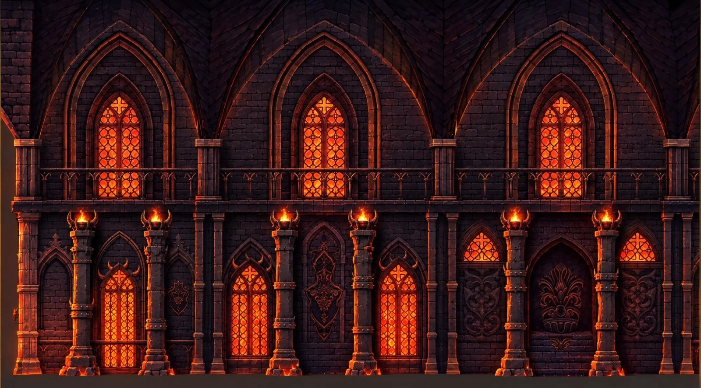

*牆面翻譯成功(炭灰石、熔岩窗、結構對齊),但柱子只是「像磚柱」,沒有參考圖的厚重感*

---

## Part 2 — 柱子定稿:從概念圖拆出來(2026-11-06)

### 2.1 為什麼「柱子完全不像」

v1 加一張柱子特寫當 IMAGE 3 後,柱子**完全不像**。原因不是 AI 沒看參考圖,而是提示詞**自相矛盾**:

- GEOMETRY LOCK 要每根柱子 `keeps its EXACT silhouette from IMAGE 1`(灰盒細柱,寬:高 ≈ 1:7)
- IMAGE 3 的柱子粗壯(≈ 1:5)、還是斜角透視

→ AI 只能照灰盒輪廓上材質。**繼續改文字結果一樣**,於是改成「先做出一根正面柱子,再貼進場景」。

### 2.2 ① 正面抽取(A 保光影軌,綠底)

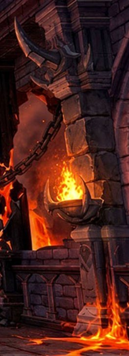

```text
From the attached concept art, extract ONLY the stone pillar — its
horned capital at the top, the horned brazier bowl with fire mounted
on its shaft, and its stepped base — exactly as they appear in the
image. Re-orient it to a true head-on FRONT view: the face that the
brazier is mounted on faces the viewer directly, with the brazier
centred on the shaft. IGNORE the concept's camera angle and
perspective — do NOT copy its 3/4 view or low angle.

REMOVE completely: the hanging chain, the wall and arch behind the
pillar, the lava, the floor and the whole background.

Render in TRUE ORTHOGRAPHIC PROJECTION, like a model-sheet elevation:
NO perspective, NO foreshortening, NO vanishing point; the camera axis
is horizontal at the pillar's mid-height; the brazier rim reads as a
straight horizontal line.

CRITICAL — preserve the source's baked lighting, colour and tone
EXACTLY as painted: warm orange light on the left side, deep
purple-brown shadow on the right side, the same dark charcoal stone
colour, the ambient occlusion in every crevice, the fire glow. Do NOT
relight, do NOT flatten to studio light, do NOT brighten.

FRAMING: the complete pillar from the tips of the horns to the bottom
of the base, centred, generous margin on all sides, nothing cropped.
BACKGROUND: one flat solid chroma-green (#00B140) colour, no gradient,
no floor, no shadow on the background.
```

- 綠底的理由:柱子有橘、紅、紫褐,綠底去背不吃色(asset-cutout 規則)。
- 5 張結果挑 **#3**(比例最均衡、左右對稱)當底,需要時從 #4 換大彎角、整根拉寬 10–15%。
- 合成後**不要再丟回 AI「統一」** — 會重畫幾何,等於白合成。
- **要用原始輸出檔,不要 Leonardo 介面截圖**(圓角、黑框、低解析)。

### 2.3 灰盒比例(白模)+ 元素圖 → 細長版

抽出的柱子比灰盒粗短很多(灰盒柱身 1:13、抽出版 1:6.5)。兩條路都試過:

- **腳本重新堆疊**:把柱子切成檐口 / 尖刺柱頭 / 柱身石塊 / 火盆 / 柱腳,照灰盒比例重疊。造型零漂移,但柱身石塊看得出重複。
- **AI 照白模比例重畫**(白模先換綠底,避免藍牆被畫進去):

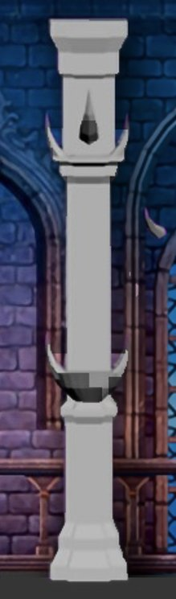 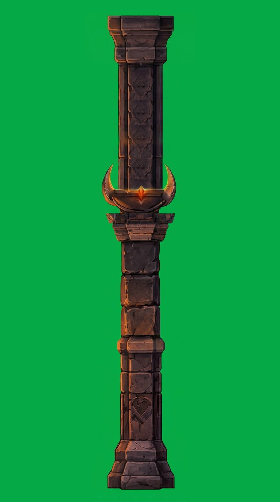

```text
Two reference images.
IMAGE 1 = PROPORTION GREYBOX: a plain light-grey placeholder pillar.
It defines the EXACT silhouette — width, height, slenderness, and the
vertical position of every part. Follow it strictly.
IMAGE 2 = DESIGN REFERENCE ONLY: take its materials and ornament
designs, NOT its proportions.

TASK — repaint the greybox pillar of IMAGE 1 with the design of
IMAGE 2, part by part, keeping IMAGE 1's layout:
- TOP CAP: the flat square cap at the very top becomes a stepped,
  chipped charcoal stone capital like IMAGE 2's capital mouldings.
- SPIKE RING (just below the cap): the small blade and two side horns
  become IMAGE 2's ornament — one central dark iron spike blade
  flanked by two curved dark horns. No fire here.
- UPPER SHAFT: large stacked charcoal stone blocks with chipped
  corners and dark mortar gaps, like IMAGE 2's shaft.
- BRAZIER (lower-middle, where the greybox has the dark bowl with two
  horns): IMAGE 2's horned iron brazier bowl with fire, at exactly the
  greybox height.
- LOWER SHAFT and BASE: the moulded ring under the brazier, the
  stone-block lower shaft, and a stepped base carved with IMAGE 2's
  emblem panel.

PROPORTION LOCK: keep IMAGE 1's slender proportions — the shaft stays
as thin as the greybox, do NOT widen it to IMAGE 2's thickness. Every
part stays at the same height as in IMAGE 1. Only the horns and the
brazier may stick out slightly past the shaft, as in IMAGE 1.

STYLE: same painterly hand-painted 3D game art as IMAGE 2 — warm
orange light on the left faces, deep purple-brown shadow on the right
faces, fire glow on the stone near the brazier.
VIEW: flat front orthographic view, no perspective.
FRAMING: the complete pillar from top cap to base, centred, nothing
cropped. BACKGROUND: one flat solid chroma-green (#00B140) colour.
```

### 2.4 修整:火 + 石托承托(不是鐵箍)

第一版用「鐵箍綁住火盆」,使用者指出那裡是**層板結構** → 改成**火盆坐在往下收窄的石托(corbel)上**,結構才合理。

```text
Two reference images.
IMAGE 1 is the BASE — a hand-painted stone pillar game asset on a
green background. Its layout, proportions, width, height and the
position of every part are FINAL. This is a REPAIR and FINISHING pass,
NOT a redesign.
IMAGE 2 is a reference for a lit brazier and a finished pillar only.

FIX in IMAGE 1:
1. FIRE: put a natural, lively fire in the horned brazier bowl —
   organic tongues of flame, bright yellow core fading to orange and
   red tips, a few floating embers, rising a little above the rim.
   Do NOT paint a square or rectangular glowing block. Remove the small
   red gem on the bowl front.
2. BRAZIER SEAT: the brazier bowl sits directly ON TOP of the stepped
   stone moulding below it — this moulding is a projecting stone
   corbel that supports the bowl. Its top is a flat, level shelf,
   slightly wider than the bottom of the bowl; the bowl rests on it
   with a clear contact line and a soft contact shadow, its back
   touching the shaft. No iron collar band around the shaft — at most
   two small dark iron clamps holding the bowl's rim to the shelf.
3. CORBEL: make the moulding one complete, solid stone corbel that
   steps INWARD as it goes down (wider at the top, narrowing toward
   the lower shaft), like a classic supporting bracket. Clean,
   continuous ledges with chipped stone edges; fill every gap — no
   green showing through anywhere inside the pillar. The two horns
   grow from the sides of the bowl as decoration, not as supports.
4. FINISH: clean up all block edges and mortar lines on the whole
   pillar; keep the chipped, hand-painted stone look.
5. FIRE LIGHT: warm orange glow from the fire on the stone just above
   and around the bowl, fading with distance.

LOCKS: keep IMAGE 1's exact silhouette, slender proportions, top cap,
the carved diamond panels on the upper shaft, the stone blocks, the
emblem panel and the stepped base, all in the same positions. The
corbel under the bowl may be reshaped as described above; every other
part stays exactly as in IMAGE 1. Do NOT add the spike ornament from
IMAGE 2. Keep the same painterly style, warm light on the left faces,
purple-brown shadow on the right faces. Flat front view, complete
pillar, nothing cropped, same flat solid chroma-green (#00B140)
background.
```

⚠️ 參考圖的火是一塊**方形發光塊**,一定要寫 `Do NOT paint a square or rectangular glowing block`。

PS 合成後得到兩根定稿(柱身、柱腳、紋章共用 → 風格統一):

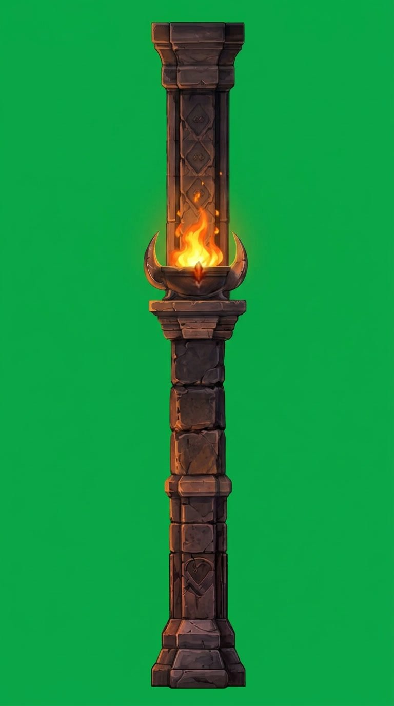 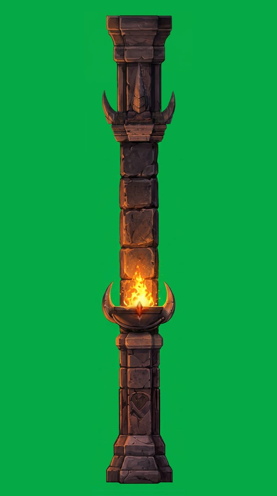

*柱 A:菱形雕紋 + 上段石托火盆 · 柱 B:尖刺環 + 下段火盆*

---

## Part 3 — 正面牆收尾(2026-11-06 ~ 11-09)

### 3.1 先拼貼、再融合(柱子不給 AI 重畫的機會)

| 灰盒位置 | 配件 | 用哪根 |
|---|---|---|
| 柱 1 | 尖刺 + 下段火盆 | 柱 B 原樣 |
| 柱 2 | 尖刺、無火盆 | 柱 B 去火盆 |
| 柱 3、5 | 素柱 | 柱 A 去火盆 |
| 柱 4、6 | 中段火盆 | 柱 A 原樣 |

1. 綠底去背、做去火盆版(仿製印章補石塊),縮放對齊灰盒柱,蓋掉白柱。
2. 跑 **v1 柱子鎖定版**(下方)。
3. 原柱子**貼回最上層**(去背輪廓當遮罩),AI 畫的落影、火光照牆留在下層;Curves 對亮度、羽化 2px。

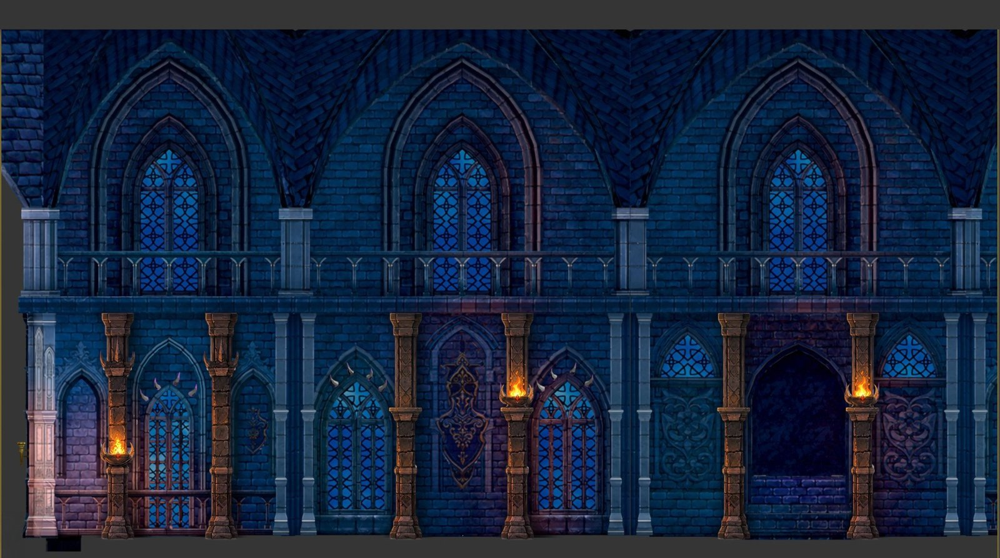 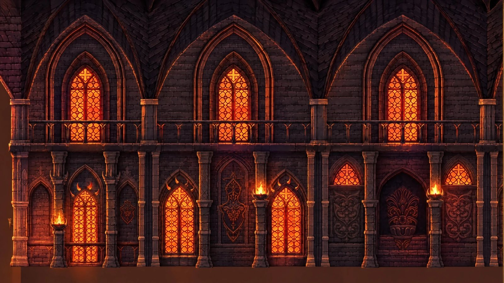

```text
Two reference images.
IMAGE 1 = SOURCE SCENE: a flat, front-facing orthographic elevation of
a gothic cathedral interior wall for a side-scrolling game — ribbed
vaults, three tall upper windows with a balcony, lower arched windows,
relief panels, a large dark archway on the right. The six slender
stone pillars on the lower floor — with spike ornaments, horned
brazier bowls and fire — are FINISHED ASSETS: their design is final.
The small grey horn shapes above three windows are greybox
placeholders.
IMAGE 2 = STYLE AND MATERIAL REFERENCE ONLY. Ignore its composition
and floor.

TASK 1 — THEME TRANSLATION to a hellish lava fortress, in the style of
IMAGE 2: all blue brick becomes heavy charcoal stone blocks with
chipped bevelled edges and hand-painted edge highlights; shadows are
warm purple-brown, never pure black. No sky light — the scene is lit
only by lava and fire glow: orange rim light on stone edges, darker
toward the ceiling vaults. Keep every window tracery exactly; the
glass now glows molten orange / ember red. Railing and metal parts
become dark forged iron. The small grey horn shapes above the windows
become curved dark horns with ember-lit tips.

TASK 2 — the six pillars: keep their EXACT design — same stone
blocks, carved panels, spike ornaments, horns, brazier bowls and fire,
same shape, width and height. Do NOT redesign, add or remove any part.
Only relight them to fit the new scene: they are dark charcoal stone,
as dark as the wall — not orange wood, not bright. Left faces catch
warm orange rim light, right faces fall into purple-brown shadow.
Each brazier fire casts a soft warm glow on the wall around it. Each
pillar casts a soft dark shadow onto the wall behind it, with an
ambient-occlusion gap where pillar meets wall.

GEOMETRY LOCK: flat orthographic front view — no perspective, no
floor plane, no vanishing point. Every arch, window, railing, panel
and pillar keeps its EXACT position, size and silhouette from
IMAGE 1. Do not add chains, statues, rubble, lavafalls or extra
braziers. Do not crop, zoom or extend.
```

關鍵句:**`FINISHED ASSETS: their design is final`**,只寫「鎖住」不夠,要寫明是成品、列出不准改的部件。

### 3.2 局部補光:火盆旁的柱子要吃到火光

結果裡柱 3、柱 5 就在柱 4、柱 6 火盆左邊,卻沒受光。
腳本 / PS 補火光暈(Screen 或 Linear Dodge,柔邊刷 `#FF8A30`)可行;
**指名對象的 LOCAL RELIGHTING prompt** 在 11-09 實跑也成功:

```text
IMAGE 1 is a finished lava-fortress wall for a side-scrolling game,
flat front orthographic view. This is a LOCAL RELIGHTING pass only,
NOT a repaint.

On the lower floor there are six freestanding stone pillars. Counting
from the LEFT, pillar 3 stands just left of the brazier fire on
pillar 4, and pillar 5 stands just left of the brazier fire on
pillar 6. Right now pillars 3 and 5 ignore that fire — fix it:

- Pillar 3 and pillar 5: add a warm orange-yellow RIM LIGHT along
  their RIGHT edges, the side facing the nearby fire. It is strongest
  at the height of the fire, fading smoothly up and down the shaft.
  Brighten the right-facing faces of their stone blocks, capitals and
  base mouldings slightly in warm orange, with a soft bounce glow on
  the stone between each pillar and the fire.
- Their LEFT sides stay in the current shadow.
- Pillars 4 and 6 (with the fires): add a soft warm glow from their
  own fire onto the stone just above and below the brazier.

LOCKS: every pillar keeps its exact shape, design, stone blocks,
carvings, size and position. Do not change the fires, the walls,
windows, balcony, arches, panels or colours anywhere else. Do not
add, remove or move anything. Do not crop, zoom or extend.
```

- 第一輪 AI 把邊緣光打到**另一根細壁柱**(打錯對象)→ 把「哪根柱子、在哪個火的哪一邊」寫成計數 + 相對位置後才對。
- 跑完**只取兩塊區域**(柱 3→柱 4 火盆、柱 5→柱 6 火盆)貼回,遮罩用 100–200 px 大柔邊(光是漸層)。

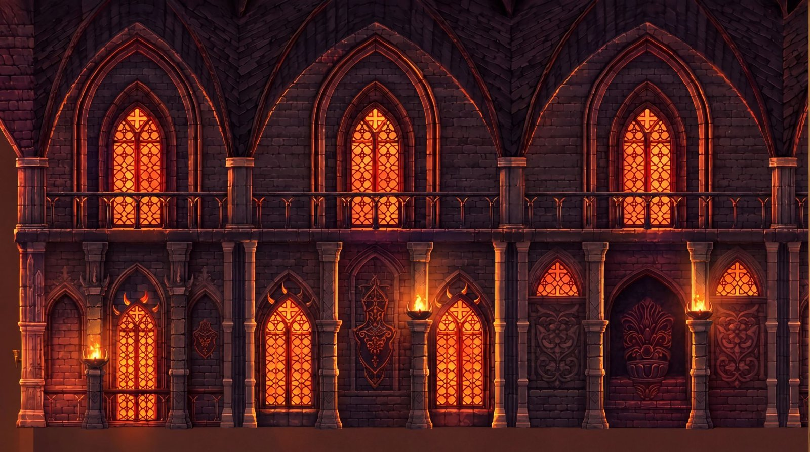

### 3.3 最左壁柱:Crop-Gen-Paste

最左邊的雕花壁柱還是粉米色、光滑。整張跑兩輪:第一輪留著紋飾(因為 prompt 寫了 `Keep its carved panel ornaments`)、第二輪石塊不清楚 — **它在整張只有約 70×430 px**。
→ 裁切放大 3 倍(612×1302)單獨跑,縮回 1/3 貼回原位。三張圖:裁切底圖 + 現場柱子的石塊特寫 + 原壁柱(只取結構)。

```text
Three reference images.
IMAGE 1 = BASE: a close-up crop of a lava-fortress wall, flat front
orthographic view. On the LEFT is a tall pale carved pilaster; on the
right are a brick wall niche and a dark stone pillar with a brazier
fire. Only the pilaster changes.
IMAGE 2 = MATERIAL REFERENCE ONLY: copy its stone blocks, colour and
painterly style.
IMAGE 3 = STRUCTURE REFERENCE ONLY: the same pilaster in its old
style. Take ONLY its shape and divisions — ignore its carvings and its
pink and blue colours.

Rebuild the LEFT pilaster:
- STRUCTURE: a corner pilaster with a wide front face and a narrow
  side face on its right; a moulded cap at the top; one projecting
  horizontal waist moulding about one third of the way up; a stepped
  base at the bottom.
- SURFACE: remove every carving, niche tracery and panel. Both faces
  are built only from large stacked charcoal stone blocks like
  IMAGE 2 — about 6 to 8 blocks in the upper section and 3 to 4 in the
  lower section, each a distinct rectangle with chipped bevelled
  edges, a lit top edge, a shadowed bottom edge and deep dark mortar
  gaps. Bold, clearly readable block outlines.
- The cap, waist moulding and base are chunky chipped stone ledges
  like IMAGE 2.
- LIGHT: same dark charcoal value as the pillar on the right. The
  brazier fire is to its right: warm orange rim light on the right
  edge of the front face, strongest at the fire's height; the narrow
  side face in deep purple-brown shadow.

LOCKS: keep the pilaster's exact position, width, height and outer
silhouette. The brick wall, the niche, the pillar and the brazier
fire on the right stay exactly as they are. Do not crop, zoom or
extend. The left edge of the image is the canvas edge — paint nothing
beyond the pilaster.
```

要點:把柱子拆成「**結構(保留)/ 表面(換掉)**」逐項寫出 — 只寫「保留外形」,AI 分不出哪些是結構。

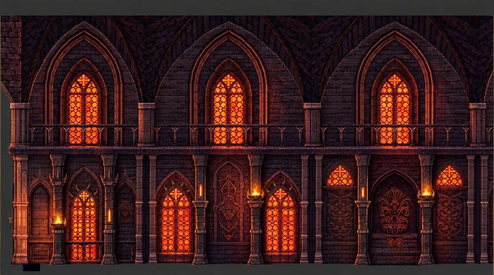

*正面牆 PS 合成(最左壁柱 Crop-Gen-Paste 修正前的版本)*

---

## Part 4 — 直向走道(2026-11-09)

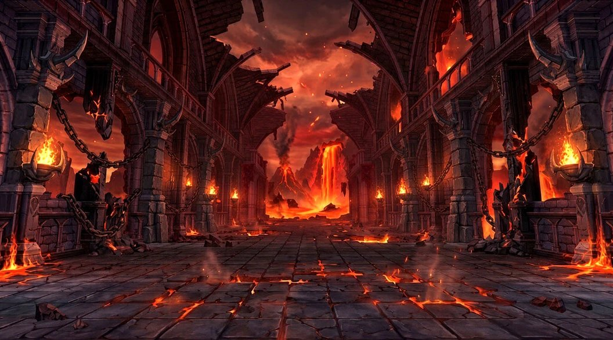 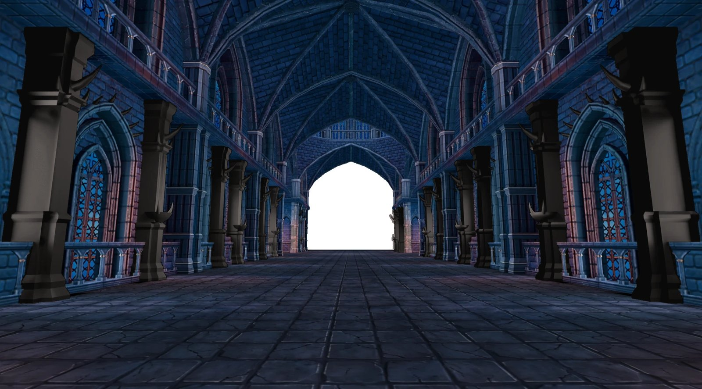

### 4.1 四張圖的分工

| 圖 | 負責 | 不要拿 |
|---|---|---|
| 走道灰盒 render | **構圖、透視、柱子位置和輪廓**(權威) | — |
| 概念圖 | 氣氛、熔岩光、地面裂縫、盡頭火山熔岩瀑布 | 它的柱子、鐵鍊、破屋頂、構圖 |
| 柱子參考 ×2 | 石塊、尖刺環、火盆的**材質和細節** | 它們是正面圖 → **不准抄火盆的位置** |
| 火盆定位圖 | 6 個橘框:哪幾根有火盆 | 框線不准出現 |

灰盒前處理:桃紅剪影 → 深炭灰(否則被當成要畫的顏色)、**柱子壓暗但保留正側面明暗差**(厚度從這裡來)、盡頭拱門透明區補白當補繪區。
用 3D render 的灰盒(有受光 / 背光面、火盆碗、彎角)比剪影版好很多;柱子受光面亮度從 ~190 壓到 ~125(理想 70–90,接近牆)。

### 4.2 成功版:5 張圖(NB2,3840×2128)

第一輪「每根柱子都有火盆、而且朝鏡頭」:柱子參考是正面圖、火盆在正中間,AI 照抄蓋過灰盒位置。
→ 加定位圖 + 寫明參考圖**不准抄火盆位置** + 火盆掛在**朝走道中間那一側**:

```text
Five reference images.
IMAGE 1 = SOURCE SCENE AND COMPOSITION AUTHORITY: a lit 3D greybox
render of a long gothic cathedral corridor in one-point perspective —
ribbed vaulted ceiling, upper balconies, tall arched windows, a
stone-tiled floor, and two rows of freestanding pillars. The dark grey
pillars are PLACEHOLDERS: their shape, volume, perspective, spike
horns and brazier bowls define the final pillars exactly. The white
pointed archway at the far end is an EMPTY OPENING to be filled.
IMAGE 2 = MOOD AND LIGHTING REFERENCE ONLY: hellish lava atmosphere,
colour grade, and the volcano with a lavafall in the distance. IGNORE
its pillars, chains, broken roof and composition.
IMAGE 3 and IMAGE 4 = PILLAR MATERIAL AND DETAIL REFERENCE ONLY: take
their stone blocks, spike ring, horns and brazier bowl design. They
are flat front views — do NOT copy where the brazier sits on them.
IMAGE 5 = BRAZIER PLACEMENT MAP: the same scene as IMAGE 1 with six
orange boxes. The orange lines must NOT appear in the output.

BRAZIERS — follow IMAGE 5 exactly:
- There are exactly SIX braziers, one inside each orange box: three
  on the left row and three on the right row.
- Each brazier hangs on the side of its pillar that FACES THE CENTRE
  OF THE CORRIDOR — on the left row it sticks out to the right, on
  the right row it sticks out to the left. Seen in perspective, NOT
  facing the camera.
- Every other pillar has NO brazier and NO fire — including the two
  large nearest pillars at the far left and far right edges. Pillars
  alternate: no brazier, brazier, no brazier, brazier...

PILLARS:
- THICKNESS: every pillar is a solid SQUARE stone pillar, not a flat
  board. In perspective you see TWO faces of each pillar: its front
  face toward the camera and its SIDE face turned toward the corridor
  centre, exactly as shaded in IMAGE 1. Keep the vertical corner edge
  between the two faces sharp and clear. Paint the stone blocks and
  mortar joints wrapping around BOTH faces, continuing across the
  corner, and receding in perspective on the side face. The capital,
  spike ring and stepped base project out on both faces.
- MATERIAL: stacked charcoal stone blocks with chipped edges and dark
  mortar gaps, the spike ring with a central blade and curved horns
  near the top, a stepped base — like IMAGES 3 and 4, following each
  greybox pillar's exact shape and perspective. Deep charcoal stone,
  as dark as the walls — never pale, white or light grey.
- LIGHT: the side face toward the corridor catches warm firelight;
  the front face is darker. No red gems on the braziers.

THEME: all blue stone becomes dark charcoal stone with chipped edges
and hand-painted edge highlights; shadows warm purple-brown, never
pure black. Window glass glows molten orange. Railings become dark
forged iron. The floor becomes cracked dark stone with only a FEW thin
glowing lava cracks, mostly near the far opening; most foreground
tiles are intact dark stone. Keep it LOW-KEY: most surfaces stay in
deep shadow; light comes from the far opening, the six braziers and
the windows, falling off quickly. Strong dark-to-light contrast, not
an evenly red-lit scene.

FAR OPENING: fill the white archway with a distant hellish vista like
IMAGE 2 — red smoky sky, a volcano and a glowing lavafall — small,
hazy and far away, the brightest point of the image.

GEOMETRY LOCK: keep IMAGE 1's exact camera, one-point perspective,
vanishing point, ceiling vaults, balconies, windows, floor grid and
every pillar's position, size and shape. Do not crop, zoom or extend.
Do not add chains, rubble, broken walls or a broken roof. Smooth
painterly 3D game-art rendering, not pixel art.
```

另外兩個加上去才收斂的句子:地面熔岩縫會鋪滿成網格 → `only a FEW thin glowing lava cracks`;
整張泛紅沒有暗部 → `Keep it LOW-KEY … not an evenly red-lit scene`。

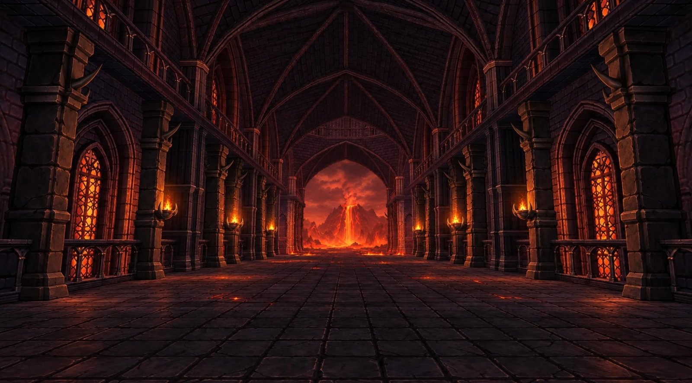

*火盆 6 個、朝走道中間、最近兩根沒有;柱子看得到兩個面;盡頭最亮*

### 4.3 ❌ 柱頭配件一直錯 → 灰盒贏過設定稿

剩下的問題:柱頭只剩**一支往外伸的大角**(設定稿是「石托 + 中央刀刃 + 兩側上彎角」)、火盆角不同。
試過:配件特寫局部重畫、做正面 + 3/4 設定稿、改 4 張圖(灰盒 / 氣氛 / 設定稿 / 定位圖)、換 GPT 2.6 —
**NB2 和 GPT 都照灰盒那支大角畫**。

| 嘗試 | 結果 |
|---|---|
| 設定稿 + 「設定稿優先於灰盒」 | 柱子變厚實,但柱頭仍是灰盒的大角 |
| GPT 2.6 Flare 同一段 4 圖 prompt | 構圖 / 火盆 / 色調和 NB 同級(推翻「GPT 不吃這種寫法」的猜測);柱頭同樣錯 |
| 叫 AI「捨棄灰盒柱子形狀、照設定稿重建、窄面朝走道」 | **完全不對** — 拿掉了唯一的幾何依據,只有有定位圖的火盆是對的 |

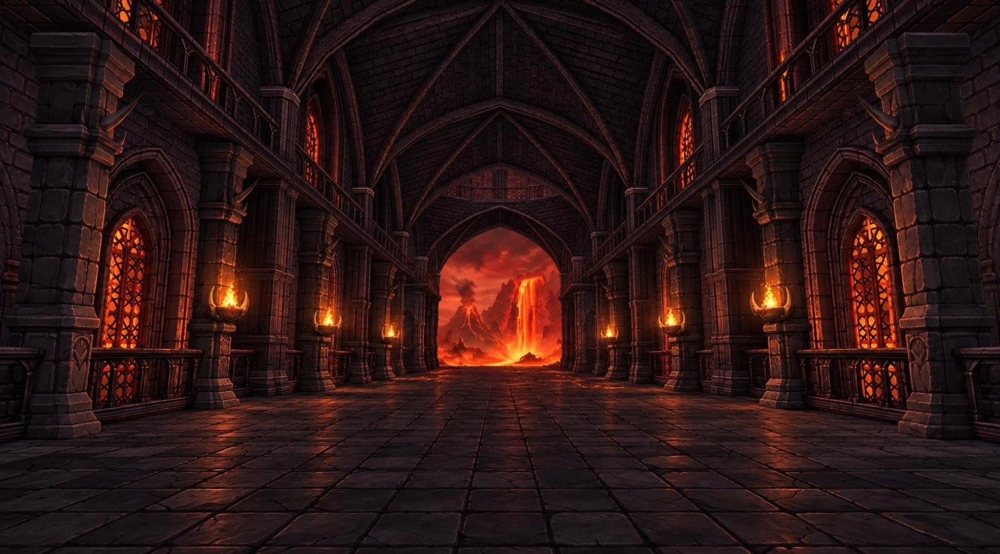 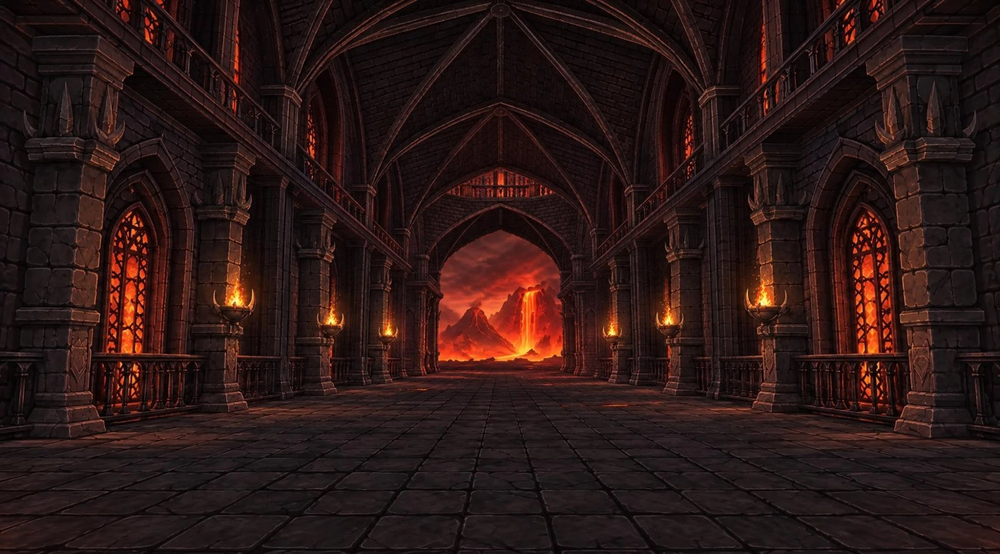

**為什麼給了 3/4 圖還是會算錯**(對話裡的完整解釋):
1. 設定稿只有**一個**角度(俯視、轉 35°),走道 12 根柱子**每根角度都不同**。
2. 相機高度相反:設定稿看得到頂蓋上面,走道近景柱子應該看到**底面**。
3. 左排要鏡射,模型不會可靠地鏡射。
4. 設定稿的正面圖把它教成「裝飾朝鏡頭」。
5. 幾何只跟**最強的空間訊號**(灰盒)走;參考圖只提供長相、材質、配件。

**唯一有效:目標角度的形狀直接出現在輸入圖裡** —
(A)3ds Max 照設定稿分段用 Box 重拼柱子(寬 1 : 深 2),或(B)PS 拼貼稿:設定稿 3/4 柱去背、Perspective/Distort 貼到每根柱子位置、左排鏡射。

### 4.4 收尾:PS

使用者決定接受柱子現狀,走道收尾全走 PS:
- 底圖選 GPT 那張(氣氛較好),地面換 NB 那張(GPT 預設**濕亮反光地面** → 要乾地面得寫 `dry, matte floor — no wet shine`)。
- **柱燈**:AI 加燈失敗 → PS:裁燈參考的發光縫 + Outer Glow(`#FF8A30`、Screen)→ Ctrl+T Perspective/Distort 貼合朝走道那面 → Linear Dodge 刷周圍石頭 → 燈比火盆暗,火盆維持主光源。
- **燈框厚度**:圖層樣式 Bevel & Emboss(Outer Bevel)+ Inner Shadow(凹槽內壁)+ Drop Shadow,Copy Layer Style 套到 6 個燈。
- **尖角**:AI 用定位圖 + 特寫重畫仍失敗(畫成好幾片直立刀刃)→ 從設定稿特寫去背貼到近處 4 個紅框位置,遠處直接複製縮小。

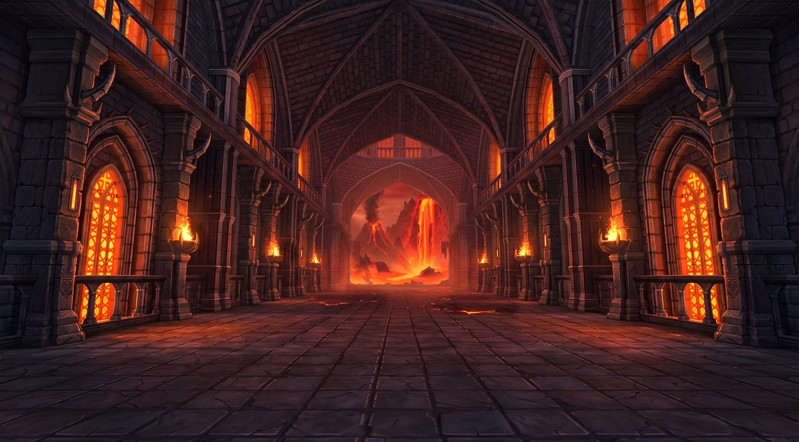

---

## Part 5 — 柱子設定稿:正面 / 3/4(2026-11-09 ~ 11-11)

### 5.1 把走道裡長出來的石托結構加回正面柱

走道近景柱子下段長出一圈厚實的階梯石托(+ 正面下垂托架),使用者要加回正面設定稿:

```text
Two images.
Image 1 is a hand-painted stone pillar game asset in a flat front
view. Keep it exactly as it is, except for one change.
Image 2 is a close-up of the same kind of pillar in a corridor. The
red box marks a structure to copy — use only that part. Do not copy
the window, the railing, the camera angle or the red box itself.

Change only this: replace the thin moulding ring just below the
glowing lamp in Image 1 with the structure from the red box in
Image 2, drawn in the same flat front view:
- a thick, heavy stepped stone collar that wraps around the shaft and
  projects clearly beyond it on both sides, two or three tiers deep,
  wider at the top tier;
- below the collar, on the front face, a short vertical stone bracket
  hanging down, like a small pendant corbel;
- chipped edges, top surfaces catching warm light, deep shadow on the
  undersides and a dark contact shadow on the shaft below.

Paint it in the same hand-painted style, stone texture, level of
detail and lighting as the rest of the pillar. Keep everything else
exactly the same: the cap, spike ornament, stone blocks, the lamp,
the carved emblem, the base, the colours and the dark brown
background. Same pillar height and width. Do not crop or zoom.
```

跑完 PS 只取石托 + 托架;石托比頂蓋寬約 25%,Ctrl+T 收到跟線腳差不多寬。火盆柱的托架剛好在碗正下方,看起來在**撐住火盆**。

### 5.2 正面 → 3/4 一次做完(深度照舊設定稿、背景不變)

舊設定稿的「加深」prompt 寫 `about 40 percent WIDER`,結果實際加深到**約 2 倍** — 使用者決定就要這麼深(**側面 = 正面 2 倍**,像石牆垛)。新柱子直接一次轉:

```text
IMAGE 1 is the FRONT plate of a stone pillar — this is the design to
draw. IMAGE 2 shows a DIFFERENT pillar; use its right half (the 3/4
view) ONLY as a guide for the camera angle and the depth. Ignore its
design, its spike horns, its ornaments and its green background.

Render the pillar of IMAGE 1 — identical design, heights and details —
as a single 3/4 view like the right half of IMAGE 2: rotated about 35
degrees to show the front face and the right side face, seen slightly
from above so the top of the cap and the brazier rim are visible.

DEPTH: exactly like IMAGE 2 — a DEEP rectangular block whose side face
is about TWICE as wide as its front face. The cap, the stone shelf
under the brazier, the moulding ring and the stepped base wrap around
the corner and run the full depth of the side face. The side face is
plain stacked stone blocks, receding in perspective, with no carvings.

FRONT FACE: the carved diamond panels, the horned brazier with its
fire and the carved emblem stay on the front face, at the same heights
as in IMAGE 1; the brazier sticks out toward the viewer, seen in 3/4.

Keep IMAGE 1's lighting, colours, dark exposure and painterly style —
do not brighten. Near-orthographic, no wide-angle distortion. Complete
pillar, centred, nothing cropped.

BACKGROUND: keep exactly the same plain flat dark brown background as
IMAGE 1 — same colour, no gradient, no floor, no shadow. Do NOT use
green.
```

- **`Do NOT use green`** 必寫:IMAGE 2 是綠底,AI 會連背景一起抄。
- **燈柱版**:FRONT FACE 換成燈柱配件,並加 `NO brazier and NO open fire`(否則從 IMAGE 2 把火盆畫回來)。
- **尖刺環 + 火盆版**:要特別寫出火盆下的**厚石托和下垂托架**,不然照 IMAGE 2 畫成薄線腳。
- 舊柱的單純加深(GEOMETRY-ONLY edit)用這段,並把光線整個鎖住 — 前一版寫了「正面受光、側面陰影」,AI 就連光都改了、紋章也不見:

```text
IMAGE 1 is a 3/4 view of a stone pillar game asset on a green
background. This is a GEOMETRY-ONLY edit: make the pillar DEEPER
front-to-back. Change nothing else.

- The right-hand side face of the pillar becomes about 40 percent
  WIDER, so the pillar reads as a thick, solid square block, not a
  thin slab. The cap, the spike-ring collar, the moulding under the
  brazier and the stepped base all extend deeper along that side face
  to match.
- The stone blocks on the side face continue in the same pattern,
  receding in the same 3/4 perspective.

LOCK — keep EXACTLY as in IMAGE 1:
- the lighting, light direction, colours, brightness, contrast and
  exposure — do NOT relight, do NOT brighten or warm up anything;
- the front face, its stone blocks and the carved emblem on the lower
  shaft;
- the spike blade, crescent horns, brazier, fire and their positions;
- the camera angle, pillar height and the flat solid chroma-green
  (#00B140) background. Nothing cropped.
```

> ⚠️ 寫 40% 會得到約 2 倍。要精準深度,PS 選取側面 Ctrl+T 拉寬 / 壓窄最準,光線也不會變。

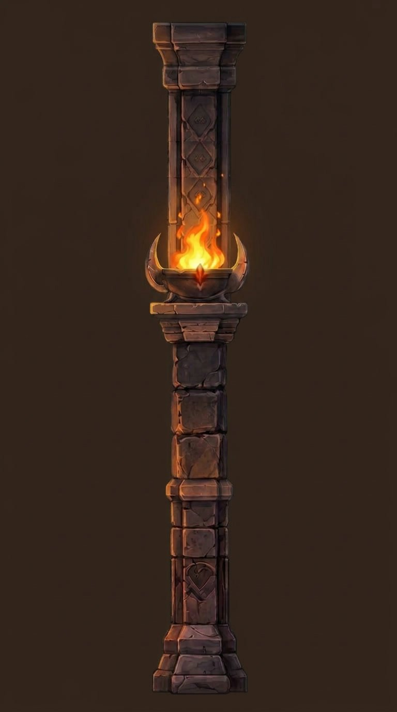 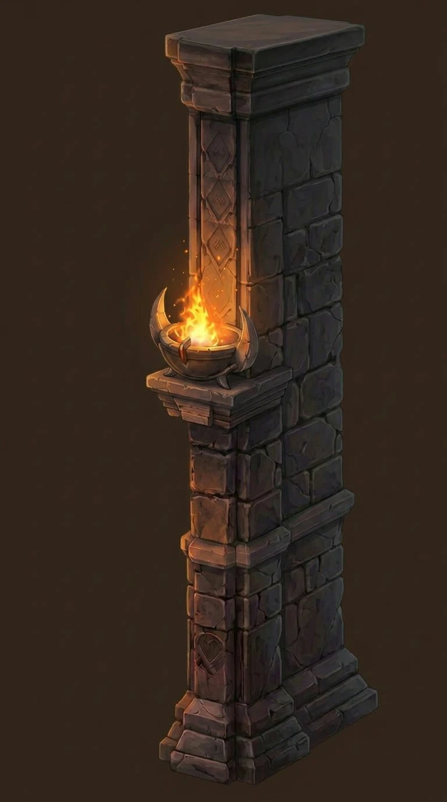

---

## Part 6 — 8 格柱子板:de-lit + 寶石(2026-11-12)

4 款柱子(火盆 / 燈槽 × 上排單一光源 / 下排尖刺環 + 下段光源)× 正面 + 3/4 = **8 格,2000×2000**。

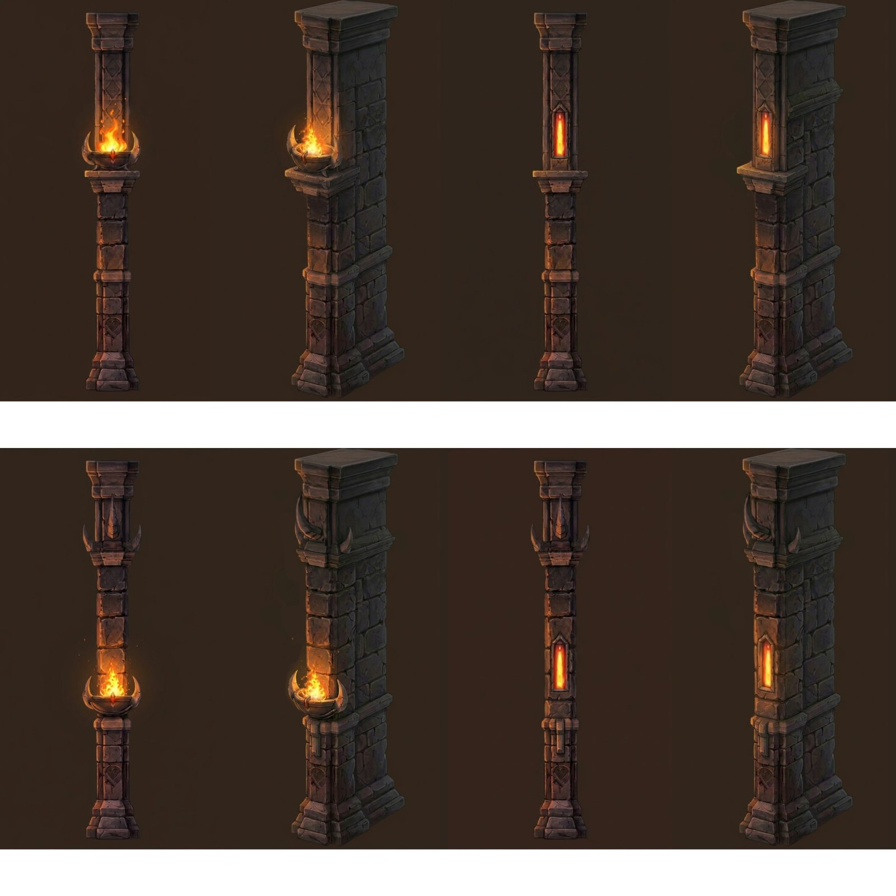

### 6.1 de-lit(A5 B 軌):整張一次跑

使用者堅持**整張 8 格一次跑**(避免各張光色不一致)。代價是每根柱子的像素變少。
A5 的 de-lit 規格:均勻漫射攝影棚光、**去光但保 albedo**、無陰影 / 輪廓光 / 光束、`#808080` 無縫底。

**火盆一直扭曲**:原圖碗口和內壁被火擋住,「拿掉火」時 AI 必須補畫被擋住的部分,就開始重新設計碗(變扁、碗口角度亂、3/4 碗浮在柱外)。
→ 不是去光造成的,是**去光 + 拿掉火同時做**造成的。解法是加 BRAZIER SHAPE LOCK(或分兩步:先拿火、再去光)。

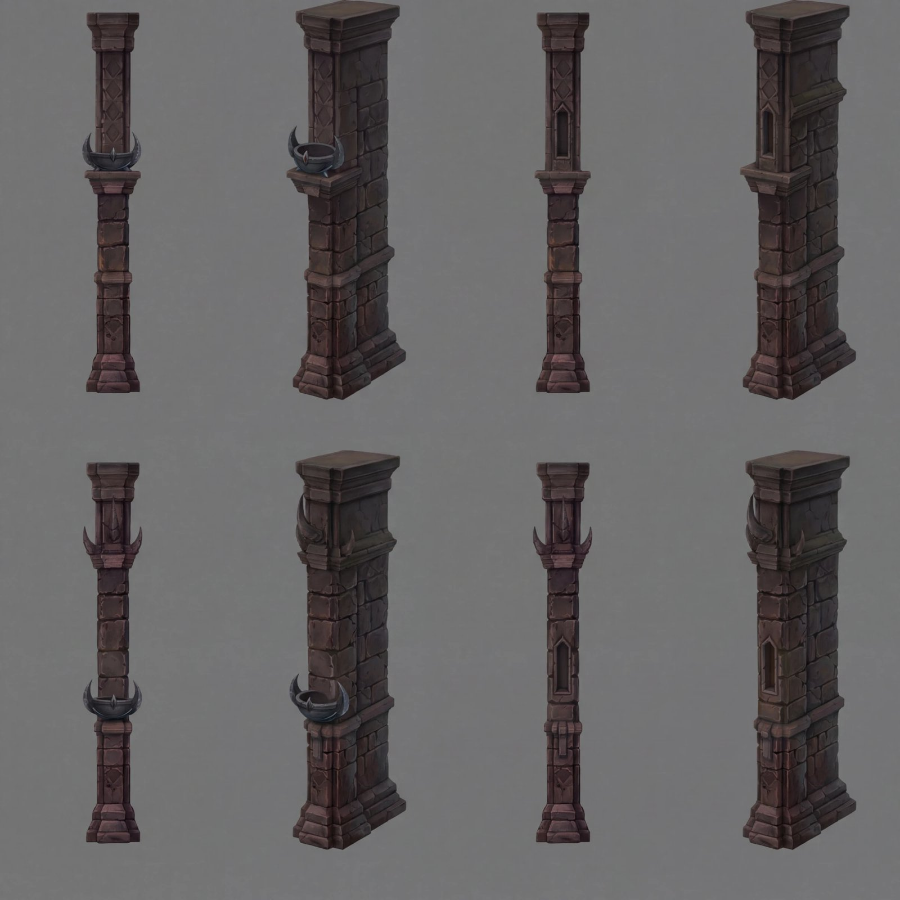

完整 prompt(去光 + 金屬 + 拿火 + 形狀鎖):

```text
The attached image is a model sheet of FOUR stone pillars in two rows:
each pillar is shown twice, as a flat front view and a 3/4 view —
eight views in total. Re-render the WHOLE sheet as a de-lit reference
sheet for image-to-3D. This is a LIGHTING change plus fire removal —
NOT a redesign. Every shape stays exactly as it is.

LAYOUT LOCK: keep all eight views exactly where they are — same
positions, same sizes, same camera angles, same order. Do not add,
remove, merge, crop or rearrange any view. The whole canvas, including
the white gap between the two rows, becomes one flat neutral grey
(#808080) seamless background.

BRAZIER SHAPE LOCK (most important): there are four braziers — on the
two front views and the two 3/4 views of the first and third pillars.
Each brazier keeps EXACTLY its current outline, size, position and
angle: the same round metal bowl, the same rim line, the same two
crescent horns curving up on its sides, the same band, the same small
point on its front, and the same place where it sits on its stone
shelf or collar. In the front views the rim stays a straight
horizontal line; in the 3/4 views the rim stays the same oval seen at
the same angle, and the bowl stays attached to the pillar. Do NOT
flatten, enlarge, shrink, tilt, float or redesign any bowl or horn.

FIRE REMOVAL: remove all flames, embers, sparks and fire glow. Each
bowl becomes EMPTY: paint only its inner wall, which was hidden by
the fire, as plain dark metal that follows the existing rim exactly.
LAMPS: every lamp slot is switched OFF — no glow; show each as an
empty recessed stone slot with a dark inner back wall, inside its
carved stone frame, same shape and size.

KEEP the real materials (albedo) — do NOT turn anything into grey
clay:
- STONE: the true dark charcoal stone colour, every block, mortar
  gap, chip, crack and carving.
- METAL: the brazier bowls and their crescent horns are dark forged
  METAL — keep their true dark iron colour and hammered surface,
  clearly different from the stone.

DE-LIT everything: remove all baked-in lighting — no warm firelight,
no orange glow on the stone, no fire reflections or orange highlights
on the metal, no shiny hot-spots, no bright side or dark side. Light
all eight views with the SAME perfectly even, uniform, flat diffuse
studio lighting at the same exposure. NO cast shadows, NO rim light,
NO light beams.

Keep each pillar's exact shape, proportions, depth and every
structural part: caps, spike rings, shelves, collars, hanging
brackets, moulding rings, carved panels, emblems and stepped bases.
The front view and the 3/4 view of the same pillar must match. High-
resolution clean de-lit albedo reference sheet for image-to-3D.
```

> 實際上使用者最後是用**較短的原版 prompt**(無 SHAPE LOCK)連跑三張挑 **#3**:全灰底、石材最接近炭灰、正面火盆看得到碗口和金屬箍。上面這版是扭曲時的修正版,兩者都留檔。

三張比較:#1 底部淺灰帶、偏紫紅;#2 白色帶沒變灰;**#3 ✅ 全灰底、石色最準**。
共通殘留:下段紋章變淡(PS 從原圖用 Luminosity 疊回)、頂部尖角偏紅褐(降紅飽和拉成深鐵色)。

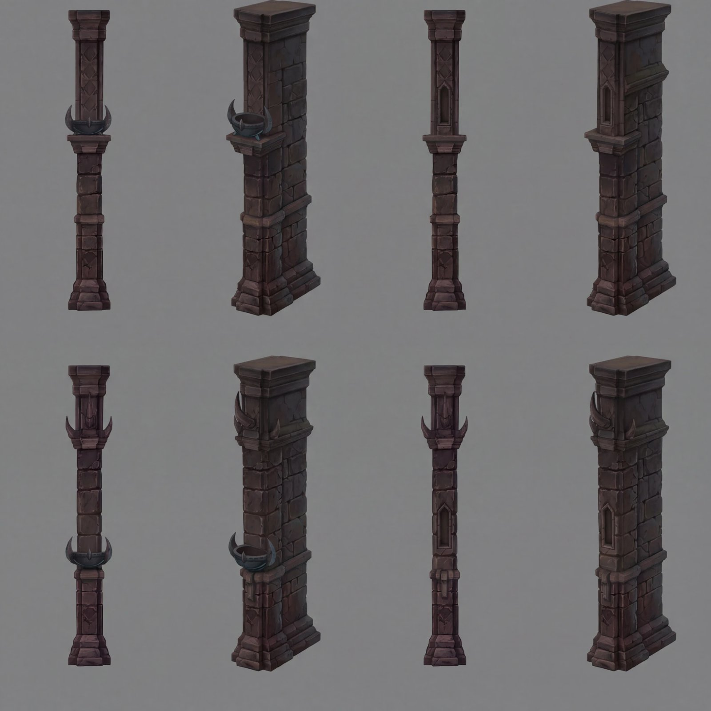

**金屬提醒:** image-to-3D 只拿 de-lit 圖當顏色,金屬感不會自動變成金屬材質 → Blender 裡火盆(和尖角)**Metallic = 1**、石頭 0([SOP AI PBR](SOP-ai-delight-pbr.md))。

### 6.2 寶石:統一 → 搬到點燈版 → 縮小 → 鑲嵌受光

1. **de-lit 版統一四顆寶石**:3/4 的寶石立在碗口上像牌子 → 寫明位置(碗外壁正中、碗口**下方**)、鑲法(薄金屬框、貼合碗面)、四顆一致。
2. **搬到點燈版**:三圖輸入(點燈原圖 BASE + de-lit 版只取寶石設計 + 紅框範圍圖),並要求照點燈版的光畫(受火光、內部透光)。
3. **寶石變太大**(幾乎跟碗一樣高、凸出碗口):不能寫「小一點」→ 用比例錨定:

```text
SIZE: each gem, including its metal bezel, must be only about ONE
THIRD of the height of the bowl it sits on, and narrower than one
third of the bowl's width. It sits fully BELOW the rim, centred on
the front of the bowl's outer wall — no part of it touches or rises
above the rim. In the 3/4 views, the same size, turned with the bowl.
All four gems the same size.
```

(PS 等比縮到約 50–55% 更快;還偏大就改 `ONE QUARTER`。)

4. **鑲嵌 + 光源**(最後一步,跑完 PS 遮罩只取四顆寶石貼回):

```text
The attached image is a lit model sheet of four stone pillars, eight
views, with burning braziers. Change ONLY the four red gems on the
brazier bowls and the metal right around them. Keep their size,
shape and position exactly as they are now.

INTEGRATION — make each gem truly set INTO the bowl:
- The dark metal bezel is forged as part of the bowl: it follows the
  bowl's curved surface, its outer edge blends into the bowl's metal
  with a slightly raised lip, and the bowl's texture and wear continue
  up to it — no clean pasted-on outline.
- A thin dark contact shadow where the bezel meets the bowl, deepest
  under its lower edge.
- The gem sits slightly recessed inside the bezel, with a small dark
  gap around it.

LIGHTING — the fire is directly above the gem:
- The gem's upper facets catch bright warm firelight; its lower
  facets are deeper red. Light passes through it: a soft glowing red-
  orange core and a tiny bright highlight near the top.
- The top edge of the bezel catches a warm orange rim of firelight;
  its lower edge is darker.
- A very faint red-orange glow from the gem tints the bowl metal just
  around it, fading quickly.
- In the 3/4 views the same lighting, following the bowl's angle.
All four gems match.

Keep everything else exactly the same: the flames, the bowls' shape,
horns, lamps, pillars, lighting, colours, the dark brown background
and the layout of all eight views. Do not crop or zoom.
```

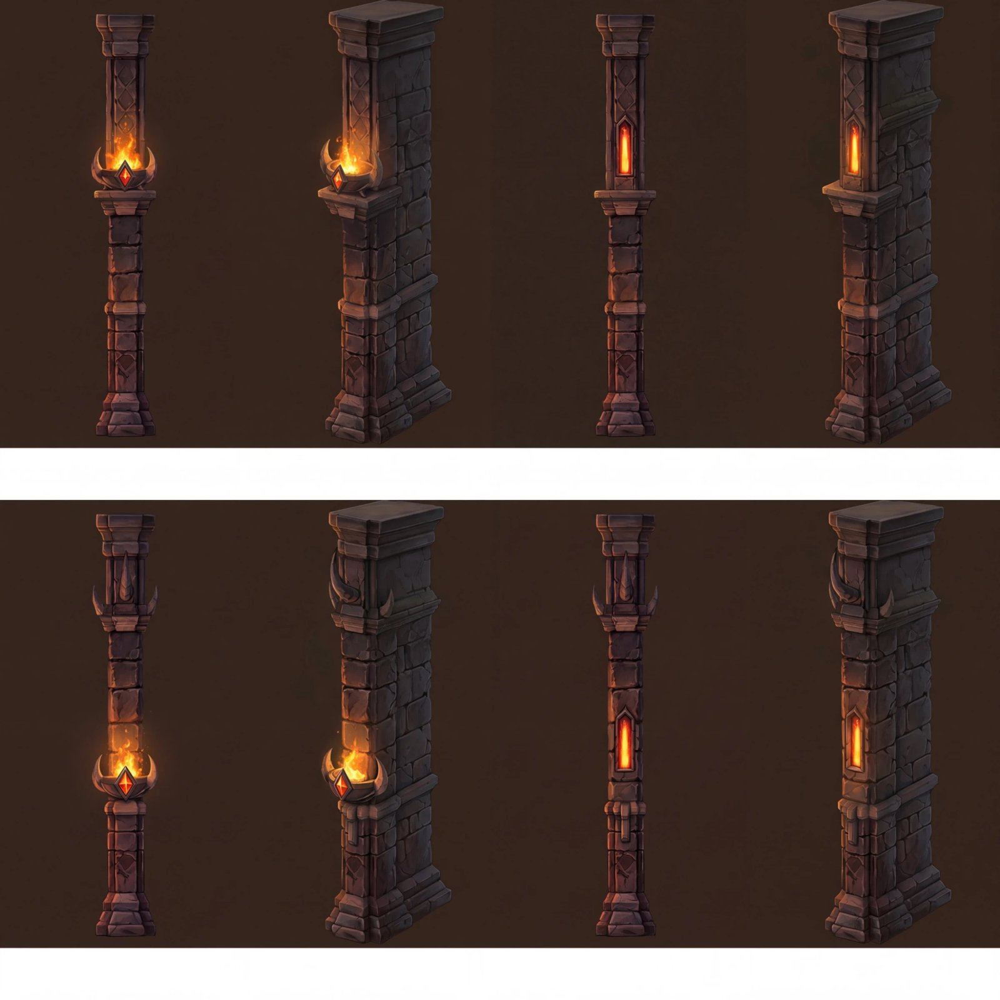 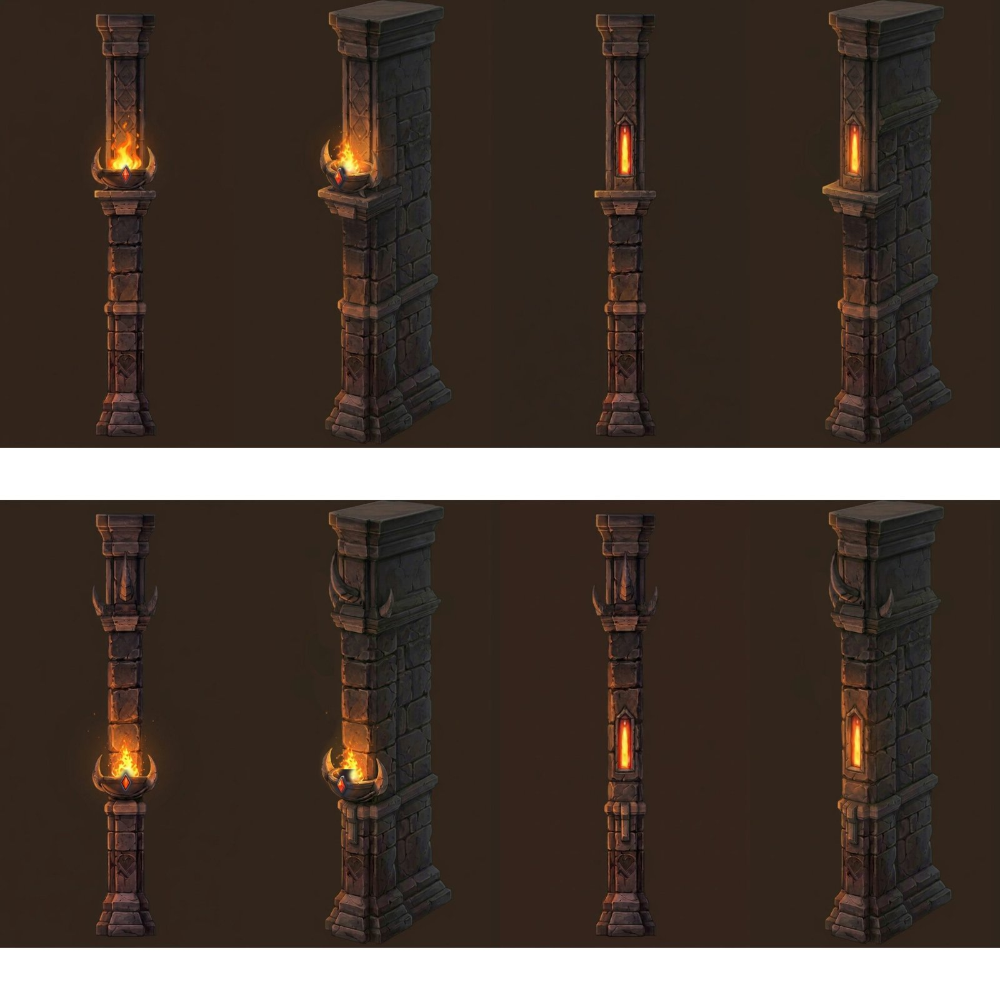

### 6.3 PS 整理完成(2026-11-13)

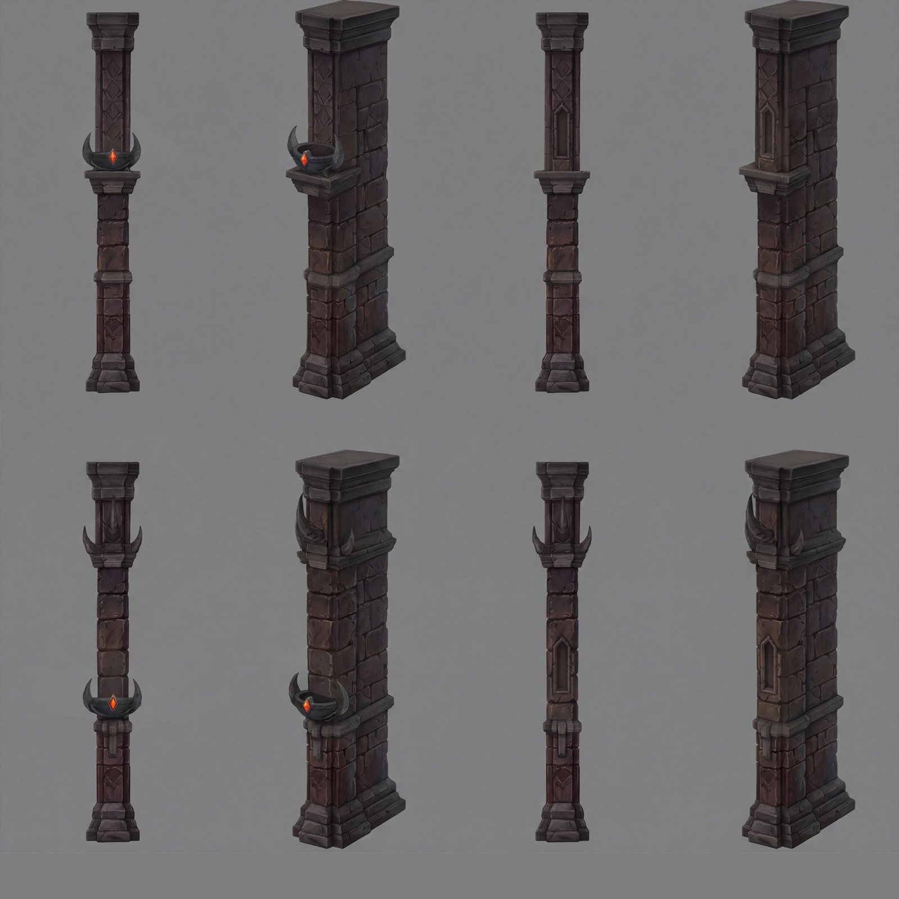 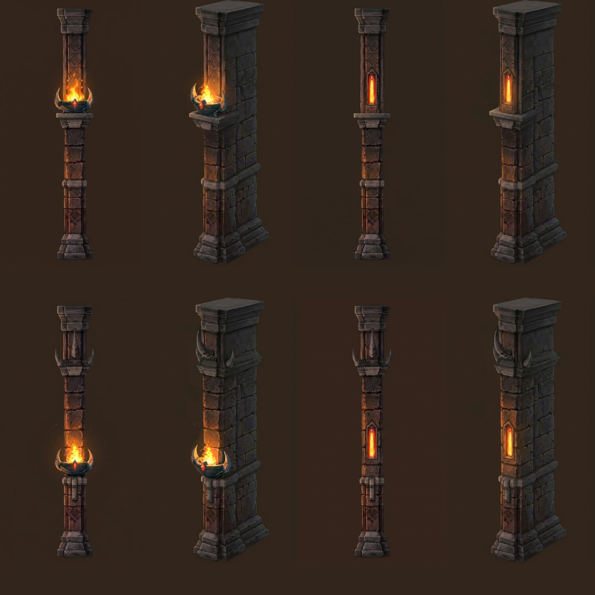

驗收(像素比對):
- 兩張 8 格的柱子外框**差 1–3 px**,可直接疊圖層切換點燈 / 不點燈;上下兩排剛好相差 1000 px。
- 點燈版底色統一 `(50,37,28)`;de-lit 版底色約 126(≈ `#7E7E7E`,接近 `#808080`)。
- ⚠️ de-lit 版 **y≈1896 有一條全寬 1 px 淺灰線**(137,比底色亮)— 就是 de-lit 階段一直提醒的「底部淺灰帶」殘留,用顏色去背會被當成物件,要先填成 `#808080`。
- ⚠️ 點燈版是深暖棕底,和石頭紅棕、光暈邊緣太接近,**不適合拿來去背**;去背用灰底版。

**下一步建議:光層拆分。** 兩張已像素對齊 → 灰底版去背當底圖;點燈版減去灰底版、只取柱子遮罩內 = 火焰 / 窗光 / 照在石頭上的光,用 Add / Screen 疊。引擎裡可開關燈、做火焰閃爍,不用每個變體各存一張點燈版。

---

## 踩坑總表

| # | 症狀 | 根因 | 解法 |
|---|---|---|---|
| 1 | 結果帶灰邊框、左下黑塊、長出地板 | 用了未裁的 viewport 截圖 | 裁到牆面實際邊緣;輸出比例 = 裁完比例 |
| 2 | 柱子太白 | 圖生圖沿用輸入明暗 | 灰盒柱先壓到牆的明度 |
| 3 | 柱子像貼牆浮雕 | 平光灰盒沒有深度線索 | 加落影 / AO / 正側面明暗(3D render 或腳本) |
| 4 | 二樓 4 根短柱全發光 | 文字無法指定「其中兩根」 | 色框定位圖 + 寫死數量 + 點名哪幾根沒有 |
| 5 | 藍框被漏看 | 藍框畫在藍牆上 | 改粗亮青框 |
| 6 | 整張變像素風 | — | `NOT pixel art, no pixelated edges` |
| 7 | 柱子完全不像參考 | GEOMETRY LOCK 鎖死灰盒輪廓 vs 參考粗柱,矛盾 | 柱子單獨做成成品,貼進場景 |
| 8 | 參考圖的火是方塊 | 參考圖瑕疵被照抄 | `Do NOT paint a square glowing block` |
| 9 | 火盆用鐵箍綁不合理 | 層板結構沒說清楚 | 改成往下收窄的石托承托 |
| 10 | 邊緣光打到錯的柱子 | 對象描述模糊 | 計數 + 相對位置(「柱 3 在柱 4 火盆左邊」) |
| 11 | 壁柱還留紋飾 | prompt 寫了 `Keep its carved panel ornaments` | 結構 / 表面分開寫,表面明令移除 |
| 12 | 壁柱石塊糊 | 只佔 70×430 px | Crop-Gen-Paste(放大 3 倍) |
| 13 | 走道每根柱子都有火盆、朝鏡頭 | 正面參考圖的火盆位置蓋過灰盒 | 定位圖 + `do NOT copy where the brazier sits` + 朝走道中間 |
| 14 | 走道地面熔岩網格、全圖泛紅 | — | `only a FEW … cracks` + `LOW-KEY … not evenly red-lit` |
| 15 | 柱頭配件一直照灰盒大角畫(NB/GPT 皆然) | 灰盒幾何 > 參考圖;模型不會轉設定稿 | 改 3D 灰盒或 PS 拼貼稿;不要叫 AI「捨棄灰盒形狀」 |
| 16 | GPT 地面濕亮 | GPT 預設 | `dry, matte floor — no wet shine` |
| 17 | AI 加燈 / 加厚度失敗 | 小改動 + 全圖重繪 | PS 圖層樣式 / Outer Glow / Distort 貼合 |
| 18 | 「加深 40%」變 2 倍 | AI 對百分比不準 | PS Ctrl+T 拉寬 / 壓窄 |
| 19 | 加深時光線也被改、紋章不見 | prompt 寫了光向 | GEOMETRY-ONLY + 光線整段 LOCK |
| 20 | 3/4 背景變綠 | 參考圖綠底被抄 | `Do NOT use green` |
| 21 | de-lit 火盆扭曲 | 拿掉火 → 補畫被擋幾何 → 重新設計 | BRAZIER SHAPE LOCK,只准畫碗內;或先拿火再去光 |
| 22 | de-lit 偏紫紅、白帶沒變灰 | 隨機性 | 連跑多張挑最好;剩下 PS 收 |
| 23 | 寶石太大 | 相對尺寸詞 | 比例錨定(碗高 1/3、完全在碗口下) |
| 24 | 寶石像貼紙 | 無接觸陰影、光源不一致 | INTEGRATION + LIGHTING 兩段,跑完遮罩只取寶石 |

---

## 驗收 checklist

**場景圖(牆 / 走道)**
- [ ] 輸入圖已裁 viewport 邊框、滿版;輸出比例 = 輸入比例
- [ ] 灰盒柱子已壓暗、有正側面明暗、有落影
- [ ] 配件數量、位置 = 定位圖;框線零殘留
- [ ] 50% 疊回原圖:拱、窗、欄杆、柱位對齊
- [ ] 柱子貼回最上層、光暈 / 落影在下層
- [ ] 火、燈光暈、熔岩瀑布拆獨立圖層(進引擎做動態 / bloom)
- [ ] 放大:Universal Upscaler 2×、creativity 最低(B1)

**柱子設定稿**
- [ ] 正面左右對稱;正面 / 3/4 各部位高度可用水平線對齊
- [ ] 3/4 深度 = 正面 2 倍(全套一致)
- [ ] 點燈版 / de-lit 版外框像素對齊
- [ ] de-lit:無灰黏土、無殘留橘光 / 白亮點、金屬和石頭看得出兩種材質、全底 `#808080`(含底部那條線)
- [ ] 四顆寶石大小一致、在碗口下方、有鑲座
- [ ] 裁 8 張 → 正面 + 3/4 成對餵 image-to-3D → Blender 火盆 / 尖角 Metallic = 1
